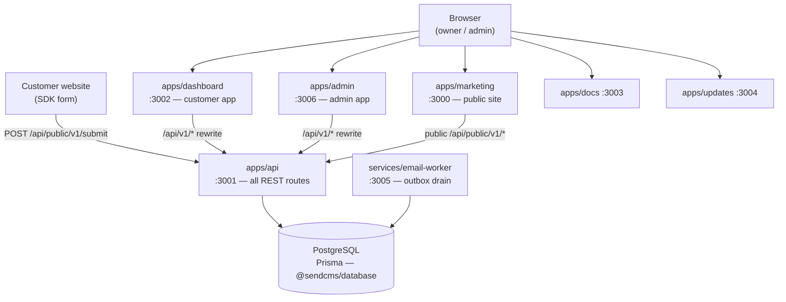

# SendCMS — a contact-form backend for any website

[](https://github.com/DashingMZA/sendcms/actions/workflows/ci.yml)
[](LICENSE)

SendCMS is a centralized contact-form backend for static and modern
websites — Astro, Hugo, Next.js, WordPress, or plain HTML. Register
your domain, create a form, paste one script tag, and every submission
lands in a dashboard inbox with spam filtering and email
notifications. No server code on your site.

Version `0.1.0` (`package.json`). Beta: APIs and schema may change
without migration paths.

## Contents

- [Status](#status)
- [Features](#features)
- [Architecture](#architecture)
- [Quick start](#quick-start)
- [Embed on your site](#embed-on-your-site)
- [Documentation](#documentation)
- [Tech stack](#tech-stack)
- [Environment variables](#environment-variables)
- [Commands](#commands)
- [Deployment](#deployment)
- [License](#license)

## Status

| Item                | State                                                                                                                                                                                           |
| ------------------- | ----------------------------------------------------------------------------------------------------------------------------------------------------------------------------------------------- |
| Production          | ✅ `feature/ai` deployed — `https://sendcms.bond` (api, dashboard, docs, updates subdomains)                                                                                                    |
| Admin Control Plane | 🚧 Phases 1–9 done on `feature/admin-control-plane` (`a331cc6`), pushed — not merged, not deployed                                                                                              |
| CI                  | ✅ `.github/workflows/ci.yml` — typecheck, lint, tests, build on `main`, `feat/**`, `feature/**`                                                                                                |
| Cloudflare vars     | ⚠️ Only the admin worker uses `sendcms.bond` vars so far; the other five still carry `jadoo.bond` placeholders — see [infrastructure/cloudflare/README.md](infrastructure/cloudflare/README.md) |
| i18n                | ✅ English + Urdu complete; the other 8 locales are coming-soon — see [packages/i18n/README.md](packages/i18n/README.md)                                                                        |

## Features

| Area                 | What it does                                                                                                                   |
| -------------------- | ------------------------------------------------------------------------------------------------------------------------------ |
| Domains              | Ownership verification via DNS TXT, meta tag, or file; one domain can feed many forms                                          |
| Forms + SDK          | Configurable fields; dependency-free vanilla-TS SDK (~7 KB minified) + no-JS fallback                                          |
| Submissions + inbox  | Search, filters, bulk actions, statuses (`NEW`, `READ`, `STARRED`, `ARCHIVED`, `SPAM`)                                         |
| Spam protection      | Origin allowlist, honeypot, Cloudflare Turnstile, rate limits, idempotency keys                                                |
| Email notifications  | Outbox with retries (Resend, SMTP fallback), drained by cron or the standalone worker                                          |
| Auth                 | Better Auth — Google / GitHub / Facebook OAuth + email/password, verification required                                         |
| AI (per-form opt-in) | Spam re-scoring, inbox digest, form-builder suggestions, reply drafts; Google, OpenAI, Anthropic, DeepSeek, OpenRouter         |
| MCP                  | `POST /api/mcp` — API-key access to the platform from MCP clients; admin kill-switch on the control-plane branch               |
| Billing              | Real providers (Stripe, PayPal, Polar, Freemius; Gumroad registered-only), versioned plans, country-scoped checkout            |
| Admin Control Plane  | Dedicated admin app (`apps/admin`) — users, plans, billing, support, audit, feature flags (branch only, see [Status](#status)) |
| i18n                 | Domain-based JSON translations; English + Urdu complete with RTL support                                                       |

## Architecture

Six Next.js 16 apps in one Turborepo monorepo, one api app serving
all REST routes, one PostgreSQL database via Prisma, and a
standalone email worker draining the notification outbox. Full
detail: [docs/architecture.md](docs/architecture.md) and
[docs/admin-control-plane/architecture.md](docs/admin-control-plane/architecture.md).



| App                     | Port | Serves                                                              |
| ----------------------- | ---- | ------------------------------------------------------------------- |
| `apps/marketing`        | 3000 | Public site, `/pricing`, `/demo/*`, `/contact`                      |
| `apps/api`              | 3001 | All REST routes (`/api/v1/*`, `/api/public/v1/*`, `/api/mcp`, auth) |
| `apps/dashboard`        | 3002 | Customer app (`/dashboard/*`, `/sign-in`)                           |
| `apps/docs`             | 3003 | Documentation                                                       |
| `apps/updates`          | 3004 | Changelog                                                           |
| `services/email-worker` | 3005 | Email outbox drain + AI jobs (long-running Node process)            |
| `apps/admin`            | 3006 | Admin app (`/admin/*`) — control-plane branch only                  |

The layered request flow is a hard rule (see
[AGENTS.md](AGENTS.md)): thin route handlers in `apps/api` call
business-logic services in `packages/modules/*`, which are the only
code that imports `@sendcms/database`. Route handlers never import
the database directly.

## Quick start

```bash
# 1. Install (pnpm v12)
pnpm install

# 2. Configure
cp .env.example .env
# Fill in DATABASE_URL, BETTER_AUTH_SECRET, BETTER_AUTH_URL,
# NEXT_PUBLIC_APP_URL, GOOGLE_CLIENT_ID, GOOGLE_CLIENT_SECRET

# 3. Database
pnpm db:generate
pnpm db:migrate

# 4. Run (also builds the SDK bundle + generates the Prisma client)
pnpm dev
```

Open `http://localhost:3000` — sign up, verify your email, register
a domain, create a form. Full walkthrough:
[Getting started](docs/getting-started.md). Demo data (demo user,
verified domain, form, sample submissions):
`pnpm db:seed` (idempotent, safe to re-run).

## Embed on your site

Open a form in the dashboard → **Embed on your site** and copy the
snippet. It looks like this (the script `src` is the api app's URL —
in production `https://api.sendcms.bond/forms/v1.js`):

```html
<script
  src="https://api.sendcms.bond/forms/v1.js"
  data-user-id="YOUR_USER_ID"
  data-form-id="YOUR_FORM_ID"
></script>

<form data-cms-form>
  <input name="name" placeholder="Your name" required />
  <input name="email" type="email" placeholder="you@example.com" required />
  <textarea name="message" placeholder="Your message" required></textarea>
  <button type="submit">Send</button>
</form>
```

The SDK auto-enhances every `<form data-cms-form>` — no JavaScript
of your own is needed. Per-form overrides, SPA navigation, and the
programmatic API are in [SDK](docs/sdk.md).

Framework guides:

- [Astro](docs/embed-astro.md)
- [Next.js](docs/embed-nextjs.md)
- [Hugo](docs/embed-hugo.md)
- [Plain HTML](docs/embed-html.md)

## Documentation

| Doc                                                                   | Covers                                                                 |
| --------------------------------------------------------------------- | ---------------------------------------------------------------------- |
| [Getting started](docs/getting-started.md)                            | Account, domains, forms, inbox                                         |
| [SDK](docs/sdk.md)                                                    | JavaScript SDK reference                                               |
| [REST API](docs/rest-api.md)                                          | Direct submit endpoint + no-JS fallback                                |
| [Email notifications](docs/email-notifications.md)                    | Providers, outbox, cron                                                |
| [Security](docs/security.md)                                          | Threat model and mitigations                                           |
| [Deployment](docs/deployment.md)                                      | Env vars, database, cron, Vercel/Cloudflare                            |
| [Deployment platforms](docs/deployment/platforms.md)                  | Vercel, Node/Docker, Render, Netlify, Railway                          |
| [Troubleshooting](docs/troubleshooting.md)                            | Common errors and fixes                                                |
| [Architecture](docs/architecture.md)                                  | System design, request flows, scaling path                             |
| [MCP](docs/mcp.md)                                                    | MCP server, API keys, tools                                            |
| [Admin Control Plane](docs/admin-control-plane/README.md)             | Admin app + modules (Phases 1–9), architecture, authorization, billing |
| [Monorepo guide](docs/development/monorepo.md)                        | Working in the monorepo                                                |
| [Operations runbook](docs/operations/runbook.md)                      | Running SendCMS in production                                          |
| [Cloudflare](infrastructure/cloudflare/README.md)                     | Per-app Workers, shared OpenNext config, production URLs               |
| [i18n package](packages/i18n/README.md)                               | Translations, locales, RTL, validation                                 |
| [Transformation plan](docs/sendcms-transformation-plan.md)            | The 11-phase OpenRemark → SendCMS rebuild (historical)                 |
| [Migration final report](docs/architecture/migration-final-report.md) | The 13-phase monorepo migration (historical)                           |
| [AGENTS.md](AGENTS.md)                                                | House rules for working in this repo                                   |

## Tech stack

| Layer      | Tech                                                            |
| ---------- | --------------------------------------------------------------- |
| Framework  | Next.js 16 App Router (Turborepo monorepo, pnpm workspaces)     |
| Database   | PostgreSQL (Prisma 7, Prisma adapter-pg)                        |
| Auth       | Better Auth 1.7 (Google/GitHub/Facebook OAuth + email/password) |
| Email      | Resend (or SMTP fallback)                                       |
| UI         | shadcn/ui + Tailwind v4                                         |
| Validation | Zod                                                             |
| SDK        | Vanilla TS → esbuild (~7 KB minified)                           |
| Tests      | Vitest (`tests/` at the repo root, by owner decision)           |

## Environment variables

See [Deployment](docs/deployment.md) for the full table, and
`.env.example` for every variable with comments. The required ones:

| Variable               | Description                                                                        |
| ---------------------- | ---------------------------------------------------------------------------------- |
| `DATABASE_URL`         | PostgreSQL connection string (use `?sslmode=verify-full` with Prisma Postgres)     |
| `BETTER_AUTH_SECRET`   | Better Auth secret (run `openssl rand -base64 32`); no fallback                    |
| `BETTER_AUTH_URL`      | Api app URL — the auth handler lives on the api app (dev: `http://localhost:3001`) |
| `NEXT_PUBLIC_APP_URL`  | Public site URL (the marketing app)                                                |
| `GOOGLE_CLIENT_ID`     | Google OAuth client ID                                                             |
| `GOOGLE_CLIENT_SECRET` | Google OAuth client secret                                                         |
| `RESEND_API_KEY`       | Resend API key (email notifications)                                               |
| `RESEND_FROM`          | Sending address on a verified Resend domain                                        |
| `CRON_SECRET`          | Bearer token for the email-outbox cron                                             |

Optional groups in `.env.example`: GitHub/Facebook OAuth, `SMTP_*`
fallback, Turnstile, AI provider keys (`OPENAI_API_KEY`,
`ANTHROPIC_API_KEY`, `GOOGLE_GENERATIVE_AI_API_KEY`,
`DEEPSEEK_API_KEY`, `OPENROUTER_API_KEY`), billing provider keys,
`WORKER_PORT` / `WORKER_POLL_INTERVAL_MS`, `COOKIE_DOMAIN`.

## Commands

| Command           | What it does                                                        |
| ----------------- | ------------------------------------------------------------------- |
| `pnpm dev`        | Prisma generate + SDK build + `turbo dev` (all apps + email worker) |
| `pnpm build`      | Prisma generate + SDK build + sequential `turbo build`              |
| `pnpm typecheck`  | `tsc --noEmit` — run before declaring work done                     |
| `pnpm lint`       | ESLint (root config)                                                |
| `pnpm test`       | `vitest run` (`tests/` — services, validators, SDK)                 |
| `pnpm db:migrate` | `prisma migrate dev` — create + apply a migration                   |
| `pnpm db:seed`    | Demo data (demo user, verified domain, form, submissions)           |
| `pnpm db:studio`  | Prisma Studio GUI                                                   |
| `pnpm sdk:build`  | Minified SDK → `apps/api/public/forms/v1.js`                        |

`pnpm dev` regenerates the Prisma client and rebuilds the SDK bundle
every start. The bundle is gitignored; CI builds it before testing.

## Deployment

- **Production (Vercel):** `https://sendcms.bond` with `api`, `dashboard`,
  `docs`, and `updates` subdomains; `admin.sendcms.bond` is reserved
  for the admin app once the control-plane branch merges.
- **Cloudflare (alternative):** one Worker per app — see
  [infrastructure/cloudflare/README.md](infrastructure/cloudflare/README.md).
- **Docker / other platforms:** shared `Dockerfile` (`APP` build arg)
  and `docker-compose.yml` for the full stack; the platform matrix is
  in [docs/deployment/platforms.md](docs/deployment/platforms.md).
- **Email outbox:** drained by the cron route
  (`GET /api/cron/email-outbox`, `CRON_SECRET` bearer) or by the
  standalone worker (`services/email-worker`, `WORKER_PORT` 3005).

## License

[MIT License](LICENSE) — Copyright (c) 2026 - Present, cSofts.
