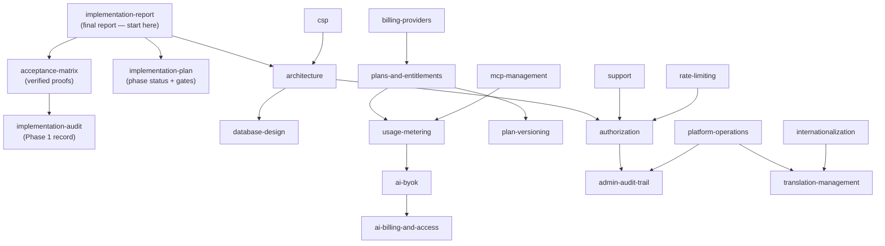

# Admin Control Plane — docs

The Admin Control Plane for SendCMS: a dedicated admin app
(`apps/admin`, `admin.sendcms.bond`) plus the service modules
behind it, built on the same auth, database, and design system
as the rest of the platform. Branch
`feature/admin-control-plane`. Phases 1–9 are done; the final
state is in [implementation-report](./implementation-report.md)
and the verified acceptance record in
[acceptance-matrix](./acceptance-matrix.md).

## How to read these docs

Read in this order. Start with the report, then the
architecture, then the topic doc you need.

| #   | Doc                                                   | Covers                                                                                                                                                    |
| --- | ----------------------------------------------------- | --------------------------------------------------------------------------------------------------------------------------------------------------------- |
| 1   | [implementation-report](./implementation-report.md)   | **Start here.** What was built per phase (1–9), the decisions, the acceptance summary, what was deferred, what is still owed                              |
| 2   | [acceptance-matrix](./acceptance-matrix.md)           | Every acceptance item verified against code + tests: the 15 proofs and the per-phase rows, with PASS / PARTIAL / NOT MET / OWED and the evidence for each |
| 3   | [implementation-audit](./implementation-audit.md)     | Phase 1 record (2026-11-21): the four inspections and the gaps found. Historical — do not edit                                                            |
| 4   | [implementation-plan](./implementation-plan.md)       | The phase plan with per-phase status, gates, and open items. The working record of the build                                                              |
| 5   | [architecture](./architecture.md)                     | System map, the six apps, the admin app, the module map, the layered flow, auth gating, config                                                            |
| 6   | [database-design](./database-design.md)               | Every model the control plane added, relations, indexes, the migration history and rules                                                                  |
| 7   | [authorization](./authorization.md)                   | The capability model: 26 capabilities, the role matrix, where checks happen, the ticket-write exception, step-up re-auth                                  |
| 8   | [plans-and-entitlements](./plans-and-entitlements.md) | Phase 4: versioned plans, entitlements, usage ledger, enforcement points                                                                                  |
| 9   | [plan-versioning](./plan-versioning.md)               | Immutability, the version lifecycle, the migration workflow, rollback-as-migration                                                                        |
| 10  | [usage-metering](./usage-metering.md)                 | The entitlement precedence chain, how "used" is computed per meter, AI + MCP usage records                                                                |
| 11  | [ai-byok](./ai-byok.md)                               | Phase 5: envelope encryption, BYOK keys, provider resolution (never silently falls back)                                                                  |
| 12  | [ai-billing-and-access](./ai-billing-and-access.md)   | Phase 5: billing modes, BYOK-vs-platform attribution, admin AI controls                                                                                   |
| 13  | [mcp-management](./mcp-management.md)                 | Phase 6: kill-switch, per-user controls, quota precedence, usage analytics, key revoke                                                                    |
| 14  | [platform-operations](./platform-operations.md)       | Phase 7: feature flags, announcements, health, abuse queue, deletion workflow, translations                                                               |
| 15  | [admin-audit-trail](./admin-audit-trail.md)           | Phase 7: the append-only audit log, `reason` / `correlationId` / `outcome`, the explorer, retention                                                       |
| 16  | [billing-providers](./billing-providers.md)           | Phase 8: real payments (Stripe, PayPal, Polar, Freemius; Gumroad registered-only), provider countries, checkout, webhooks                                 |
| 17  | [support](./support.md)                               | Phase 8: support tickets (dashboard-only creation, staff reply/status/assign, SUPPORT does full ticket work)                                              |
| 18  | [rate-limiting](./rate-limiting.md)                   | Phase 9: admin-API + auth sign-in rate limiting (closes ADR 0008 §6)                                                                                      |
| 19  | [csp](./csp.md)                                       | Phase 9: nonce-based Content-Security-Policy on the five page apps (report-only first, then enforcing)                                                    |
| 20  | [internationalization](./internationalization.md)     | The i18n package, the 10-locale registry, and the honest state: `en` + `ur` complete, the other 8 coming-soon                                             |
| 21  | [translation-management](./translation-management.md) | The read-only translation UI, the validation workflow, adding a domain or a locale                                                                        |

## Map of the doc set

## Honest-state notes (read before reusing a claim)

- **i18n is `en` + `ur` only.** The other 8 locales are
  registered as coming-soon with 0 files, by the owner's
  explicit decision (2026-11-21). Do not present 10 locales
  as done. See
  [internationalization](./internationalization.md#the-honest-state).
- **Proofs 10/12/13 are NOT MET** (same reason) and proof 14
  is PARTIAL (no test drives the switch-and-persist flow).
  See
  [acceptance-matrix](./acceptance-matrix.md#part-a--the-15-proofs-additional-requirements-7).
- **Live verification is owed** for BYOK, MCP, Phase 7, Phase 8
  billing, the overview, step-up, and the signed-in CSP nonce
  check. Everything in these docs is proven by unit tests
  (615/615) unless it says otherwise.
- **The audit doc is historical.** Its Phase 8 row says
  "billing-provider abstraction (design only)" — superseded by
  the owner's 2026-11-22 decision to build payments real.
  Recorded in the matrix; the audit doc is not edited.
- **Phase 9 is uncommitted** at this writing (HEAD `0395930`).
  The two Phase 9 migrations exist in the tree; the dev DB
  stands at 36/36 after integration.
