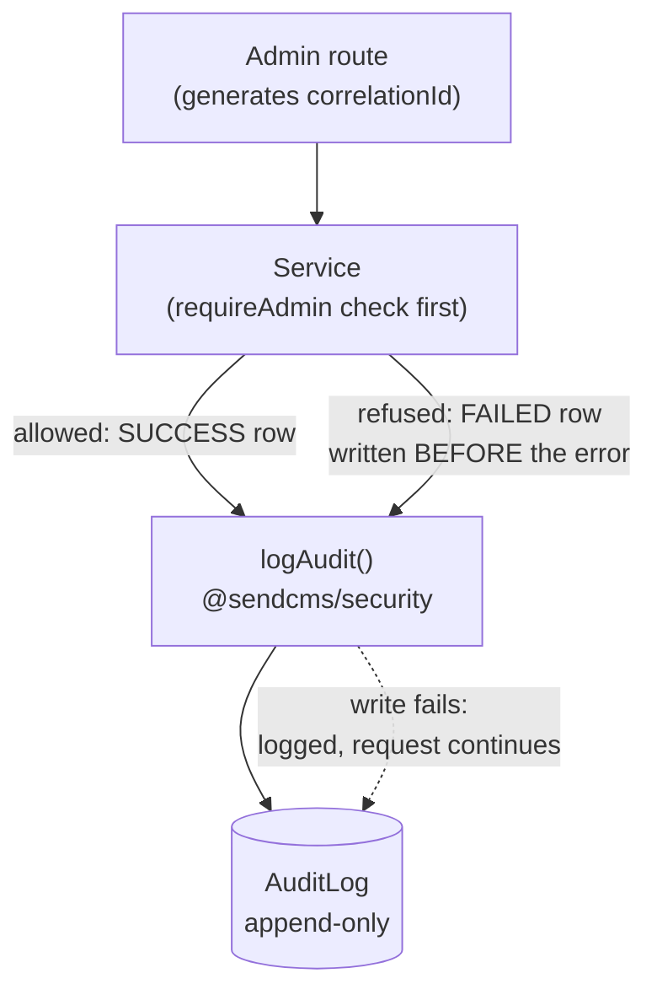

# Admin audit trail (Admin Control Plane, Phase 7)

The `AuditLog` is the platform's append-only record of who did
what, when, and why. Every admin action that mutates state writes
one row through the single writer `logAudit()` in
`@sendcms/security` — the documented exception to "only services
import `@sendcms/database`", like `@sendcms/auth` is for auth —
and it is called only from services, never from routes. The
platform-ops module has NO update or delete function for the log,
by design: admins cannot silently edit or delete historical audit
records through any interface this module offers (the test suite
proves the module exports no `AuditLog` mutation).

Branch: `feature/admin-control-plane` (pushed, not merged to
`main`, not deployed). Live verification against the real dev DB
is still owed.

## Contents

- [The writer](#the-writer)
- [New fields (Phase 7)](#new-fields-phase-7)
- [Idempotency](#idempotency)
- [Failed actions are recorded, never dropped](#failed-actions-are-recorded-never-dropped)
- [Audit event flow](#audit-event-flow)
- [Explorer](#explorer)
- [Retention / privacy](#retention--privacy)
- [What the audit covers (Phase 7)](#what-the-audit-covers-phase-7)

## The writer

`logAudit({ userId?, action, resourceType, resourceId, detail?,
ipAddress?, reason?, correlationId?, outcome? })`.

Best-effort by design: an audit write must never fail the request
that triggered it, so a failure is logged (structured, via the
observability logger) and the call resolves. See
[architecture](./architecture.md#security-services) for where the
writer lives and [authorization](./authorization.md) for which
capabilities gate the actions being audited.

## New fields (Phase 7)

| Field           | Meaning                                                                                                                                                                                               |
| --------------- | ----------------------------------------------------------------------------------------------------------------------------------------------------------------------------------------------------- |
| `reason`        | The admin-supplied reason for the action. Required for critical actions (flag toggles, announcement activation, deletion review/erasure, submission status changes) — the audit record must say why.  |
| `correlationId` | The request correlation ID. Lets one request's audit rows be grouped — and it is the idempotency key (below). Every mutating admin route generates one (`randomUUID()`) and passes it to the service. |
| `outcome`       | `SUCCESS` (default) or `FAILED`. A refused sensitive action is recorded with `FAILED`, never dropped.                                                                                                 |
| `ipAddress`     | The caller IP, when the service knows it.                                                                                                                                                             |

Backwards compatible: existing callers pass nothing new and get
exactly the write shape they wrote before Phase 7. Callers that
pass no `outcome` get `SUCCESS` from the schema default
(`AuditLog.outcome @default(SUCCESS)`) — the writer does not
duplicate that default in code, so a call that passes none of the
new fields writes exactly the shape it wrote before.

## Idempotency

When a `correlationId` is passed, the write is skipped if a row with
the same `correlationId` + `action` + `resourceType` + `resourceId`
already exists. The check is best-effort and race-tolerant — two
truly concurrent duplicates can both pass the check, so the
correlationId prevents retries/double-submits from doubling a row;
it does not make the write atomic. Callers that retry a request
reuse the same correlationId.

## Failed actions are recorded, never dropped

The services in the platform-ops module pass `outcome: "FAILED"`
when the action they attempted was refused — a forbidden erasure
(owner, self-erasure, wrong state, already erased), a deletion
review of a non-`REQUESTED` request. The refusal audit row carries
the target id + reason, never PII, and it is written BEFORE the
error is thrown, so the failure is on the record even though the
request failed.

## Audit event flow

## Explorer

| Operation                             | Endpoint                              | Capability          |
| ------------------------------------- | ------------------------------------- | ------------------- |
| Paginated audit history, newest first | `GET /api/v1/admin/audit-logs`        | `VIEW_AUDIT_LOGS`   |
| One entry with its actor              | `GET /api/v1/admin/audit-logs/[id]`   | `VIEW_AUDIT_LOGS`   |
| The same filtered rows as JSON        | `GET /api/v1/admin/audit-logs/export` | `EXPORT_AUDIT_LOGS` |

Filters: `actorId` (actions taken BY an administrator),
`targetUserId` (actions taken ABOUT a user — recorded as
`resourceType` `USER` with the target's id as `resourceId`; the
actor is the row's `userId`), `action`, `resourceType`, `outcome`,
`correlationId`, date range (`from`/`to`, inclusive). Pagination
max 100 per page.

A bad filter value is a 422, not a Prisma error: `action` /
`resourceType` / `outcome` are checked against the live Prisma enum
values, never a second copy of the list.

The export returns the same safe rows as JSON, for download by the
admin UI. The rows are returned as stored — safe only because
services never write secrets into `detail` (see below).

## Retention / privacy

- Services must never put secrets in `detail` — no passwords,
  tokens, keys, or raw submission content. The export returns the
  rows as stored, so what is never written can never leak.
- The erasure audit row carries deleted-row counts, never PII; the
  sensitive-submission-access row carries the form and owner ids,
  never the submission content.
- 🚧 There is no retention/deletion job for audit rows in this phase:
  the log is append-only and nothing prunes it. Retention policy
  (how long rows are kept, and whether old rows are ever archived)
  is an open item for the hardening phase — do not invent a pruning
  job until it is decided.

## What the audit covers (Phase 7)

Every mutating platform-ops action is audited: flag created /
toggled / override set / override removed, announcement created /
updated / active-changed, deletion request reviewed / account erased,
platform submission status changed, sensitive submission accessed.
Earlier phases audit their own actions through the same writer
(users, plans, subscriptions, AI settings, MCP settings/keys) —
see [platform-operations](./platform-operations.md),
[plans-and-entitlements](./plans-and-entitlements.md),
[ai-byok](./ai-byok.md), [mcp-management](./mcp-management.md),
[billing-providers](./billing-providers.md), and
[support](./support.md) for their event lists.
