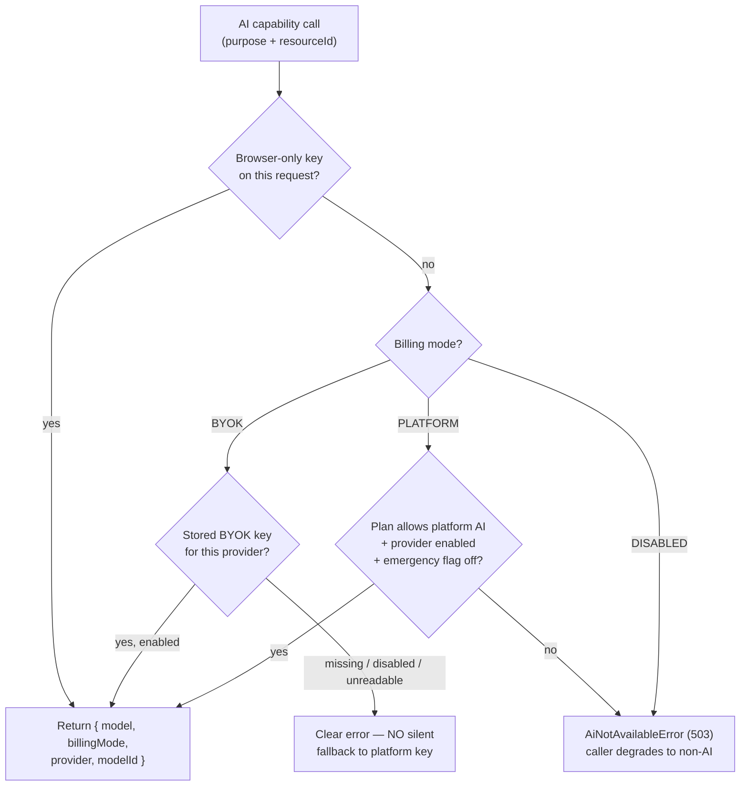

# AI BYOK — Bring Your Own Key (Phase 5)

Customers can use their own AI provider keys (one per provider, up
to five: OpenAI, Anthropic, Google, DeepSeek, OpenRouter) instead of
— or alongside — the platform key. Keys are stored **encrypted**
(envelope encryption, master key in `.env` outside the DB), never
hashed and never plaintext. A key is tested with an explicit Test
button, and the billing mode (BYOK / PLATFORM / DISABLED) decides
which key a call uses. Provider resolution is a single function
(`resolveAiModelForUser`) that every AI capability calls, and it
**never silently falls back BYOK → platform**.

Branch: `feature/admin-control-plane` (pushed, not merged to
`main`, not deployed). Live verification against a real provider
is still owed.

## Contents

- [Encryption design (read this before touching the code)](#encryption-design-read-this-before-touching-the-code)
- [Storage choices (the owner's design, 2026-11-21)](#storage-choices-the-owners-design-2026-11-21)
- [Provider resolution](#provider-resolution)
- [Wiring the existing capabilities](#wiring-the-existing-capabilities)
- [Admin controls](#admin-controls)
- [Audit events (AI_KEY / USER / SETTINGS)](#audit-events-ai_key--user--settings)
- [What is NOT in this phase](#what-is-not-in-this-phase)

Module: `packages/modules/ai-settings` (`@sendcms/ai-settings`).
Crypto: `packages/ai/src/byok-crypto.ts` (envelope encryption).
Routes: `apps/api/app/api/v1/ai/keys/*`, `.../ai/billing-mode`,
`.../admin/ai/providers/*`, `.../admin/ai/usage/*`,
`.../admin/ai/users/[userId]/keys`, `.../admin/ai/users/[userId]/billing-mode`.
Tests: `tests/ai-byok.test.ts` (41 tests). Billing modes and
attribution are covered in
[ai-billing-and-access](./ai-billing-and-access.md).

## Encryption design (read this before touching the code)

A hash is one-way, so a hashed key could never be used to call a
provider — that is why keys are **encrypted, not hashed** (the owner
explicitly accepted this correction on 2026-11-21).

Envelope layout, per `UserAiKey` row (all fields base64):

1. A random 32-byte data key (DEK) encrypts the API key with
   AES-256-GCM (random 12-byte IV, AAD binds `userId` + provider, so
   a ciphertext cannot be moved to another user or provider).
2. The DEK itself is encrypted with the master key from `.env`
   (`AI_BYOK_MASTER_KEY`), also AES-256-GCM, with its own IV/tag
   packed into `encryptedDek` as `iv.ciphertext.tag`.

- The master key lives OUTSIDE the database (in `.env`,
  `AI_BYOK_MASTER_KEY`, 32 bytes as 44 base64 chars or 64 hex chars).
  `getByokMasterKey()` throws a clear error when it is missing or
  the wrong length — never a default key. Rotating it only
  re-encrypts the DEKs; the API keys themselves never need to be
  re-encrypted. `masterKeyVersion` on the row records which master
  key version encrypted that row's DEK (`BYOK_MASTER_KEY_VERSION`,
  currently 1).
- Only the SHA-256 fingerprint is stored alongside the ciphertext,
  for display ("…aB3x") and matching — a fingerprint can never be
  reversed into the key. The API, the logs, and the audit records
  show only the fingerprint's last 4 chars.
- The plaintext key, the ciphertext, the IV, and the tag NEVER leave
  `packages/modules/ai-settings/src/service.ts`: no API response, no
  log line, no audit record contains them. List/detail endpoints
  return metadata only (provider, model, isEnabled, keyVersion,
  lastTestedAt, lastTestStatus, fingerprint last4).
- Code: `packages/ai/src/byok-crypto.ts`
  (`encryptByokKey`, `decryptByokKey`, `fingerprintKey`,
  `getByokMasterKey`). Do not write new crypto — use these.

## Storage choices (the owner's design, 2026-11-21)

- **Platform/master key** — the system's own key, in `.env` with
  model/provider, same as MCP/AI today. It runs by default. An
  admin controls whether it is enabled and for which users/plans
  (provider config + plan entitlements).
- **Customer BYOK** — paid or free users may use their own key +
  model + provider. Selecting BYOK **pauses the platform key for
  that user** until they re-enable PLATFORM — that is exactly what
  the billing mode means, no separate paused flag.
- **Save/test popup** — when a user saves or tests a key, they pick
  **"Browser only"** (the key stays in this browser only, never on
  the server; it works only from that browser; background jobs
  cannot use it) or **"Both (browser + server)"** (stored encrypted
  in the DB, works from any browser/device they log into). The
  dashboard stores a browser-only key in `localStorage` and sends
  it per request (`browserKey` + `browserProvider` +
  `browserModel` on the suggest-fields / draft-reply routes); the
  server uses it for that one call and never stores or logs it.
- **Test button with every saved key** — `testUserAiKey` decrypts
  the stored key and makes the smallest live call that proves it
  works: one `generateText` with `maxOutputTokens: 1` ("Reply with
  the single word: ok"). A list-models call would need a second,
  provider-specific client per provider; `generateText` works for
  all five through the one AI SDK. Cost is a few tokens. The result
  is `{ ok, latencyMs, model, error? }` (error message only, never
  the key), `lastTestedAt`/`lastTestStatus` are updated, and a usage
  record (`key-test`, BYOK) is written either way. A failed test
  NEVER falls back to the platform key. A browser-only key is tested
  the same way through `testBrowserKey` (`POST
/api/v1/ai/keys/[provider]/test-browser`): the raw key is sent for
  the one live probe and never stored or logged — only the key-test
  BYOK usage row is kept (no resourceId). The shared probe is
  `probeKey` in the service.
- **One key per provider per user** — `@@unique([userId, provider])`.
  Saving a second key for the same provider replaces the first,
  increments `keyVersion`, re-enables the key, and resets the test
  status to UNTESTED. A save never tests the key (testing is the
  separate Test-button action).

## Provider resolution

`resolveAiModelForUser(userId, { provider?, purpose, browserKey?,
browserModel?, resourceId?, env? })` — the single function every AI
capability calls. Precedence:

1. **Per-request browser-only key** — used for this call only via
   `getAiModelForKey`, never stored, never logged. Needs an explicit
   provider: the key is bound to one provider and must never be sent
   to another.
2. **Billing mode BYOK** — the user's stored enabled key for the
   provider (decrypt + `getAiModelForKey`). If the key is missing,
   disabled, or unreadable → throw a clear error, **NEVER silently
   fall back to the platform key**. A provider with no stored BYOK
   key also throws — there is no silent platform fallback.
3. **Billing mode PLATFORM** — the platform key, but ONLY when the
   plan allows platform AI (`aiPlatformAllowed`), the admin has the
   provider enabled (`AiProviderConfig.isEnabled`), and the Phase 4
   emergency flag is off (the emergency flag is folded into the
   effective entitlements by `@sendcms/plans`).
4. **DISABLED or nothing configured** — a clear "AI is not
   available" error (`AiNotAvailableError`, 503). Callers degrade to
   the non-AI behavior.

Two fallbacks exist, and they are deliberately different:

- **Store-availability fallback (inside the resolver):** if the
  settings store itself is unreadable, the mode cannot be known, so
  the platform default is used (`resolveAiModelLegacy`, built on the
  pre-BYOK `isAiConfigured` + `getAiModel`). This is NOT a key
  fallback — it only runs when the mode itself could not be read.
  Once the mode is known to be BYOK, a missing/disabled/failing key
  NEVER falls back.
- **Worker-safe wrapper:** `resolveAiModelForUserSafe` returns null
  on ANY resolution failure, so the worker skips the AI step instead
  of crashing. Interactive callers use `resolveAiModelForUser` and
  surface the error.

A customer's key is never sent to a different provider: it is bound
to its provider by the crypto AAD and by the lookup. The resolution
returns `{ model, billingMode, provider, modelId }` so callers can
record usage on completion/failure. Billing-mode validation and
BYOK-vs-platform attribution are covered in
[ai-billing-and-access](./ai-billing-and-access.md); the
entitlement precedence chain is in
[usage-metering](./usage-metering.md).

## Wiring the existing capabilities

Spam re-scoring, digest, suggest-fields, and draft-reply all resolve
per the FORM OWNER (the user who owns the form/submission) with
purpose `spam-rescore` / `digest` / `suggest-fields` / `draft-reply`
and the form/submission id as `resourceId`. Resolution is cached
once per owner per worker run. When resolution throws "not
available", the capability degrades exactly as it does today when AI
is unconfigured (no crash, no submission dropped). The per-form
`aiEnabled` opt-in and the per-form daily cap are unchanged.

- Worker paths (`rescoreNewSubmissions`, `sendDueDigests`): the
  early gate is now "any AI at all" — the platform key OR any stored
  BYOK key (`anyByokKeyConfigured`), so a BYOK-only deployment
  (no platform key) still runs its AI jobs. The two worker jobs are
  additionally gated by the feature flags `ai-spam-rescore` and
  `ai-digest` — see
  [platform-operations](./platform-operations.md#feature-flags).
- Interactive paths (`suggestFieldsForForm`,
  `draftReplyForSubmission`): the `isAiConfigured` pre-check is
  gone — the resolver owns availability. Both take an optional
  trailing `opts: { provider?, browserKey?, browserModel? }` for
  browser-only keys. Their return values are unchanged (the ai
  function's result is returned as-is).
- Usage: every model call records an `AiUsageRecord` via
  `recordAiUsage` (best-effort, never throws) with billingMode,
  provider, model, tokens when the provider reports them (via the
  `onUsage` callback the four capability functions gained in
  `packages/ai`), `costMicros` ONLY when the provider reports a
  reliable cost — never an estimate — `sourceEvent` = purpose,
  `resourceId`, status SUCCESS/FAILED/RETRY.

## Admin controls

- `listProviderConfigs` / `setProviderConfig` (MANAGE_AI): all five
  providers with `isEnabled` / `allowedModels` / `defaultModel`.
  Missing rows are auto-created with defaults on first read.
  `allowedModels` applies to the PLATFORM path only (it is the
  allowlist for the platform key); an empty list means "provider
  default only". Audited as UPDATE on SETTINGS with
  `detail.event: "ai-provider-config-changed"`.
- `getProviderHealth` (MANAGE_AI): per provider — enabled?,
  platform key configured?, last-24h calls/failed/error rate from
  usage records (counts only, no key material).
- `listUserAiKeysForAdmin` (VIEW_CUSTOMER_DATA + MANAGE_AI):
  metadata only, never key material.
- `setUserAiBillingModeForAdmin` (MANAGE_AI): same validation as
  the customer's own set, audited.

## Audit events (AI_KEY / USER / SETTINGS)

`byok-key-saved` (CREATE/UPDATE), `byok-key-enabled`,
`byok-key-disabled`, `byok-key-deleted` (DELETE),
`ai-billing-mode-changed` (UPDATE on USER),
`ai-provider-config-changed` (UPDATE on SETTINGS). Every audit
detail carries only the provider + fingerprint last4 — never key
material. The writer is documented in
[admin-audit-trail](./admin-audit-trail.md).

## What is NOT in this phase

- No cost reporting beyond provider-reported costs: `costMicros`
  is only ever set when a provider reports a reliable cost. Never
  an estimate, never a price-table lookup.
- No key rotation UI yet: replacing a key (save again) is the
  rotation path; `keyVersion` tracks it.

📌 Note: the Phase 5 text originally said no admin or dashboard AI
UI existed yet. That is superseded — the follow-up UI shipped:
`/admin/ai/*` (overview, providers, settings, usage, models) and
`/dashboard/ai` (billing mode, per-provider cards, storage popup,
Test button), using the hooks in
`packages/modules/ai-settings/src/queries.ts` (`useAiKeys`,
`useAiBillingMode`, `useAiUsage`, `useProviderConfigs` +
mutations).
