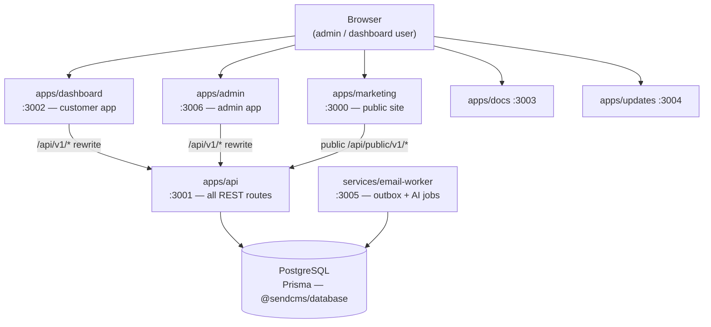
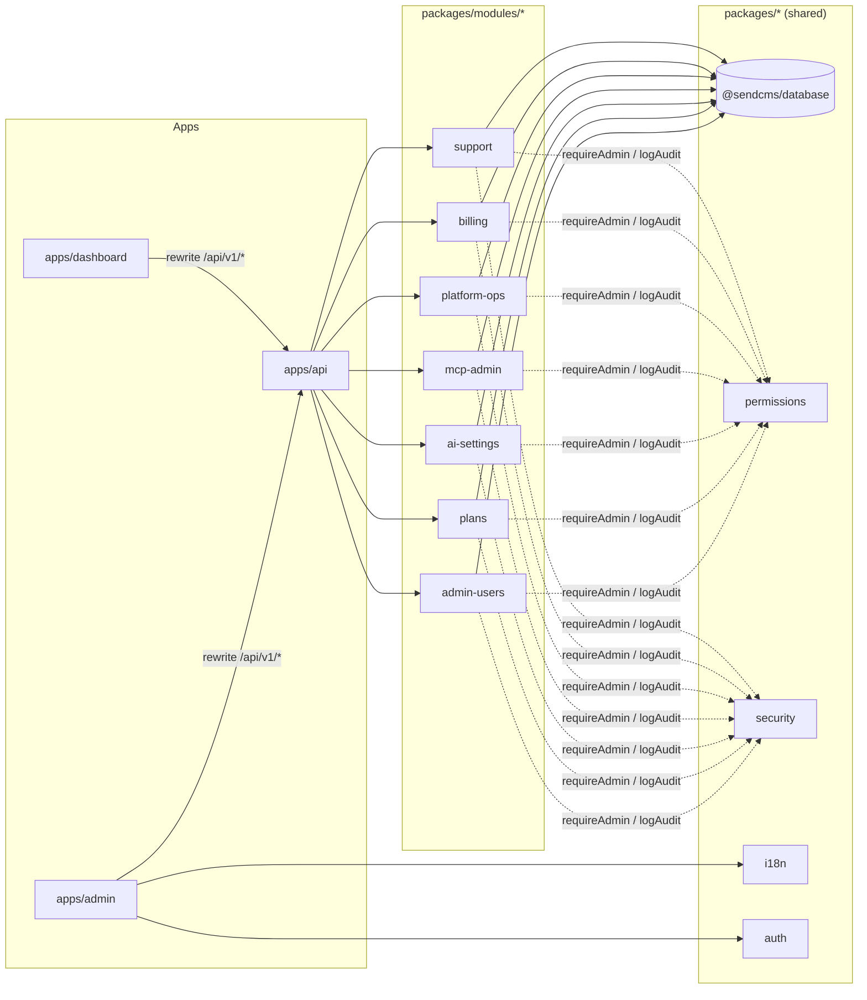
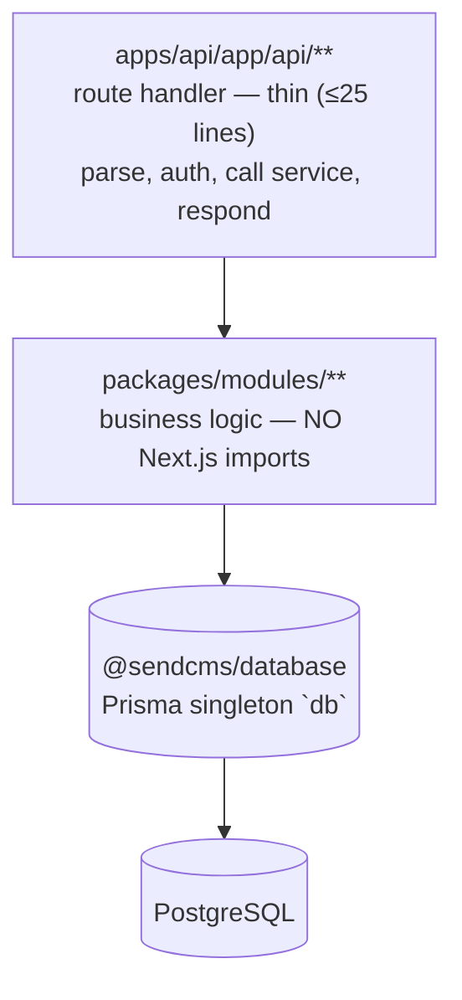

# Architecture (Admin Control Plane)

The Admin Control Plane is the platform-operator side of SendCMS: a
dedicated admin app plus the service modules behind it, built on the
same auth, database, and design system as the rest of the platform.
There is no second auth system, no second database, and no parallel
API — the admin app is a client of the api app, exactly like the
dashboard is.

Branch: `feature/admin-control-plane` (cut from `feature/ai` @
`843ce3b`, 2026-11-21). This doc describes the system as it stands
after Phase 9 (2026-11-22, pushed @ `a331cc6` — see
[implementation-report](./implementation-report.md)).

## Contents

- [System map](#system-map)
- [The six apps](#the-six-apps)
- [The admin app](#the-admin-app)
- [Module map](#module-map)
- [Layered request flow](#layered-request-flow)
- [Auth and capability gating](#auth-and-capability-gating)
- [Internationalization](#internationalization)
- [Security services](#security-services)
- [Configuration](#configuration)
- [What the admin app is not](#what-the-admin-app-is-not)

## System map

The browser never talks to the database. Every admin action goes
browser → admin app → (rewrite) → api app → service module →
`@sendcms/database` → PostgreSQL. The email worker reads the same
database and drains the same outbox; it never serves HTTP to the
browser.

## The six apps

| App              | Port | Serves                                                              | Talks to the api app via                   |
| ---------------- | ---- | ------------------------------------------------------------------- | ------------------------------------------ |
| `apps/marketing` | 3000 | Public site, `/pricing`, `/demo/*`, `/contact`                      | `NEXT_PUBLIC_API_URL` (public routes only) |
| `apps/api`       | 3001 | All REST routes (`/api/v1/*`, `/api/public/v1/*`, `/api/mcp`, auth) | — (it is the API)                          |
| `apps/dashboard` | 3002 | Customer app (`/dashboard/*`, `/sign-in`)                           | `/api/v1/*` rewrite → api app              |
| `apps/docs`      | 3003 | Documentation                                                       | —                                          |
| `apps/updates`   | 3004 | Changelog                                                           | —                                          |
| `apps/admin`     | 3006 | Admin app (`/admin/*`)                                              | `/api/v1/*` rewrite → api app              |

All six are Next.js 16 (App Router) apps in one Turborepo workspace.
`pnpm build` builds them sequentially (`turbo run build
--concurrency 1`) — parallel builds contend on `next/font/google`
(ADR 0006). Production host for the admin app is
`admin.sendcms.bond`, env-driven via `NEXT_PUBLIC_ADMIN_URL`, never
hardcoded (owner decision 2026-11-21).

## The admin app

`apps/admin` (`@sendcms/admin`, Next 16, port 3006) reuses the
dashboard's theme, UI components, and CSS verbatim — no new theme
(owner decision 2026-11-21).

- **Entry gate — `apps/admin/proxy.ts`.** The proxy matches
  `/admin/:path*`. No session → redirect to the dashboard sign-in
  with a `callbackURL` back to the admin page. A session without
  `VIEW_ADMIN_DASHBOARD` → `/admin/unauthorized`. A suspended or
  disabled user is refused (their session is useless: `auth()`
  returns null for them). The proxy also sets the CSP nonce header
  on every response (see [csp](./csp.md)).
- **Auth — `apps/admin/lib/auth.ts`.** A thin wrapper around
  `createSendcmsAuth()` from `@sendcms/auth`. Each app runs its own
  server and owns its own Better Auth instance; the api and
  dashboard apps have the identical wiring in their own
  `lib/auth.ts`. The apps cannot share one instance. One session
  cookie is shared across the subdomain apps via `COOKIE_DOMAIN`
  (`sendcms.bond` in production); the session row lives in the
  database, so every app sees the same session.
- **API access — the rewrite.** Client-side fetches use relative
  `/api/v1/*` paths (`apiFetch` from `@sendcms/shared`). The admin
  `next.config.mjs` rewrites `/api/v1/:path*` to
  `${NEXT_PUBLIC_API_URL}/api/v1/:path*` (dev: `http://localhost:3001`).
  The browser stays same-origin, so the admin routes need no CORS
  and the session cookie is forwarded to the api app. The dashboard
  does exactly the same.
- **Shell and navigation.** `app/admin/layout.tsx` wraps every admin
  page with the sidebar + header. The sidebar is the shadcn `Sidebar`
  with `side` from the locale direction — right in RTL locales,
  left in LTR (see [internationalization](./internationalization.md)).
  Server pages fetch via services and pass `initialData`; client
  components use the React Query hooks from the modules'
  `queries.ts`.
- **Admin pages.** `/admin` (real DB-backed overview, Phase 9),
  `/admin/users`, `/admin/plans`, `/admin/subscriptions`,
  `/admin/usage`, `/admin/ai/*`, `/admin/mcp/*`,
  `/admin/features`, `/admin/announcements`, `/admin/audit-logs`,
  `/admin/health`, `/admin/settings`, `/admin/submissions`,
  `/admin/security`, `/admin/translations`, `/admin/billing`,
  `/admin/support`. Every page is backed by a real API route —
  there are no fake cards and no placeholder stats.

## Module map

Business logic lives in `packages/modules/*`. Each module owns its
service, validators, and React Query hooks. The admin control plane
added seven modules (the rest of the platform's modules —
`domains`, `forms`, `submissions`, `inbox`, `notifications`,
`users`, `analytics`, `api-keys` — are unchanged by this work
except where the plan says enforcement was wired in).

| Module         | Package                 | Owns                                                                                                                              |
| -------------- | ----------------------- | --------------------------------------------------------------------------------------------------------------------------------- |
| `admin-users`  | `@sendcms/admin-users`  | User inspection, status, roles, notes, deletion requests, key/session revocation (Phase 3)                                        |
| `plans`        | `@sendcms/plans`        | Versioned plans, subscriptions, entitlements, usage ledger, overrides (Phase 4)                                                   |
| `ai-settings`  | `@sendcms/ai-settings`  | BYOK keys, billing mode, provider config, AI usage (Phase 5)                                                                      |
| `mcp-admin`    | `@sendcms/mcp-admin`    | MCP kill-switch, per-user MCP settings, MCP usage, key revoke (Phase 6)                                                           |
| `platform-ops` | `@sendcms/platform-ops` | Feature flags, announcements, audit explorer, health, abuse queue, deletion workflow, translations, admin overview (Phases 7 + 9) |
| `billing`      | `@sendcms/billing`      | Provider registry, checkout, webhooks, country-scoped providers (Phase 8)                                                         |
| `support`      | `@sendcms/support`      | Support tickets and threads (Phase 8)                                                                                             |

Shared packages the control plane builds on:

| Package                  | Role                                                                                                                                                                                                               |
| ------------------------ | ------------------------------------------------------------------------------------------------------------------------------------------------------------------------------------------------------------------ |
| `@sendcms/database`      | The Prisma singleton (`db`) — only services import it                                                                                                                                                              |
| `@sendcms/auth`          | `createSendcmsAuth` (Better Auth 1.7.25), `AdminSession`                                                                                                                                                           |
| `@sendcms/permissions`   | Capability model, role maps, `adminCan` — see [authorization](./authorization.md)                                                                                                                                  |
| `@sendcms/security`      | `logAudit`, rate limiter, step-up — the documented exceptions to "only services import the database"; the CSP builder is exported separately from the `@sendcms/security/csp` subpath (DOC-024, Phase 16, Wave 12) |
| `@sendcms/i18n`          | Locale registry, translator, validation — see [internationalization](./internationalization.md)                                                                                                                    |
| `@sendcms/ui`            | shadcn/ui components, design tokens (the admin app uses these, never Radix primitives directly)                                                                                                                    |
| `@sendcms/ai`            | Provider plumbing + BYOK crypto (`byok-crypto.ts`)                                                                                                                                                                 |
| `@sendcms/mcp`           | The MCP server; enforcement lives here, not in the admin UI                                                                                                                                                        |
| `@sendcms/api-client`    | Response/error helpers, CORS                                                                                                                                                                                       |
| `@sendcms/observability` | Structured JSON logging (`createLogger`)                                                                                                                                                                           |
| `@sendcms/email`         | The platform mailer (Resend → SMTP → none)                                                                                                                                                                         |

## Layered request flow

The layered flow is a hard rule (see `AGENTS.md` and the
`project-guidelines` skill):

- Route handlers never import `@sendcms/database` — they call
  services. (78 admin route files under
  `apps/api/app/api/v1/admin/`.)
- Zod schemas live in each module's `validators.ts`, shared by
  routes and services.
- Client hooks live in each module's `queries.ts` (React Query);
  `apiFetch` lives in `@sendcms/shared`.
- `ApiError` lives in `@sendcms/shared` (re-exported from
  `@sendcms/api-client`).
- Audit logging: the one `logAudit()` writer lives in
  `@sendcms/security` — it imports `@sendcms/database` (the
  documented exception, like `@sendcms/auth` is for auth) and is
  called only from services. See
  [admin-audit-trail](./admin-audit-trail.md).
- Server logging: `createLogger(scope)` from
  `@sendcms/observability` (JSON lines), not `console` — except
  the auth mailer's dev verification-link line, whose exact
  `[auth-email]` format is greppable and the journey depends on it.

## Auth and capability gating

One auth system for the whole platform: Better Auth 1.7.25 —
Google/GitHub/Facebook OAuth + email/password (verification
required) → session cookie stored server-side in the database.
First user becomes `PLATFORM_OWNER` via an atomic conditional
`UPDATE` + partial unique index
(`User_single_platform_owner_idx`).

Gating happens in three layers, in order:

1. **Proxy** (`apps/admin/proxy.ts`) — session exists, user is
   `ACTIVE`, and holds `VIEW_ADMIN_DASHBOARD`. This is the front
   door only.
2. **Service** (`requireAdmin(actor, capability)` in each module)
   — every service function checks the exact capability it needs
   before touching data. The admin proxy cannot know which
   capability a page needs; the service does. This is the real
   boundary. See [authorization](./authorization.md).
3. **UI** — the sidebar hides pages the role cannot use. UX only,
   never the security boundary: a direct API call to a hidden
   page's route is still refused by the service.

Additional gates in the same shape: `requireTicketWrite` for
support-ticket writes (`@sendcms/support`), `requireStepUp` for
high-impact actions (see [authorization](./authorization.md)),
and the per-route rate limiter (see
[rate-limiting](./rate-limiting.md)).

Suspension is enforced everywhere at once: `auth()` returns null
for a non-`ACTIVE` user, so a suspended or disabled user loses
the dashboard, the admin app, and their MCP keys in one move
(their session row stays, so reactivation restores access
without a new sign-in).

## Internationalization

`packages/i18n` holds the locale registry (exactly 10 locales),
the translator, and the validation script. Admin and dashboard
strings live in domain JSON files under
`packages/i18n/locales/{locale}/{admin,dashboard}/`. The honest
state as of 2026-11-22: **English and Urdu are complete (41 files
each, 100% in sync); the other 8 locales are coming-soon by the
owner's explicit decision** (English + Urdu first, 2026-11-21).
Full detail — including the RTL story — is in
[internationalization](./internationalization.md).

## Security services

All of these live in `@sendcms/security`, next to `logAudit`, under
the same documented exception:

| Service          | File                                  | What it does                                                                                                                                                      |
| ---------------- | ------------------------------------- | ----------------------------------------------------------------------------------------------------------------------------------------------------------------- |
| Audit writer     | `packages/security/src/audit.ts`      | `logAudit()` — append-only, best-effort, with `reason` / `correlationId` / `outcome`                                                                              |
| Rate limiter     | `packages/security/src/rate-limit.ts` | Generic DB-backed buckets, atomic upsert, fail-open — see [rate-limiting](./rate-limiting.md)                                                                     |
| Step-up re-auth  | `packages/security/src/step-up.ts`    | `verifyStepUp` / `requireStepUp` — password re-check for high-impact actions                                                                                      |
| CSP builder      | `packages/security/src/csp.ts`        | `buildCsp(nonce)` — nonce-based policy for the five page apps, imported via the `@sendcms/security/csp` subpath (DOC-024), never the barrel — see [csp](./csp.md) |
| Security headers | `packages/security/src/headers.mjs`   | The shared non-CSP headers (one source for `next.config.mjs` + `public/_headers`)                                                                                 |

## Configuration

All new config goes in the workspace-root `config/config.json`,
not `.env` and not hardcoded. It holds the platform emergency
flag (`platform.emergency`, read by `@sendcms/plans`, cached per
process, restart to apply) and the rate limits
(`rateLimits.adminApi`, `rateLimits.authSignIn`) plus the step-up
settings (`stepUp.ttlMinutes`, `stepUp.maxAttemptsPerHour`).
Missing file / bad JSON / bad values fall back to the documented
defaults per field. Secrets (provider keys, `AI_BYOK_MASTER_KEY`,
`BETTER_AUTH_SECRET`) live in `.env` only — never in config and
never in the repo.

## What the admin app is not

- **Not a second auth system.** It reuses Better Auth and the
  shared session cookie. (Spec §21: a second auth system is
  never built.)
- **Not a second API.** All 78 admin routes live on the api app;
  the admin app only renders pages and proxies its fetches.
- **Not a microservice.** The control plane is modules inside the
  monorepo, deployed as part of the same six apps.
- **Not the source of truth for submissions.** The submit path,
  the inbox, MCP, and AI all work when the admin app is down —
  they never call it. The admin app reads their records; it does
  not sit in front of them. (Spec §21: the core submission path
  stays independent of AI, billing, and admin availability.)
- **Not an impersonation tool.** There is no "sign in as user"
  anywhere in the control plane, by design.
