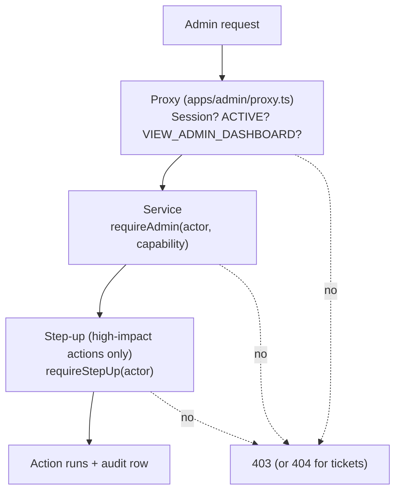

# Authorization (Admin Control Plane)

The capability model for the admin app: who may do what, where the
check happens, and what happens when it fails. The single source of
truth is `packages/permissions/src/platform.ts` — this doc mirrors
it, it does not restate it from memory. If the two ever disagree,
the code wins.

## Contents

- [The model in one paragraph](#the-model-in-one-paragraph)
- [Capabilities](#capabilities)
- [Role matrix](#role-matrix)
- [The platform owner](#the-platform-owner)
- [Where the check happens](#where-the-check-happens)
- [The ticket-write exception](#the-ticket-write-exception)
- [Step-up re-authentication](#step-up-re-authentication)
- [Guards that are not capabilities](#guards-that-are-not-capabilities)
- [Deny by default](#deny-by-default)
- [What the UI is (and is not)](#what-the-ui-is-and-is-not)

## The model in one paragraph

Every admin action names one capability (e.g. `MANAGE_USERS`).
Every actor has a role: the platform owner (`PLATFORM_OWNER`),
a staff role (`SUPER_ADMIN` / `MANAGER` / `SUPPORT` via
`User.adminRole`), or a plain customer (`PLATFORM_USER`). The
check is `adminCan(role, capability)` — the owner passes
everything, a plain customer passes nothing, staff pass exactly
their mapped set. The check runs **in the service**, never only
in the route or the UI. A failure is a 403 (or a 404 where a 403
would leak existence — tickets).

## Capabilities

28 admin capabilities. (The "23" in the Phase 2 record was the
count then; Phase 7 added `MANAGE_ANNOUNCEMENTS`, Phase 8 added
`VIEW_BILLING` + `MANAGE_BILLING`, Phase C added `VIEW_JOBS` +
`MANAGE_JOBS`.)

| Capability                   | Guards                                                                                                    |
| ---------------------------- | --------------------------------------------------------------------------------------------------------- |
| `VIEW_ADMIN_DASHBOARD`       | Entering the admin app at all (`/admin/*`)                                                                |
| `VIEW_USERS`                 | User lists and detail reads                                                                               |
| `MANAGE_USERS`               | User status/role actions, notes, key/session revocation, ticket writes (with the SUPPORT exception below) |
| `VIEW_CUSTOMER_DATA`         | Customer forms, domains, submissions (metadata), subscriptions                                            |
| `VIEW_SENSITIVE_SUBMISSIONS` | Reading a submission's `data` (audited before return)                                                     |
| `MANAGE_PLANS`               | Plan create / version / duplicate / archive                                                               |
| `VIEW_PLAN_VERSIONS`         | Reading plans and versions                                                                                |
| `PUBLISH_PLAN_VERSIONS`      | Publishing a plan version                                                                                 |
| `MANAGE_SUBSCRIPTIONS`       | Assigning / cancelling subscriptions                                                                      |
| `MIGRATE_SUBSCRIPTIONS`      | Migration preview / execute                                                                               |
| `MANAGE_USAGE`               | Entitlement overrides, usage reads                                                                        |
| `MANAGE_AI`                  | AI provider config, per-user AI controls                                                                  |
| `MANAGE_AI_BILLING`          | AI billing-mode controls (admin side)                                                                     |
| `MANAGE_BYOK`                | BYOK key administration                                                                                   |
| `VIEW_AI_USAGE`              | AI usage lists and summaries                                                                              |
| `MANAGE_MCP`                 | MCP settings writes, key revoke                                                                           |
| `VIEW_MCP`                   | MCP pages, usage, keys reads                                                                              |
| `MANAGE_FEATURE_FLAGS`       | Feature-flag create / toggle / overrides                                                                  |
| `MANAGE_ANNOUNCEMENTS`       | Announcement create / edit / activate                                                                     |
| `VIEW_AUDIT_LOGS`            | Audit explorer reads                                                                                      |
| `EXPORT_AUDIT_LOGS`          | Audit export                                                                                              |
| `MANAGE_TRANSLATIONS`        | Translation completion reads + export                                                                     |
| `REVIEW_TRANSLATIONS`        | Translation review (reserved; no UI yet)                                                                  |
| `MANAGE_ADMINISTRATORS`      | Managing administrators (owner-only)                                                                      |
| `VIEW_BILLING`               | Billing provider reads                                                                                    |
| `MANAGE_BILLING`             | Billing provider enable/disable + countries                                                               |
| `VIEW_JOBS`                  | Jobs page reads                                                                                             |
| `MANAGE_JOBS`                | Requeue a FAILED email job, manual email-outbox cron run (both + step-up re-auth)                           |

Three legacy capabilities exist outside the admin set and stay
owner-only: `VIEW_NOTICE_BOARD`, `VIEW_ADMINISTRATION`,
`MANAGE_PLATFORM_SETTINGS`.

## Role matrix

✓ = the role holds the capability. The owner holds all 28 (plus
the 3 legacy ones). A plain customer holds none.

| Capability                   | SUPER_ADMIN | MANAGER | SUPPORT |
| ---------------------------- | :---------: | :-----: | :-----: |
| `VIEW_ADMIN_DASHBOARD`       |      ✓      |    ✓    |    ✓    |
| `VIEW_USERS`                 |      ✓      |    ✓    |    ✓    |
| `MANAGE_USERS`               |      ✓      |    ✓    |    —    |
| `VIEW_CUSTOMER_DATA`         |      ✓      |    ✓    |    ✓    |
| `VIEW_SENSITIVE_SUBMISSIONS` |      ✓      |    ✓    |    ✓    |
| `MANAGE_PLANS`               |      ✓      |    —    |    —    |
| `VIEW_PLAN_VERSIONS`         |      ✓      |    ✓    |    —    |
| `PUBLISH_PLAN_VERSIONS`      |      ✓      |    —    |    —    |
| `MANAGE_SUBSCRIPTIONS`       |      ✓      |    ✓    |    —    |
| `MIGRATE_SUBSCRIPTIONS`      |      ✓      |    —    |    —    |
| `MANAGE_USAGE`               |      ✓      |    ✓    |    —    |
| `MANAGE_AI`                  |      ✓      |    —    |    —    |
| `MANAGE_AI_BILLING`          |      ✓      |    —    |    —    |
| `MANAGE_BYOK`                |      ✓      |    —    |    —    |
| `VIEW_AI_USAGE`              |      ✓      |    ✓    |    —    |
| `MANAGE_MCP`                 |      ✓      |    —    |    —    |
| `VIEW_MCP`                   |      ✓      |    ✓    |    ✓    |
| `MANAGE_FEATURE_FLAGS`       |      ✓      |    —    |    —    |
| `MANAGE_ANNOUNCEMENTS`       |      ✓      |    —    |    —    |
| `VIEW_AUDIT_LOGS`            |      ✓      |    ✓    |    —    |
| `EXPORT_AUDIT_LOGS`          |      ✓      |    —    |    —    |
| `MANAGE_TRANSLATIONS`        |      ✓      |    —    |    —    |
| `REVIEW_TRANSLATIONS`        |      ✓      |    —    |    —    |
| `MANAGE_ADMINISTRATORS`      |      —      |    —    |    —    |
| `VIEW_BILLING`               |      ✓      |    ✓    |    —    |
| `MANAGE_BILLING`             |      ✓      |    —    |    —    |
| `VIEW_JOBS`                  |      ✓      |    ✓    |    ✓    |
| `MANAGE_JOBS`                |      ✓      |    —    |    —    |

Notes on the map:

- **SUPER_ADMIN** is "full access except managing
  administrators" — 27 of 28. `MANAGE_ADMINISTRATORS` is
  owner-only.
- **MANAGER** is view + manage users and subscriptions, inspect
  plans and usage, read audit logs and AI usage, read billing,
  view Jobs — 13 capabilities. No plan/AI/MCP publishing, no
  feature flags, no translations, no administrator management,
  no job requeues or manual runs. The
  `MANAGE_USERS` in the MANAGER row excludes role changes — that
  sub-restriction is enforced in the `@sendcms/admin-users`
  service, not in the role map.
- **SUPPORT** is "support queries only" — 6 capabilities: enter
  the admin app, view users and their data, read sensitive
  submissions, view MCP usage, view Jobs. SUPPORT does full ticket work
  through the separate exception below, not through
  `MANAGE_USERS`.

Proven by `tests/permissions.test.ts` (9 tests: the owner map,
each staff map, `adminCan` for owner / staff / plain user).

## The platform owner

`PLATFORM_OWNER` passes every capability check
(`adminCan` returns `true` before consulting any map). The
owner is the first user, set by an atomic conditional `UPDATE`
together with the partial unique index
`User_single_platform_owner_idx` — the database enforces that
there is exactly one. The owner can never be suspended,
disabled, role-changed, or erased, and no self-target guard
applies to the owner because the owner is never the target of
those actions (the services refuse them with 403 before any
capability check matters).

## Where the check happens

| Layer   | File                                            | What it checks                                                                                                |
| ------- | ----------------------------------------------- | ------------------------------------------------------------------------------------------------------------- |
| Proxy   | `apps/admin/proxy.ts`                           | Session exists; user is `ACTIVE`; holds `VIEW_ADMIN_DASHBOARD` (via `adminCan` + `PLATFORM_ROUTE_CAPABILITY`) |
| Service | each module's `requireAdmin(actor, capability)` | The exact capability for that action, before any data access                                                  |
| Route   | `apps/api/app/api/v1/admin/*`                   | Session only (thin handlers); the service does the capability check                                           |
| UI      | sidebar / page guards                           | Hides what the role cannot use — UX only                                                                      |

`requireAdmin` lives in each module (e.g.
`packages/modules/admin-users/src/service.ts:32`,
`packages/modules/platform-ops/src/require-admin.ts`,
`packages/modules/mcp-admin/src/service.ts:52`). The shape is
the same everywhere: resolve the actor's role (owner → all,
staff `adminRole` → the map, otherwise none), call `adminCan`,
throw 403 on failure. The dashboard's proxy does the same shape
for customer routes via `PLATFORM_ROUTE_CAPABILITY` and
`platformCan`.

## The ticket-write exception

Support tickets break the pure capability pattern once, by
owner decision (2026-11-22): **SUPPORT staff do full ticket
work** — reply, change status, and assign — because "support
staff exist to answer tickets and queries". SUPPORT does not
hold `MANAGE_USERS`, so the service enforces it with a
dedicated helper instead of a capability:

`requireTicketWrite(session)` in
`packages/modules/support/src/service.ts:74` — passes when the
actor holds `MANAGE_USERS` **or** holds the `SUPPORT` role.
It gates the admin reply (line 446), status change (line 498),
assign (line 544), and staff-list (line 595) actions. Reads
still need `VIEW_CUSTOMER_DATA`. A plain signed-in user gets
403 on every admin ticket action; reading or replying to
another user's ticket is a 404, never a 403 (a 403 would leak
that the ticket exists). Proven by `tests/support.test.ts`
(19 tests, including "SUPPORT can read + reply + change status

- assign" and "plain user 403 on admin list and on reply").

## Step-up re-authentication

Some actions need more than a capability: the admin must
re-enter their password first. `verifyStepUp(session, password)`
in `packages/security/src/step-up.ts:138` checks the password
against Better Auth and writes a `StepUpVerification` row valid
for `stepUp.ttlMinutes` (10 minutes by default, from
`config/config.json`); `requireStepUp(actor)` in the same file
(line 219) accepts the action only while a live row exists.
Failed attempts are capped per user
(`stepUp.maxAttemptsPerHour`, 5/hour) and audited
(`step-up-failed` with the reason, never the password).

The scope is the owner's decision of 2026-11-22
("irreversible + role change + MCP kill-switch"), confirmed
unchanged on 2026-11-24 (Phase 16, Wave 2 — SEC-104): no
narrowing, no extension. The rows marked — are intentionally
OUT of scope, not gaps: step-up is for actions that cannot be
undone or that change who can administer the platform, not for
every privileged write.

| Action                                   | Function                                                       | Step-up                                                                          |
| ---------------------------------------- | -------------------------------------------------------------- | -------------------------------------------------------------------------------- |
| Disable a user                           | `disableUser` (`@sendcms/admin-users`)                         | ✓                                                                                |
| Change a user's admin role               | `setAdminRole` (`@sendcms/admin-users`)                        | ✓                                                                                |
| Toggle the MCP kill-switch               | `setMcpSettings` (`@sendcms/mcp-admin`)                        | ✓                                                                                |
| Revoke an MCP key                        | `revokeMcpKey` (`@sendcms/mcp-admin`)                          | ✓                                                                                |
| Review a deletion request (approve only) | `reviewDeletionRequest` (`@sendcms/platform-ops`)              | ✓ (approve only — a reject needs no step-up)                                     |
| Execute the erasure                      | `executeErasure` (`@sendcms/platform-ops`)                     | ✓                                                                                |
| Suspend a user                           | `suspendUser`                                                  | — (reversible; reactivation restores access)                                     |
| Reactivate / restore a user              | `reactivateUser` / `restoreUser`                               | —                                                                                |
| Approve a user                           | `approveUser` (`@sendcms/admin-users`)                         | — (reversible; approval is undone by suspending)                                 |
| Reject a user                            | `rejectUser` (`@sendcms/admin-users`)                          | — (reversible; rejection is undone by restoring)                                 |
| Revoke a user's API keys                 | `revokeUserApiKeys` (`@sendcms/admin-users`)                   | ✓ (SEC-103 / ADM-009 — destructive, account-wide)                                |
| Revoke a user's sessions                 | `revokeUserSessions` (`@sendcms/admin-users`)                  | — (reversible by signing in again)                                               |
| Migrate a subscription to another plan   | `executeMigration` (`@sendcms/plans`)                          | — (reversible by migrating back; no data destroyed)                              |
| Publish / archive a plan version         | `publishPlanVersion` / `archivePlan` (`@sendcms/plans`)        | — (archive is reversible; publish is a capability-gated content change)          |
| Assign / cancel a subscription           | `assignSubscription` / `cancelSubscription` (`@sendcms/plans`) | — (reversible by assigning again; no data destroyed)                             |
| Change a billing provider's config       | `setProviderConfig` (`@sendcms/billing`)                       | — (reversible; a provider can be re-enabled)                                     |
| Requeue an email job (admin)             | `requeueEmailJobForAdmin` (`@sendcms/notifications`)           | ✓ (MANAGE_JOBS + step-up — one password entry authorizes exactly one requeue)    |
| Run the email-outbox cron manually       | `runManualEmailOutboxCron` (`@sendcms/cron`)                   | ✓ (MANAGE_JOBS + step-up — one password entry authorizes exactly one manual run) |

**DOC-003 addendum (2026-11-28):** the Approve / Reject rows above
are no scope change — both actions are reversible (suspend undoes an
approval, restore undoes a rejection) and change no role, the same
shape as suspend / reactivate / restore, which the owner-confirmed
scope (SEC-104) already leaves out. If an approval is ever combined
with a role assignment, that is a separate `setAdminRole` call with
its own step-up — never folded into approve.

**Wave 12 addendum (Phase C, 7 admin pages — Jobs page, 2026-11-27):**
the scope above was extended with the last two rows. The Wave 2
confirmation ("no extension", SEC-104) predates Phase C; the Jobs
page added email-job requeue and the manual cron run as step-up
actions because both send customer email / mutate the outbox on an
operator's say-so — the same "cannot be undone" shape as the
original scope. Both are gated on MANAGE_JOBS (Q9: SUPER_ADMIN +
owner — MANAGER views Jobs but never requeues or triggers a run;
SUPPORT never mutates it) + step-up re-auth, checked last, after
every cheap guard, immediately before the write/run (single-use).
The owner-scoped requeue (`requeueEmailJob`, no step-up) is
unchanged — step-up applies to the admin variant only. Proven by
`requeueEmailJobForAdmin` (`packages/modules/notifications/src/service.ts:1175`,
`requireStepUp` at :1189) and `runManualEmailOutboxCron`
(`packages/modules/cron/src/service.ts:634`, `requireStepUp` at
:648); the Jobs page (`apps/admin/app/admin/jobs/page.tsx`) opens
the step-up dialog before either write.

The verify endpoint is `POST /api/v1/admin/step-up/verify`
(`apps/api/app/api/v1/admin/step-up/verify/route.ts`). The
admin UI opens a `StepUpDialog` (password field) before the
confirmation runs, in the user-detail, MCP overview, MCP keys,
and security-overview components. Proven by
`tests/step-up.test.ts` (21 tests). An admin who signed in via
OAuth and has no password cannot step up — the verify call
fails with a clear "no password set" error and the action is
refused; that is the designed behavior, not a bug.

## Guards that are not capabilities

Some refusals are about the target, not the actor's role, and
live in the services alongside the capability check:

- **Owner protection:** the `PLATFORM_OWNER` can never be
  suspended, disabled, role-changed, or erased.
- **Self-target ban:** an admin cannot suspend, disable, or
  role-change themself, and cannot erase themself.
- **MANAGER cannot change roles** (even though MANAGER holds
  `MANAGE_USERS`).
- **MCP settings have no owner protection and no self-target
  ban** (deliberate — disabling MCP never locks anyone out of
  the dashboard; it only stops their API keys from calling
  tools).
- **Assigning a ticket** requires the assignee to be the owner
  or a staff `adminRole` holder, else 422.
- **A suspended user cannot enable AI** (BYOK/PLATFORM refused
  403; `DISABLED` is still allowed).

## Deny by default

There is no "allow unless forbidden" anywhere in the control
plane. `adminCan` returns `false` for any role/capability pair
not in the map; `requireAdmin` throws unless the check passes;
`isFeatureEnabled` returns `false` for an unknown flag; the
entitlement resolver returns `denied` for a non-`ACTIVE` user;
the audit explorer rejects a bad filter value with 422 rather
than guessing. A new capability, route, or action is denied
until it is explicitly mapped and enforced.

## What the UI is (and is not)

The UI is never the security boundary. The sidebar hides pages
by role, the buttons hide actions by capability, and the ticket
pages only offer transitions the service will accept — but a
direct `fetch` to the route bypasses all of that, and the
service still refuses it. Every proof in the test suite calls
the service (or the route) directly, never through the UI.
