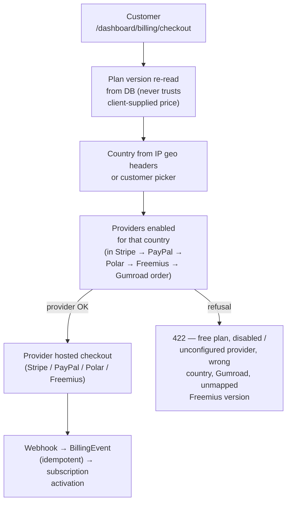

# Billing providers (Admin Control Plane, Phase 8)

Real payments for SendCMS plans — not design-only. A provider can be
enabled in the admin app **only when its env values exist**; without
them the provider stays disabled by default and never appears at
checkout. Provider API keys are never shown in the admin UI — only
whether they are set.

Branch: `feature/admin-control-plane` (live in production since 2026-11-23; not merged to `main`). No live payment test has been run yet — that
needs real Stripe test-mode keys on the owner's machine.

📌 Note: this phase supersedes the Phase 4 record. The
Phase 1 audit doc
([implementation-audit](./implementation-audit.md), historical —
do not edit) and the Phase 4 doc
([plans-and-entitlements](./plans-and-entitlements.md)) both
described the billing-provider abstraction as "design only". The
owner decided on 2026-11-22 to build payments real, and this doc
records the build as shipped.

Provider order (owner decision, 2026-11-22): **Stripe first, then
PayPal, then Polar, then Freemius, then Gumroad.** Checkout shows
providers in that order.

## Contents

- [The registry](#the-registry)
- [Admin provider configs](#admin-provider-configs)
- [Per-provider countries](#per-provider-countries)
- [Checkout](#checkout)
- [Checkout flow](#checkout-flow)
- [Webhooks](#webhooks)
- [Public plans + pricing page](#public-plans--pricing-page)
- [i18n + tests](#i18n--tests)
- [What is NOT done / honest limits](#what-is-not-done--honest-limits)

## The registry

Service module: `packages/modules/billing/` (`@sendcms/billing`) —
`src/registry.ts`, `src/service.ts`, `src/validators.ts`,
`src/queries.ts`, `src/geo.ts`, `src/providers/*.ts`. The registry is
the single source of truth for what each provider needs and whether
it is configured.

| Provider | Required env vars                                                                                                    | Checkout                                                                | Notes                                                                                                                      |
| -------- | -------------------------------------------------------------------------------------------------------------------- | ----------------------------------------------------------------------- | -------------------------------------------------------------------------------------------------------------------------- |
| Stripe   | `STRIPE_SECRET_KEY`, `STRIPE_PUBLISHABLE_KEY`, `STRIPE_WEBHOOK_SECRET`                                               | Checkout Session (API)                                                  | Price created on the fly per checkout                                                                                      |
| PayPal   | `PAYPAL_CLIENT_ID`, `PAYPAL_CLIENT_SECRET`, `PAYPAL_WEBHOOK_ID` (+ `PAYPAL_MODE=sandbox\|live`)                      | Subscription API (direct REST — the v2.5 SDK has no catalog controller) | Product → Plan created per checkout                                                                                        |
| Polar    | `POLAR_ACCESS_TOKEN`, `POLAR_WEBHOOK_SECRET` (+ `POLAR_ENVIRONMENT=sandbox\|production`)                             | Hosted checkout (API-created session)                                   | Product created on the fly                                                                                                 |
| Freemius | `FREEMIUS_PRODUCT_ID`, `FREEMIUS_API_KEY`, `FREEMIUS_SECRET_KEY`, `FREEMIUS_PUBLIC_KEY` (+ `FREEMIUS_PLAN_MAP` JSON) | Hosted checkout (`checkout.create().getLink()`)                         | Plans live in the Freemius dashboard — see the plan map below                                                              |
| Gumroad  | `GUMROAD_APP_ID`, `GUMROAD_APP_SECRET`                                                                               | **None — registered only**                                              | Gumroad has no subscription/payment creation API; checkout through Gumroad refuses with a clear 422, never fakes a payment |

SDK versions (latest stable, pinned in `packages/modules/billing/
package.json`): `stripe` ^23.2.0, `@paypal/paypal-server-sdk` ^2.5.0,
`@polar-sh/sdk` ^1.3.2, `@freemius/sdk` ^0.5.0. Gumroad has no
official Node SDK (CLI only) — none is installed for it.

`isConfigured(provider, env)` is true only when every required var
is set and non-blank; `missingEnvVars` names the missing ones, and
the admin UI shows exactly that list when an enable is refused.

## Admin provider configs

Models: `BillingProviderConfig` (one row per provider, `provider
@unique`, `isEnabled @default(false)`) and the country mapping
below. `AuditResource` gained `BILLING_PROVIDER`.

| Action                                   | Route                                              | Capability       |
| ---------------------------------------- | -------------------------------------------------- | ---------------- |
| List providers (auto-creates all 5 rows) | `GET /api/v1/admin/billing/providers`              | `VIEW_BILLING`   |
| Enable / disable + countries             | `PATCH /api/v1/admin/billing/providers/[provider]` | `MANAGE_BILLING` |
| List countries (reference list)          | `GET /api/v1/admin/billing/countries`              | `VIEW_BILLING`   |

Enabling a provider whose env values are missing is refused with
**422 naming the missing vars**; disabling is always allowed.
Enabling/disabling requires a reason and is audited (`UPDATE` /
`BILLING_PROVIDER`, detail event `billing-provider-updated`, old +
new `isEnabled` + countries). `MANAGER` gets `VIEW_BILLING` only;
`SUPPORT` gets neither. `VIEW_BILLING` / `MANAGE_BILLING` are in
`packages/permissions/src/platform.ts` — see
[authorization](./authorization.md).

## Per-provider countries

Models: `Country` (`code` String `@id` — the ISO 3166-1 alpha-2
code, `name`) and `BillingProviderCountry` (join table,
`@@unique([providerConfigId, countryCode])`). The `Country` table
is seeded with all 249 codes by migration
`20261122050526_add_countries_table` (names from Node's
`Intl.DisplayNames`); it is a reference list, not editable from the
admin UI.

- **No mapping rows = all countries** (the default). The admin
  selects countries only to restrict a provider.
- The admin PATCH accepts `countries: string[]`, validated against
  the `Country` table — an unknown code is a **422**.
- Owner defaults (2026-11-22): Stripe all countries; PayPal USA,
  UK, Australia, Germany and similar; Gumroad Pakistan. These are
  admin choices, not hardcoded — the admin sets them per provider.
- At checkout only the providers enabled for the customer's country
  show. Examples from the owner's spec: US → PayPal + Stripe;
  PK → Gumroad + Stripe; UAE → Stripe only. The mechanism is the
  mapping table; the examples are never hardcoded.

## Checkout

`POST /api/v1/billing/checkout` (signed-in customer). The service
re-reads the plan version from the database — it never trusts a
client-supplied price. Refusals, all 422: free plans, disabled
providers, unconfigured providers, providers not enabled for the
customer's country, Gumroad (no automated checkout), unmapped
Freemius plan versions (see below).

- **Stripe:** creates the Price on the fly, then a Checkout Session;
  the customer is sent to Stripe's hosted page.
- **PayPal:** creates a Product then a Plan per checkout (direct
  REST calls — the SDK v2.5 has no catalog controller), then a
  subscription approval link.
- **Polar:** creates the product on the fly (interval + trial on the
  product), then a hosted checkout session.
- **Freemius:** hosted checkout via `checkout.create().getLink()`.
  **Plan map (known gap):** Freemius plans are created in the
  Freemius dashboard, so SendCMS plan versions map to Freemius plan
  ids in the `FREEMIUS_PLAN_MAP` env var (JSON object:
  `{ "<planVersionId>": "<freemiusPlanId>" }`). A version with no
  mapping refuses checkout with a clear 422.
- **Gumroad:** throws a clear 422. It is registered in the admin
  app like the others, but there is no automated checkout to offer.

The customer country comes from IP geo headers
(`x-vercel-ip-country`, `cf-ipcountry` — `countryFromHeaders` in
`src/geo.ts`); when no header is present the checkout page asks the
customer to pick a country. `GET /api/v1/billing/providers?country=XX`
lists the providers for a country; `GET /api/public/v1/billing/
countries` lists the reference countries for the picker.

## Checkout flow

## Webhooks

`POST /api/public/v1/billing/webhooks/{stripe,paypal,polar,freemius}`
— public routes, no session. **Signature verification on the raw
body for all four** (Stripe `constructEvent`, PayPal
`verify-webhook-signature`, Polar `validateEvent`, Freemius
HMAC-SHA256). A bad signature is a 401 and the event is never
processed.

`BillingEvent` (`@@unique([provider, providerEventId])`) makes
delivery idempotent: a duplicate event is skipped, never
re-applied. Normalized events drive the `@sendcms/plans` system
functions (new in Phase 8): `activateSubscriptionFromCheckout`
(idempotent per provider subscription id, one-active-per-user
transaction), `cancelSubscriptionFromProvider`,
`extendSubscriptionPeriod` (computes the period end from the plan
interval when the provider gives none), `getMySubscription`.
Subscription activation reuses the Phase 4 `assign` flow — a webhook
never invents a price or an entitlement. The plan and subscription
model is documented in
[plans-and-entitlements](./plans-and-entitlements.md) and the
version lifecycle in
[plan-versioning](./plan-versioning.md).

## Public plans + pricing page

`listPublishedPlans` (`@sendcms/plans`) returns PUBLISHED, non-private
plans only: the current published version with its price and
entitlements, no draft or internal fields. `GET /api/public/v1/plans`
(no auth) serves it. The marketing `/pricing` page is a server
component that fetches those records live — **no hardcoded prices** —
and renders every published plan (free with limits, paid,
paid-unlimited) with its price and limits; if the API fails it shows
an honest error state instead of stale prices. The homepage's
content-driven pricing section is untouched (follow-up).

The dashboard checkout is a proper page, per the Phase 8 UX rule
(pages, not popups — a confirmation dialog appears only at
confirmation time): `/dashboard/billing` (current subscription +
change-plan) and `/dashboard/billing/checkout` (plan picker →
country select, geo-detected when available → provider list for
that country → "Continue to payment" to hosted checkout).
`/admin/billing` is the admin page: provider table with a
configured badge (booleans only — never key values), an enabled
switch, and a countries checklist; the switch opens a confirmation
dialog with a reason field and the countries.

## i18n + tests

- `packages/i18n/locales/{en,ur}/admin/billing.json` and
  `{en,ur}/dashboard/billing.json`, real Urdu script in `ur`.
  `pnpm --filter @sendcms/i18n validate`: en + ur 100% in sync.
  (i18n is en + ur only — the other 8 locales are coming-soon by
  owner decision; see
  [internationalization](./internationalization.md).)
- Tests: `tests/billing.test.ts`, 21 tests — registry
  configured/unconfigured, enable refused without env (422 naming
  vars), countries filter (US → Stripe + PayPal, PK/AE → Stripe
  only, disabled hidden), Stripe webhook with real HMAC signatures
  (activate + duplicate skipped + bad signature 401), PayPal
  webhook via stubbed fetch, Freemius HMAC + plan-map activation,
  checkout refusals (disabled / unconfigured / Gumroad / free /
  country), public plans only-published. No network, no real DB.

## What is NOT done / honest limits

- ⚠️ **No live payment test yet.** No real checkout or webhook
  delivery has been tested — that needs real Stripe test-mode keys
  on the owner's machine. The checkout code paths are typechecked
  and unit-tested at the refusal/webhook layer only, never executed
  against a live provider.
- **Freemius plan mapping is manual.** Every plan version sold
  through Freemius needs an entry in `FREEMIUS_PLAN_MAP`; an
  unmapped version cannot be sold through Freemius (clear 422).
- **Gumroad cannot be automated.** It is registered and
  country-scoped like the others, but checkout through it is
  refused by design — Gumroad offers no subscription/payment
  creation API.
- **Test mode only.** All providers are wired for their sandbox /
  test modes; no live charges have been made or tested.
