# Database design (Admin Control Plane)

Every model the Admin Control Plane added to the SendCMS schema,
their relations and indexes, and the migration rules that govern
them. The schema file is `packages/database/prisma/schema.prisma`
(1,420 lines). Line numbers below are the `model` declaration
lines, so a reader can jump straight to the definition.

The control plane added **no new database** — it extends the one
Prisma Postgres database the whole platform shares.

## Contents

- [Migration rule (read first)](#migration-rule-read-first)
- [Migration history](#migration-history)
- [Entity map](#entity-map)
- [User additions](#user-additions)
- [User management](#user-management)
- [Plans, subscriptions, usage](#plans-subscriptions-usage)
- [AI BYOK and usage](#ai-byok-and-usage)
- [MCP controls](#mcp-controls)
- [Billing and support](#billing-and-support)
- [Rate limiting and step-up](#rate-limiting-and-step-up)
- [Pre-existing models the control plane reuses](#pre-existing-models-the-control-plane-reuses)
- [Indexing conventions](#indexing-conventions)
- [What is never done](#what-is-never-done)

## Migration rule (read first)

- **Forward-only, never edit an applied migration.** A change is a
  new migration. Never `prisma migrate reset`, never a DB reset —
  the dev DB holds real owner accounts and production inbox data.
- **Never physically delete rows for a business state change.**
  Status enums and soft flows instead: a user is `SUSPENDED` /
  `DISABLED`, never deleted; a plan version is `SUPERSEDED` /
  `ARCHIVED`, never rewritten; an API key is revoked (`revokedAt`),
  never deleted. The one exception is the anonymizing erasure
  (Phase 7 deletion workflow), which deletes credentials and
  customer data but keeps the billing/audit history rows.
- **Every domain model gets `createdAt` + `updatedAt`.**
  Append-only event models (`SubscriptionEvent`, `UsageLedger`,
  `TicketMessage`, `AiUsageRecord`, `McpUsageRecord`,
  `BillingEvent`, `StepUpVerification`) get `createdAt` only.
- **IDs are `cuid()` strings.** Enums for status/role fields.
  Indexes on every foreign key and on every status/timestamp
  filter the admin UI queries by.
- **One row per subject where the subject is the key:**
  `ApiKeyRateLimit` (PK = `apiKeyId`), `RateLimitBucket`
  (`@@unique([scope, subject])`), `UserAiSettings`
  (`userId @unique`), `McpUserSettings` (`userId @unique`).

## Migration history

36 migration directories in
`packages/database/prisma/migrations/` (34 committed at HEAD
`0395930` + the 2 Phase 9 migrations, uncommitted until the
Phase 9 push). The dev DB stands at 36/36 applied after the
Phase 9 integration.

| #   | Migration                                         | Phase | Adds                                                                                                                          |
| --- | ------------------------------------------------- | ----- | ----------------------------------------------------------------------------------------------------------------------------- |
| 25  | `20261121201308_add_user_locale`                  | 2     | `User.locale`                                                                                                                 |
| 26  | `20261121212116_add_user_status_admin_role_notes` | 3     | `User.status` / `adminRole` / `statusReason` / `statusChangedAt`, `AdminNote`                                                 |
| 27  | `20261121212357_add_user_deletion_request`        | 3     | `User.deletionRequestedAt` / `deletionRequestReason`                                                                          |
| 28  | `20261121224247_add_plans_subscriptions_usage`    | 4     | `Plan`, `PlanVersion`, `Subscription`, `SubscriptionEvent`, `UsageLedger`, `EntitlementOverride`                              |
| 29  | `20261121233835_add_ai_byok_keys_usage`           | 5     | `UserAiKey`, `AiProviderConfig`, `AiUsageRecord`                                                                              |
| 30  | `20261121234141_add_user_ai_settings`             | 5     | `UserAiSettings`                                                                                                              |
| 31  | `20261122010723_add_mcp_controls`                 | 6     | `McpSettings`, `McpUserSettings`, `McpUsageRecord`                                                                            |
| 32  | `20261122015329_add_platform_operations`          | 7     | `FeatureFlag`, `FeatureFlagOverride`, `Announcement`, `DeletionRequest`, `AuditLog` new fields                                |
| 33  | `20261122050016_add_billing_support_tickets`      | 8     | `BillingProviderConfig`, `BillingEvent`, `SupportTicket`, `TicketMessage`, `Subscription.provider` + `providerSubscriptionId` |
| 34  | `20261122050526_add_countries_table`              | 8     | `Country` (249-row seed), `BillingProviderCountry`                                                                            |
| 35  | `20261122064351_add_rate_limit_buckets`           | 9     | `RateLimitBucket`, `RateLimitScope` (`ADMIN_API`, `AUTH`)                                                                     |
| 36  | `20261122070123_add_step_up_verification`         | 9     | `StepUpVerification`, `RateLimitScope.STEP_UP`, `AuditAction.STEP_UP_VERIFIED` / `STEP_UP_FAILED`                             |

Migrations 1–24 are the pre-control-plane history (contact-form
SaaS build, Better Auth switch, comment-system removal, API keys,
AI phases). The `Country` seed lives in migration 34 itself
(`INSERT ... ON CONFLICT ("code") DO NOTHING`, 249 codes) — not
in `seed.ts`, which seeds only the demo user, domain, form, and
sample submissions.

## Entity map

```mermaid
erDiagram
    User ||--o{ AdminNote : "has notes / writes"
    User ||--o{ Subscription : "has"
    User ||--o{ SubscriptionEvent : "admin on"
    User ||--o{ PlanVersion : "creates"
    User ||--o{ UsageLedger : "uses"
    User ||--o{ EntitlementOverride : "target / admin"
    User ||--o{ UserAiKey : "owns"
    User ||--o{ AiUsageRecord : "uses AI"
    User |o--|| UserAiSettings : "has"
    User |o--|| McpUserSettings : "has"
    User ||--o{ McpUsageRecord : "calls tools"
    User ||--o{ SupportTicket : "owns / assigned"
    User ||--o{ TicketMessage : "authors"
    User ||--o{ StepUpVerification : "verifies"
    User ||--o{ ApiKey : "owns"
    User ||--o{ FeatureFlagOverride : "target / sets"
    User ||--o{ DeletionRequest : "requests / reviews"
    User ||--o{ Announcement : "creates"
    User ||--o{ AuditLog : "actor on"
    Plan ||--o{ PlanVersion : "versions"
    Plan ||--o{ Subscription : "subscribed"
    PlanVersion ||--o{ Subscription : "effective version"
    PlanVersion ||--o{ SubscriptionEvent : "from / to"
    Subscription ||--o{ SubscriptionEvent : "history"
    BillingProviderConfig ||--o{ BillingProviderCountry : "enabled in"
    Country ||--o{ BillingProviderCountry : "mapped to"
    SupportTicket ||--o{ TicketMessage : "thread"
    ApiKey ||--o{ McpUsageRecord : "used by"
    ApiKey |o--|| ApiKeyRateLimit : "counter"
    FeatureFlag ||--o{ FeatureFlagOverride : "per-user"
```

`McpSettings` (singleton, fixed id `"platform"`) and
`AiProviderConfig` (one row per provider) have no relations to
other tables, so they do not appear in the diagram.

`McpSettings` is a singleton (fixed id `"platform"`, created on
first read). `AiProviderConfig` has one row per provider
(`provider @unique`, auto-created with defaults on first read).
`BillingProviderConfig` likewise (one row per provider,
`provider @unique`).

## User additions

`User` (line 289) gained the control-plane fields. The rest of
the model (auth, domains, forms) is unchanged.

| Field                                           | Type                                                                   | Meaning                                                                      |
| ----------------------------------------------- | ---------------------------------------------------------------------- | ---------------------------------------------------------------------------- |
| `status`                                        | `UserStatus` (`ACTIVE` / `SUSPENDED` / `DISABLED`), `@default(ACTIVE)` | Account state; `auth()` returns null unless `ACTIVE`                         |
| `statusReason`                                  | `String?`                                                              | Why the status changed (required by the service)                             |
| `statusChangedAt`                               | `DateTime?`                                                            | When the status last changed                                                 |
| `adminRole`                                     | `AdminRole?` (`SUPER_ADMIN` / `MANAGER` / `SUPPORT`)                   | Staff role; null = plain customer                                            |
| `deletionRequestedAt` / `deletionRequestReason` | `DateTime?` / `String?`                                                | Open deletion request (Phase 3; the workflow row lives in `DeletionRequest`) |
| `deletionCompletedAt`                           | `DateTime?`                                                            | When the erasure completed                                                   |
| `locale`                                        | `String?`                                                              | Preferred UI locale (BCP 47, e.g. `en`, `ur`); null = no preference          |

Indexes: `[status]`, `[adminRole]`, `[createdAt]`,
`[platformRole]`, `[emailVerified]`. The `PLATFORM_OWNER` is
guarded by the partial unique index
`User_single_platform_owner_idx` (one owner, enforced by the
database, not by code).

## User management

### `AdminNote` (line 371)

| Field                     | Type                                     |
| ------------------------- | ---------------------------------------- |
| `userId`                  | → `User` (`UserAdminNotes`, Cascade)     |
| `adminId`                 | → `User?` (`AdminNotesWritten`, SetNull) |
| `body`                    | `String`                                 |
| `createdAt` / `updatedAt` | timestamps                               |

Indexes: `[userId]`, `[createdAt]`. Notes about a user are
deleted by the erasure workflow; notes are internal only, never
shown to the customer.

### `DeletionRequest` (line 1219, Phase 7)

Status `DeletionRequestStatus` (`REQUESTED` / `APPROVED` /
`REJECTED` / `COMPLETED`). One open request per user. The row is
never deleted — it is the record that the erasure happened.
The erasure anonymizes the `User` row (email →
`deleted-<last-8-of-id>@deleted.local`, name → `"Deleted user"`,
status `DISABLED`) and deletes credentials and customer data,
while keeping `AuditLog`, `Subscription`, `SubscriptionEvent`,
`UsageLedger`, `AiUsageRecord`, and `McpUsageRecord`. See
[platform-operations](./platform-operations.md).

## Plans, subscriptions, usage

See [plan-versioning](./plan-versioning.md) and
[usage-metering](./usage-metering.md) for the behavior; this
section is the shape.

### `Plan` (line 786)

| Field              | Type                                                                      |
| ------------------ | ------------------------------------------------------------------------- |
| `slug`             | `String @unique`                                                          |
| `kind`             | `PlanKind` (`FREE` / `PAID`), `@default(FREE)`                            |
| `isPrivate`        | `Boolean @default(false)` — private plans are invisible to public pricing |
| `status`           | `PlanStatus` (`DRAFT` / `PUBLISHED` / `ARCHIVED`)                         |
| `currentVersionId` | → `PlanVersion?` (`PlanCurrentVersion`, SetNull)                          |

Relations: `versions`, `subscriptions`. Indexes: `[status]`,
`[kind]`, `[status, kind]`.

### `PlanVersion` (line 816)

The immutable snapshot. `version` increments per plan (1, 2,
3…). A `PUBLISHED` version is never mutated — an edit creates a
new `DRAFT` version.

| Field             | Type                                                                    |
| ----------------- | ----------------------------------------------------------------------- |
| `planId`          | → `Plan` (Cascade)                                                      |
| `version`         | `Int`                                                                   |
| `status`          | `PlanVersionStatus` (`DRAFT` / `PUBLISHED` / `SUPERSEDED` / `ARCHIVED`) |
| `priceAmount`     | `Int?` (minor units; null = free)                                       |
| `priceCurrency`   | `String @default("USD")`                                                |
| `billingInterval` | `BillingInterval` (`MONTHLY` / `ANNUAL` / `CUSTOM` / `ONE_TIME`)        |
| `trialDays`       | `Int @default(0)`                                                       |
| `entitlements`    | `Json` — validated by `PlanEntitlementsSchema` at the service boundary  |
| `changeReason`    | `String?`                                                               |
| `publishedAt`     | `DateTime?`                                                             |
| `createdById`     | → `User?` (`PlanVersionsCreatedBy`, SetNull)                            |

`@@unique([planId, version])`. Indexes: `[planId]`,
`[planId, status]`, `[status, publishedAt]`.

### `Subscription` (line 853)

| Field                                     | Type                                                                                                   |
| ----------------------------------------- | ------------------------------------------------------------------------------------------------------ |
| `userId`                                  | → `User` (Cascade)                                                                                     |
| `planId`                                  | → `Plan` (Restrict — a plan cannot be deleted while a subscription points at it)                       |
| `planVersionId`                           | → `PlanVersion` (Restrict) — **the effective version; subscriptions never move when a plan is edited** |
| `status`                                  | `SubscriptionStatus` (`ACTIVE` / `TRIALING` / `PAST_DUE` / `CANCELED` / `EXPIRED`)                     |
| `currentPeriodStart` / `currentPeriodEnd` | `DateTime?`                                                                                            |
| `cancelAtPeriodEnd`                       | `Boolean @default(false)`                                                                              |
| `provider`                                | `BillingProvider?` (Phase 8)                                                                           |
| `providerSubscriptionId`                  | `String?` (Phase 8)                                                                                    |

One `ACTIVE` subscription per user, enforced in the service
transaction (a DB partial unique index is not expressible in
Prisma schema). Indexes: `[userId]`, `[userId, status]`,
`[planId]`, `[planVersionId]`, `[status, currentPeriodEnd]`,
`[providerSubscriptionId]`.

### `SubscriptionEvent` (line 887)

Append-only history (`CREATED` / `MIGRATED` / `RENEWED` /
`CANCELED` / `EXPIRED` / `REACTIVATED`), with `fromPlanVersionId`
/ `toPlanVersionId`, `adminId`, `reason`. `createdAt` only — no
`updatedAt`. Indexes: `[subscriptionId, createdAt]`,
`[subscriptionId, type, createdAt]`.

### `UsageLedger` (line 911)

Append-only metering. `recordUsage` returns the existing row on
an `idempotencyKey` conflict instead of double-counting.

| Field                        | Type                                                                                             |
| ---------------------------- | ------------------------------------------------------------------------------------------------ |
| `userId`                     | → `User` (Cascade)                                                                               |
| `meter`                      | `UsageMeter` (`FORMS` / `DOMAINS` / `SUBMISSIONS` / `API_KEYS` / `MCP_REQUESTS` / `AI_REQUESTS`) |
| `quantity`                   | `Int @default(1)`                                                                                |
| `unit`                       | `String`                                                                                         |
| `period`                     | `DateTime` (bucket start: month / day / hour, UTC)                                               |
| `sourceEvent` / `resourceId` | `String?`                                                                                        |
| `idempotencyKey`             | `String @unique`                                                                                 |
| `createdAt`                  | only                                                                                             |

Indexes: `[userId, meter, period]`, `[userId, meter, createdAt]`,
`[period]`.

### `EntitlementOverride` (line 937)

Per-user, per-meter override. `value` null = unlimited (rejected
for `API_KEYS` and `MCP_REQUESTS`). `reason` is required.
`expiresAt` optional.

`@@unique([userId, meter])`. Indexes: `[userId]`,
`[expiresAt]`.

## AI BYOK and usage

See [ai-byok](./ai-byok.md) and
[ai-billing-and-access](./ai-billing-and-access.md) for the
behavior; this section is the shape.

### `UserAiKey` (line 972)

Envelope-encrypted customer key. One per provider per user.

| Field                                                | Type                                                                         |
| ---------------------------------------------------- | ---------------------------------------------------------------------------- |
| `userId`                                             | → `User` (Cascade)                                                           |
| `provider`                                           | `AiProvider` (`OPENAI` / `ANTHROPIC` / `GOOGLE` / `DEEPSEEK` / `OPENROUTER`) |
| `encryptedKey` / `encryptedDek` / `keyIv` / `keyTag` | `String` (base64) — ciphertext only; the plaintext never reaches the DB      |
| `keyFingerprint`                                     | `String` (SHA-256 hex, display only)                                         |
| `model`                                              | `String?`                                                                    |
| `isEnabled`                                          | `Boolean @default(true)`                                                     |
| `keyVersion` / `masterKeyVersion`                    | `Int @default(1)`                                                            |
| `lastTestedAt` / `lastTestStatus`                    | `DateTime?` / `AiKeyTestStatus` (`OK` / `FAILED` / `UNTESTED`)               |

`@@unique([userId, provider])`. Indexes: `[userId]`,
`[provider]`, `[userId, isEnabled]`.

### `AiProviderConfig` (line 1010)

One row per provider (`provider @unique`): `isEnabled`
`@default(true)`, `allowedModels` (`Json`), `defaultModel`.
Index: `[provider]`.

### `AiUsageRecord` (line 1030)

Per-call attribution. `costMicros` is set ONLY when the provider
reports a reliable cost — never an estimate.

| Field                                   | Type                                               |
| --------------------------------------- | -------------------------------------------------- |
| `userId` / `provider` / `model`         | → `User` (Cascade) / `AiProvider` / `String`       |
| `billingMode`                           | `AiBillingMode` (`BYOK` / `PLATFORM` / `DISABLED`) |
| `tokensIn` / `tokensOut` / `costMicros` | `Int?`                                             |
| `status`                                | `AiUsageStatus` (`SUCCESS` / `FAILED` / `RETRY`)   |
| `sourceEvent` / `resourceId`            | `String?` (purpose + form/submission id)           |
| `createdAt`                             | only                                               |

Indexes: `[userId, createdAt]`, `[provider, createdAt]`,
`[billingMode, createdAt]`, `[userId, billingMode, createdAt]`.

### `UserAiSettings` (line 1062)

One row per user (`userId @unique`): `billingMode`
`AiBillingMode @default(PLATFORM)`. This is the single source of
truth for the platform-key pause: `BYOK` mode means the platform
key is paused for that user until they re-enable `PLATFORM`.
Index: `[userId]`.

## MCP controls

See [mcp-management](./mcp-management.md) for the behavior.

### `McpSettings` (line 1089)

The global kill-switch. Singleton (fixed id `"platform"`,
upserted on first read): `globalEnabled` `Boolean @default(true)`.
No relations, no indexes — one row, read by id.

### `McpUserSettings` (line 1105)

One row per user (`userId @unique`): `isEnabled`
`@default(true)`, `allowedTools` (`Json?` — null = every tool the
key's scope allows, `[]` = none), `minuteLimit` / `hourLimit`
(`Int?` — null = the plan's limits). Index: `[userId]`.

### `McpUsageRecord` (line 1128)

One row per executed tool call: `apiKeyId` → `ApiKey`
(Cascade), `userId` → `User` (Cascade), `tool` (`String`),
`status` `McpUsageStatus` (`SUCCESS` / `FAILED`), `durationMs`
(`Int?`). Arguments and results are never recorded. `createdAt`
only. Indexes: `[userId, createdAt]`, `[apiKeyId, createdAt]`,
`[tool, createdAt]`, `[userId, tool, createdAt]`.

### `ApiKey` / `ApiKeyRateLimit` (lines 708 / 736)

Pre-control-plane models (Phase 11 MCP), reused by the control
plane. `ApiKey.keyHash` is a SHA-256 hex (`@unique`) — the
plaintext key is never stored. `ApiKeyRateLimit` has one row per
key (`apiKeyId` is both PK and FK), minute + hour fixed-window
counters. `McpUsageRecord` points at `ApiKey`, so key revocation
(`revokedAt`) keeps the usage history.

## Billing and support

See [billing-providers](./billing-providers.md) and
[support](./support.md) for the behavior.

### `BillingProviderConfig` (line 1273)

One row per provider (`provider @unique`): `isEnabled`
`Boolean @default(false)` — a provider is disabled by default
and can be enabled only when its env values exist. Relation:
`countries` (`BillingProviderCountry[]`).

### `BillingEvent` (line 1286)

Webhook idempotency: `provider`, `providerEventId`, `eventType`,
`processedAt` (`DateTime?`). `@@unique([provider,
providerEventId])` — a duplicate delivery is skipped, never
re-applied. `createdAt` only. Index: `[provider, createdAt]`.

### `Country` (line 1338) / `BillingProviderCountry` (line 1350)

`Country.code` is the ISO 3166-1 alpha-2 code and the PK
(`String @id`); `name` is the display name. Seeded with all 249
codes by migration 34. `BillingProviderCountry` is the join
table (`providerConfigId` → `BillingProviderConfig`, Cascade;
`countryCode` → `Country.code`, Cascade;
`@@unique([providerConfigId, countryCode])`; index
`[countryCode]`). **No mapping rows = all countries** (the
default); the admin selects countries only to restrict a
provider.

### `SupportTicket` (line 1300) / `TicketMessage` (line 1321)

`SupportTicket`: owner `userId` → `User` (`SupportTicketOwner`,
Cascade), `subject`, `status` `TicketStatus` (`OPEN` /
`IN_PROGRESS` / `WAITING_ON_CUSTOMER` / `RESOLVED` / `CLOSED`),
`priority` `TicketPriority` (`LOW` / `NORMAL` / `HIGH` /
`URGENT`), `assignedToId` → `User?` (`SupportTicketAssignee`,
SetNull). Indexes: `[userId, status]`, `[status, createdAt]`,
`[assignedToId]`.

`TicketMessage`: `ticketId` → `SupportTicket` (Cascade),
`authorId` → `User?` (`TicketMessageAuthor`, SetNull), `body`.
Append-only — `createdAt` only, never edited. Index:
`[ticketId, createdAt]`.

## Rate limiting and step-up

See [rate-limiting](./rate-limiting.md) for the behavior.

### `RateLimitBucket` (line 1382)

One generic bucket per subject: `scope` `RateLimitScope`
(`ADMIN_API` / `AUTH` / `STEP_UP`), `subject` (opaque string —
`user:<id>`, `ip:<ip>`, `email:<lowercased>`),
`minuteWindowStart` / `minuteCount` and `hourWindowStart` /
`hourCount` (UTC windows). `@@unique([scope, subject])`. Rows
are created lazily on first use and never deleted.

### `StepUpVerification` (line 1407)

One row per successful step-up verification: `userId` → `User`
(Cascade), `verifiedAt` `@default(now())`, `expiresAt` (the
verification is valid for `stepUp.ttlMinutes`, 10 minutes by
default). Append-only — `createdAt` only, never edited, never
deleted by the admin UI. Index: `[userId, expiresAt]`.
`requireStepUp` accepts a row only while `expiresAt` is in the
future.

## Pre-existing models the control plane reuses

| Model                                                | How the control plane uses it                                                                                                                                            |
| ---------------------------------------------------- | ------------------------------------------------------------------------------------------------------------------------------------------------------------------------ |
| `AuditLog` (line 670)                                | Append-only; Phase 7 added `reason`, `correlationId`, `outcome`, `ipAddress`. No update/delete function exists anywhere. See [admin-audit-trail](./admin-audit-trail.md) |
| `Domain` / `Form` / `Submission` / `SubmissionEvent` | Inspected read-only from user detail and the abuse queue; the submission `data` is only returned with `VIEW_SENSITIVE_SUBMISSIONS`                                       |
| `EmailJob`                                           | Health counts (pending + oldest pending age)                                                                                                                             |
| `AiDailyUsage`                                       | Per-form daily AI-call counters (Phase 12); the AI rescore cap reads them                                                                                                |
| `FeatureFlag` / `FeatureFlagOverride`                | DB-backed flags (Phase 7): per-user override → global → off (fail-closed)                                                                                                |
| `Announcement`                                       | Active-window + audience (`ALL` / `ADMIN_ONLY`); never deleted, only deactivated                                                                                         |
| `Session` / `Account`                                | Session lookup in the proxies; erasure deletes them                                                                                                                      |

## Indexing conventions

- Every foreign key has an index (explicit `@@index` or via a
  `@@unique`).
- Every admin list query filters on an indexed column: user
  lists on `[status]` / `[adminRole]`; ticket queue on
  `[status, createdAt]`; audit explorer on the actor/target/action
  columns; usage reads on `[userId, meter, period]`.
- The per-day overview series does one `findMany` for the
  `createdAt` values in range and buckets in JS — no N+1, no raw
  SQL (see `packages/modules/platform-ops/src/overview.ts`).
- `groupBy` is used for status splits and top-N lists
  (submissions by status, subscriptions by plan, MCP calls by
  tool), never a query per row.

## What is never done

- **No migration is ever edited after it is applied.** A wrong
  migration is fixed by a new migration.
- **No `prisma migrate reset` / DB reset.** The dev DB is the
  owner's working database.
- **No hard deletes for business state.** Suspension, disabling,
  archiving, superseding, and revocation are status changes.
  The erasure workflow is the single designed exception, and it
  keeps the billing/audit history by design.
- **No secrets in the database in plaintext.** BYOK keys are
  envelope-encrypted (`UserAiKey` holds ciphertext only);
  `ApiKey.keyHash` is a one-way SHA-256; audit `detail` never
  carries passwords, tokens, keys, or submission content.
- **No `select *` on sensitive tables.** Services select exactly
  the columns they need — `Account.password` / tokens,
  `Session.token`, `ApiKey.keyHash`, `EmailJob.payload`, and
  `Submission.data` are never selected except by the one function
  that needs them, behind its capability.
