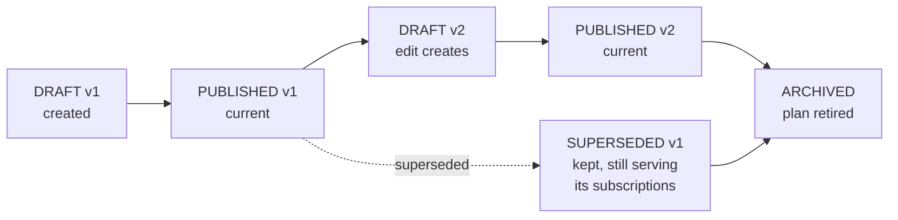
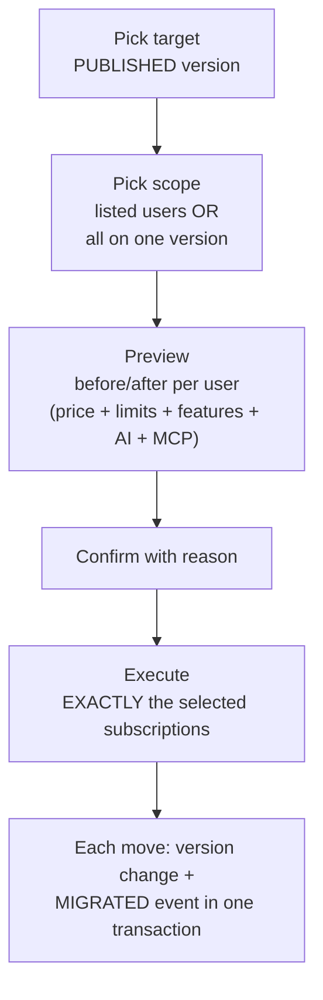

# Plan versioning (Admin Control Plane)

Plans are versioned and immutable: editing a plan never rewrites
an existing customer's terms. This doc is the versioning half of
Phase 4 — the behavior lives in `packages/modules/plans/`
(`@sendcms/plans`); the entitlements and metering that sit on top
of versions are in [usage-metering](./usage-metering.md) and
[plans-and-entitlements](./plans-and-entitlements.md).

## Contents

- [The rule in one sentence](#the-rule-in-one-sentence)
- [Lifecycle](#lifecycle)
- [What an edit does](#what-an-edit-does)
- [Publishing](#publishing)
- [Duplicate and archive](#duplicate-and-archive)
- [Subscriptions stay pinned](#subscriptions-stay-pinned)
- [Migration workflow](#migration-workflow)
- [Rollback is a migration](#rollback-is-a-migration)
- [Version comparison](#version-comparison)
- [Entitlement checks use the effective version](#entitlement-checks-use-the-effective-version)
- [Audit](#audit)
- [What is not built](#what-is-not-built)

## The rule in one sentence

**A published plan version is never mutated; editing a plan
creates a new draft version, and subscriptions stay on the
version they were assigned until an explicit migration moves
them.**

## Lifecycle

| Status       | Meaning                                                                                               |
| ------------ | ----------------------------------------------------------------------------------------------------- |
| `DRAFT`      | Being edited; not purchasable, not assignable (a subscription target must be `PUBLISHED`)             |
| `PUBLISHED`  | The plan's current version — what new subscriptions get and what public pricing shows                 |
| `SUPERSEDED` | Was published, replaced by a newer published version; **still serves the subscriptions pinned to it** |
| `ARCHIVED`   | The plan is retired; existing subscriptions on its versions keep working                              |

`PlanVersion.version` increments per plan (1, 2, 3…), unique per
plan (`@@unique([planId, version])`). `Plan.currentVersionId`
points at the current published version (or null when the plan
is archived / has no published version).

## What an edit does

Editing a plan's price, limits, AI config, or MCP config calls
`createPlanVersion`: a new `DRAFT` version copying the current
version's values with the edits applied. Nothing about the old
version changes — not its price, not its entitlements, not its
status. There is no "edit in place" path for a published
version in the service; the API has no endpoint for it.

The entitlements on every version are validated by
`PlanEntitlementsSchema` (strict Zod) at write time and parsed
at read time:

| Key                                          | Meaning                                                                 |
| -------------------------------------------- | ----------------------------------------------------------------------- |
| `forms`, `domains`, `submissionsPerMonth`    | `number` limit, or `null` = unlimited                                   |
| `apiKeys`                                    | Always a `number` (an unbounded key count is an abuse vector)           |
| `aiRequestsPerDay`                           | `number`, or `null` = unlimited                                         |
| `mcpRequestsPerMinute`, `mcpRequestsPerHour` | `number`, or `null` = "use the platform default" (120/min + 2000/hour)  |
| `aiProviders`                                | Allowlist subset of openai / anthropic / google / deepseek / openrouter |
| `aiByokAllowed`, `aiPlatformAllowed`         | Whether the plan permits BYOK / platform AI                             |
| `features`                                   | Free-form feature flags (strings)                                       |

## Publishing

`publishPlanVersion` (capability `PUBLISH_PLAN_VERSIONS`,
reason required) sets the draft as the plan's current version
and **supersedes** the previously published one — in one
transaction, so the plan never points at two current versions
and never points at none mid-publish. Publishing does not touch
any subscription: every existing subscription keeps its
`planVersionId`, and its terms are unchanged. New subscriptions
(and the public pricing page) use the new current version from
that moment on.

## Duplicate and archive

- `duplicatePlan` copies the current version's entitlements
  into a new plan as version 1 `DRAFT` (new slug, new name) —
  the fast path for "same limits, different price".
- `archivePlan` retires the plan and its draft/published
  versions and clears `currentVersionId`. Existing subscriptions
  on its versions keep working — archiving is not a
  cancellation. A plan cannot be deleted while a subscription
  points at it (`planId` is `Restrict` on `Subscription`).

## Subscriptions stay pinned

`Subscription.planVersionId` is the **effective version**. It is
set once, at assignment (`assignSubscription` — in one
transaction: cancel any existing active subscription with a
`CANCELED` event, create the new one with a `CREATED` event;
the target version must be `PUBLISHED`). It changes only by an
explicit migration (below) or by a webhook activation that
reuses the same assign flow. One `ACTIVE` subscription per user,
enforced in the service transaction.

`SubscriptionEvent` is the append-only history of those
changes: `CREATED` / `MIGRATED` / `RENEWED` / `CANCELED` /
`EXPIRED` / `REACTIVATED`, with `fromPlanVersionId` /
`toPlanVersionId`, the admin, and the reason. It is never
edited and never deleted — the proof that a customer's terms
only ever changed by an explicit, audited action.

## Migration workflow

The admin moves subscriptions between versions in four steps
(the admin UI is a wizard: target → scope → preview →
confirm). The service functions are `getMigrationPreview` and
`executeMigration` in `@sendcms/plans`.

- **Preview** lists which subscriptions the migration would
  touch: either the listed users' active subscriptions, or
  every active subscription on a given version. Each affected
  user gets a before/after comparison (price, billing interval,
  trial days, every entitlement key). Users already on the
  target version (or with no active subscription) are listed in
  `skippedUserIds` — never touched. The preview shows the first
  100 users (`previewTruncated` says whether more exist).
- **Execute** applies the migration to **exactly** the selected
  user IDs (or, with `allOnVersionId`, to every active
  subscription on that version, resolved server-side — the
  wizard used to execute only the previewed first 100; fixed in
  Phase 4). Each subscription's version change and its
  `MIGRATED` event happen in one transaction, so a version
  change is never recorded without its event. Unselected
  subscriptions are never touched — proven by
  `tests/plans.test.ts`.
- **Reason required**, audited (`MIGRATE` on `SUBSCRIPTION`).
  Capability: `MIGRATE_SUBSCRIPTIONS`.

## Rollback is a migration

There is no "undo" and no history rewrite. Rolling back means
running a new migration back to the previous version — with its
own preview, reason, audit row, and `MIGRATED` events. The
history then shows the move forward and the move back, both
with their reasons and timestamps. That is deliberate: a
customer's terms history must be readable after the fact, not
rewritten to look as if the first migration never happened.

## Version comparison

`comparePlanVersions` returns a field-level before/after diff
(price, billing interval, trial days, every entitlement key).
The admin UI uses it for the version comparison view and the
migration preview uses the same shape per user. The diff is
computed from the stored versions, never from a cached copy —
two versions are compared by reading both rows.

## Entitlement checks use the effective version

Every entitlement check resolves through
`getEffectiveEntitlements(userId)` (see
[usage-metering](./usage-metering.md)), and the subscription
step reads the **subscription's** `planVersionId` — never the
plan's `currentVersionId`. A plan edit therefore cannot change
a single existing customer's limits, even for a second: the
check reads the pinned version. The one place the current
version is read is for _new_ subscriptions and public pricing
(`listPublishedPlans` returns PUBLISHED, non-private plans with
their current published version only).

## Audit

Every mutation writes an `AuditLog` row via `logAudit`
(best-effort): plan create / version create / publish /
archive / duplicate (`PLAN`), subscription assign / migrate /
cancel (`SUBSCRIPTION`), override set / remove
(`ENTITLEMENT`). Reasons are recorded in `detail` for publish,
migrate, assign, and overrides. No secrets are ever logged.
The audit trail itself is append-only — see
[admin-audit-trail](./admin-audit-trail.md).

## What is not built

- **No scheduled plan changes.** A dated "switch this plan on
  X" feature does not exist — migrations are explicit and
  immediate.
- **No payments in the versioning layer.** Subscriptions are
  admin-assigned or webhook-activated (Phase 8 billing); the
  versioning logic never invents a price.
- **No public pricing route in this layer.** Marketing pricing
  reads the same plan records (`listPublishedPlans`) in Phase 8;
  this layer builds the records and the admin contract only.
