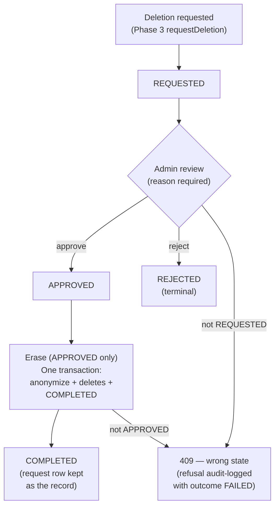

# Platform operations (Admin Control Plane, Phase 7)

Feature flags, announcements, audit log explorer, platform health,
abuse/spam queue, data export & deletion workflows, and translation
completion — the backend plus the admin pages that consume it. The
React Query hooks the pages need live in
`packages/modules/platform-ops/src/queries.ts`.

Branch: `feature/admin-control-plane` (live in production since 2026-11-23; not merged to `main`). Live verification against the real dev DB
is still owed.

## Contents

- [Feature flags](#feature-flags)
- [Announcements](#announcements)
- [Health + system](#health--system)
- [Abuse / spam queue](#abuse--spam-queue)
- [Deletion workflow](#deletion-workflow)
- [Translation completion](#translation-completion)
- [Support architecture prep](#support-architecture-prep)
- [React Query hooks](#react-query-hooks)
- [Tests](#tests)
- [Open items](#open-items)

Service module: `packages/modules/platform-ops/` (`@sendcms/platform-ops`)
— per-domain services (`flags`, `announcements`, `audit`, `health`,
`abuse`, `deletion`, `translations`) + `validators.ts` + `queries.ts` +
`service.ts` (barrel) + `index.ts`. Routes are thin handlers under
`apps/api/app/api/v1/` (21 routes, all in the api build). Authorization
lives in the services via `requireAdmin`, never in the routes — see
[authorization](./authorization.md). The one
new capability is `MANAGE_ANNOUNCEMENTS` (owner + SUPER_ADMIN only;
MANAGER and SUPPORT do not get it — announcements are a platform-wide
voice, not a support action). The audit trail these actions write is
documented in [admin-audit-trail](./admin-audit-trail.md).

## Feature flags

DB-backed (`FeatureFlag` + `FeatureFlagOverride`), NOT
`config/config.json`. An admin flips them from the admin UI with no
restart and no redeploy. The Phase 4 platform emergency flag in
`config/config.json` stays the separate restart-gated kill-switch —
it is not a flag in this registry and it is not toggled from here.
See [plans-and-entitlements](./plans-and-entitlements.md#the-emergency-flag).

Precedence: per-user override → global flag → off. An unknown key is
OFF — fail-closed. `isFeatureEnabled(key, userId?)` never throws: on
a DB error it returns `false` and logs, so a flag lookup can never
break the request that asked.

| Operation                      | Endpoint                                                 | Capability             |
| ------------------------------ | -------------------------------------------------------- | ---------------------- |
| List flags                     | `GET /api/v1/admin/features`                             | `MANAGE_FEATURE_FLAGS` |
| Create a flag (off by default) | `POST /api/v1/admin/features`                            | `MANAGE_FEATURE_FLAGS` |
| One flag                       | `GET /api/v1/admin/features/[key]`                       | `MANAGE_FEATURE_FLAGS` |
| Toggle the global switch       | `PATCH /api/v1/admin/features/[key]`                     | `MANAGE_FEATURE_FLAGS` |
| List a flag's overrides        | `GET /api/v1/admin/features/[key]/overrides`             | `MANAGE_FEATURE_FLAGS` |
| Set a per-user override        | `POST /api/v1/admin/features/[key]/overrides`            | `MANAGE_FEATURE_FLAGS` |
| Remove a per-user override     | `DELETE /api/v1/admin/features/[key]/overrides/[userId]` | `MANAGE_FEATURE_FLAGS` |

Flag keys match `^[a-z0-9][a-z0-9-]*$` (validated by
`FlagKeySchema`; the route validates it). Toggling a flag or setting
an override requires a reason (max 500 chars), and the change is
audited with the old/new values (`flag-toggled`,
`flag-override-set`, `flag-override-removed`). A duplicate key is a
409, never an upsert. Removing an override makes the global flag
apply again.

The two system flags are seeded (disabled) by migration
`20261125091400_wave8d_seed_platform_settings`, so they are visible
in `/admin/features` on a fresh deploy. Phase 7 shipped the registry

- API with no consumer wiring, by design — the wiring landed in
  Phase 8: `ai-spam-rescore` gates `rescoreNewSubmissions` and
  `ai-digest` gates `sendDueDigests` in `@sendcms/submissions` (flag
  missing/disabled = job off). See
  [ai-byok](./ai-byok.md#wiring-the-existing-capabilities) and
  [Deployment](../deployment.md#ai-background-jobs) for the
  post-deploy enable step.

## Announcements

Active = `isActive` AND inside the optional `[startsAt, endsAt]`
window (a null bound is open). Audience `ALL` shows on the customer
dashboard banner AND the admin overview; `ADMIN_ONLY` shows only in
the admin app. Announcements are never sent by email — they are read
from the active-announcements endpoint. They are never deleted:
deactivation is the way to take one down, so the record survives.

| Operation                                    | Endpoint                                             | Capability                   |
| -------------------------------------------- | ---------------------------------------------------- | ---------------------------- |
| List announcements (status/audience filters) | `GET /api/v1/admin/announcements`                    | `MANAGE_ANNOUNCEMENTS`       |
| Create (active by default)                   | `POST /api/v1/admin/announcements`                   | `MANAGE_ANNOUNCEMENTS`       |
| One announcement                             | `GET /api/v1/admin/announcements/[announcementId]`   | `MANAGE_ANNOUNCEMENTS`       |
| Edit fields, or flip the active switch       | `PATCH /api/v1/admin/announcements/[announcementId]` | `MANAGE_ANNOUNCEMENTS`       |
| Live announcements for the caller            | `GET /api/v1/announcements/active`                   | session-gated, no capability |

Title ≤ 200 chars, body ≤ 2000 chars; `endsAt` must be after
`startsAt` (validated by the schema). The PATCH accepts field
updates AND the active toggle in one endpoint: when `isActive` is
present the toggle wins and a reason is required; otherwise the
field update runs. Every write is audited
(`announcement-created`, `announcement-updated`,
`announcement-active-changed`, with old/new values).

The banner endpoint takes no actor and no capability — the ROUTE
decides the audience from the actor: admin callers (owner or any
staff adminRole) see `ALL` + `ADMIN_ONLY`; customer callers see
`ALL` only. The service takes the audience as a parameter.

## Health + system

Read-only, `VIEW_ADMIN_DASHBOARD`. Every number is a real query —
there is no fake uptime, no synthetic latency, no invented
deployment status.

`GET /api/v1/admin/health` (`getPlatformHealth`):

- `database` — `pingDatabase()` (latency in ms); a failed ping is
  reported as `disconnected` with 0 ms instead of throwing.
- `counts` — users, forms, domains, submissions today.
- `outbox` — pending `EmailJob` count + oldest pending age in
  minutes (null when nothing is pending).
- `ai` — today's `AiDailyUsage` total + count of enabled AI
  providers.
- `mcp` — `McpUsageRecord` calls in the last 24 h + error rate +
  the global kill-switch state (see
  [mcp-management](./mcp-management.md#the-global-kill-switch)).
- `emergency` — the Phase 4 emergency flag from
  `config/config.json` (`readPlatformConfig`).

`GET /api/v1/admin/system` (`getSystemSummary`):

- Node version (`process.version`), Postgres version (raw
  `SELECT version()`), Prisma client version
  (`Prisma.prismaVersion.client`).
- Required-env presence booleans ONLY (`DATABASE_URL`,
  `BETTER_AUTH_SECRET`, `RESEND_API_KEY`, `CRON_SECRET`,
  `AI_BYOK_MASTER_KEY`) — presence, never values.
- The config.json emergency flag.

## Abuse / spam queue

The list is METADATA ONLY — never the submission `data` (which may
hold PII). The full submission is a separate call that needs
`VIEW_SENSITIVE_SUBMISSIONS` and is audit-logged before the return
(the Phase 3 convention — the row records who looked at whose
submission).

| Operation                                               | Endpoint                                               | Capability                   |
| ------------------------------------------------------- | ------------------------------------------------------ | ---------------------------- |
| List submissions (status/form/user/search/date filters) | `GET /api/v1/admin/submissions`                        | `VIEW_CUSTOMER_DATA`         |
| Spam stats                                              | `GET /api/v1/admin/submissions/stats`                  | `VIEW_CUSTOMER_DATA`         |
| One submission WITH its `data`                          | `GET /api/v1/admin/submissions/[submissionId]`         | `VIEW_SENSITIVE_SUBMISSIONS` |
| Change status                                           | `POST /api/v1/admin/submissions/[submissionId]/status` | `MANAGE_USERS`               |

`getSpamStats` returns counts by status, the top-5 forms by SPAM
count, and the top-5 users by submission volume in the last 30 days
(groupBy, no N+1 — submissions carry no ownerId, so volume is
counted per form, then summed per owner in code).

Status changes reuse the inbox's own transition rules
(`resolveStatusAction` from `@sendcms/inbox`): the admin sets the
target status (`NEW` | `SPAM` | `ARCHIVED`, reason required) and the
service maps it onto the inbox action — a restore lands on `READ`,
never on `NEW`. An illegal transition is a no-op (`changed: false`),
not an error. The status update and the `SubmissionEvent` write run
in ONE transaction, and the change is audited with old/new values.

## Deletion workflow

State machine: `REQUESTED` → `APPROVED` or `REJECTED` → `COMPLETED`.
The request row is never deleted; it is the record that the erasure
happened.

| Operation                         | Endpoint                                           | Capability     |
| --------------------------------- | -------------------------------------------------- | -------------- |
| List requests (status filter)     | `GET /api/v1/admin/deletion-requests`              | `MANAGE_USERS` |
| Review (`APPROVED` \| `REJECTED`) | `POST /api/v1/admin/deletion-requests/[id]/review` | `MANAGE_USERS` |
| Execute the erasure               | `POST /api/v1/admin/deletion-requests/[id]/erase`  | `MANAGE_USERS` |

Review and erasure both require a reason. Only a `REQUESTED`
request can be reviewed and only an `APPROVED` request can be
erased; any other state is a 409, and the refusal is audit-logged
with outcome `FAILED` (see
[admin-audit-trail](./admin-audit-trail.md#failed-actions-are-recorded-never-dropped)).

### How a request starts

Phase 3's `requestDeletion` (in `@sendcms/admin-users`) now
creates the `DeletionRequest` row (status `REQUESTED`, same reason)
in the SAME transaction as the `User`-row update — the record and
the workflow share one source of truth. One open request per user:
a second request while one is `REQUESTED` or `APPROVED` is a 409.
The audit detail carries the new `deletionRequestId`.

### What the erasure does

The anonymization + all deletes run in ONE transaction; the request
flips to `COMPLETED` inside the same transaction. The state is
re-checked inside the transaction, so a request reviewed between the
guard read and the transaction cannot be erased. A concurrent
double-erasure is harmless (the anonymized values are deterministic
from the user id, and every delete is idempotent).

The `User` row is ANONYMIZED, not deleted (its id is the foreign
key of the billing/audit history): email →
`deleted-<last-8-of-id>@deleted.local`, name → `"Deleted user"`,
image → null, status `DISABLED`, statusReason `"Account erased"`,
`deletionCompletedAt` now, locale → null.

| Deleted                                                                                                    | Kept (billing/audit history must survive erasure) |
| ---------------------------------------------------------------------------------------------------------- | ------------------------------------------------- |
| OAuth accounts (credentials)                                                                               | `AuditLog`                                        |
| Sessions                                                                                                   | `Subscription`                                    |
| API keys (revoked, `revokedAt` now)                                                                        | `SubscriptionEvent`                               |
| BYOK keys (`UserAiKey` — credentials must be gone)                                                         | `UsageLedger`                                     |
| AI settings, MCP settings                                                                                  | `AiUsageRecord`                                   |
| Feature flag overrides, entitlement overrides                                                              | `McpUsageRecord`                                  |
| Admin notes ABOUT the user                                                                                 |                                                   |
| Domains + forms (cascade: fields, submissions + events, notification settings, email jobs, AI daily usage) |                                                   |

Guards (same as Phase 3): the `PLATFORM_OWNER` can never be
erased; self-erasure is forbidden (403). The erasure is audited
with the deleted-row counts in `detail`, never any PII.

## Translation completion

Read-only, `MANAGE_TRANSLATIONS`. Every comparison goes through
`@sendcms/i18n`'s loaders (`loadLocaleDomain` /
`loadLocaleAppDomain`) — never Node `fs` reads. A locale with no
files for a domain simply has every key missing; a load failure for
one domain never fails the whole report.

| Operation                                 | Endpoint                                         | Capability            |
| ----------------------------------------- | ------------------------------------------------ | --------------------- |
| Per-locale, per-domain completion vs `en` | `GET /api/v1/admin/translations`                 | `MANAGE_TRANSLATIONS` |
| One locale's domain JSONs as one bundle   | `GET /api/v1/admin/translations/[locale]/export` | `MANAGE_TRANSLATIONS` |

`getTranslationCompletion` returns, for every locale and every
domain (shared + admin + dashboard), `{ total, translated,
missingKeys[] }` plus an overall percent (`en` itself is always
100%). `exportTranslations` returns one locale's domain JSONs as a
single bundle for external review; an unknown locale is a 422.

NO write endpoints — no ordinary admin may overwrite translation
files from the browser (spec rule). Translation changes go through
the version-controlled workflow (see
[translation-management](./translation-management.md)). AI
translation is NOT built: it is permission-controlled, reviewable,
and deferred. The honest i18n state (en + ur complete, the other 8
locales coming-soon) is in
[internationalization](./internationalization.md).

## Support architecture prep

A design note, not a build: no separate support module was built in
this phase. What support staff use is the surface above — the abuse
queue (`VIEW_CUSTOMER_DATA` / `VIEW_SENSITIVE_SUBMISSIONS`), user
management (Phase 3), and the audit explorer — plus the per-user
AI/MCP tabs from Phases 5–6. The dedicated support workspace
(tickets, assignment, staff replies) shipped later as its own
module in Phase 8 — see [support](./support.md).

## React Query hooks

`packages/modules/platform-ops/src/queries.ts` (`PLATFORM_OPS_KEYS`
factory): `useFeatureFlags`, `useCreateFeatureFlag`,
`useSetFeatureFlag`, `useFlagOverrides`, `useSetFlagOverride`,
`useRemoveFlagOverride`, `useAnnouncements`,
`useCreateAnnouncement`, `useUpdateAnnouncement`,
`useSetAnnouncementActive`, `useActiveAnnouncements`,
`useAuditLogs`, `useAuditLog`, `usePlatformHealth`,
`useSystemSummary`, `usePlatformSubmissions`,
`usePlatformSubmission`, `useSpamStats`,
`useUpdatePlatformSubmissionStatus`, `useDeletionRequests`,
`useReviewDeletionRequest`, `useExecuteErasure`,
`useTranslationCompletion`. Mutations invalidate the matching list
keys; the two export endpoints have no hook (the admin UI downloads
them directly).

## Tests

`tests/platform-ops.test.ts` — 31 tests against a stateful
in-memory fake Prisma client (the REAL `logAudit` writer runs
against the fake DB, so the idempotency and `FAILED`-outcome proofs
exercise the real writer; only the database, the plans config read,
and the i18n loaders are stubbed). Proven: flag precedence
(override → global → false, unknown key off), reason-required
rejection, the announcement active window + audience filtering, audit
explorer filters, the module exporting NO AuditLog mutation, a
refused sensitive action recorded with outcome `FAILED`, the
deletion state machine + reject path + wrong-state 409s, erasure
(anonymize + revoke + delete, keep history), owner/self-erasure
refusals, translation completion detecting missing keys, and the
Phase 3 `requestDeletion` wiring (row + mirror in one transaction,
second call while open → 409).

Two test-file notes: the `@sendcms/i18n` mock only works because the
root `package.json` lists `@sendcms/i18n` as a devDependency — the
package has no root symlink otherwise, and `vi.mock` silently never
matches an unresolvable specifier (found while debugging the
translation tests). And the real `pingDatabase` closes over the REAL
Prisma client, not the mocked `db` export, so the test mocks it
directly.

## Open items

- No live verification against the real dev DB or a real MCP client
  (all proofs are mocked); live click-through of the admin UI is
  still owed now that the pages have landed.
- No per-tool quota (Phase 6 note, unchanged).

📌 Note: the Phase 7 text said the admin UI pages for this phase
land afterwards. They shipped — 8 new admin pages (`/admin/features`,
`/admin/announcements`, `/admin/audit-logs`, `/admin/health`,
`/admin/submissions`, `/admin/translations`, plus the overview and
system views) and the dashboard announcement banner.
