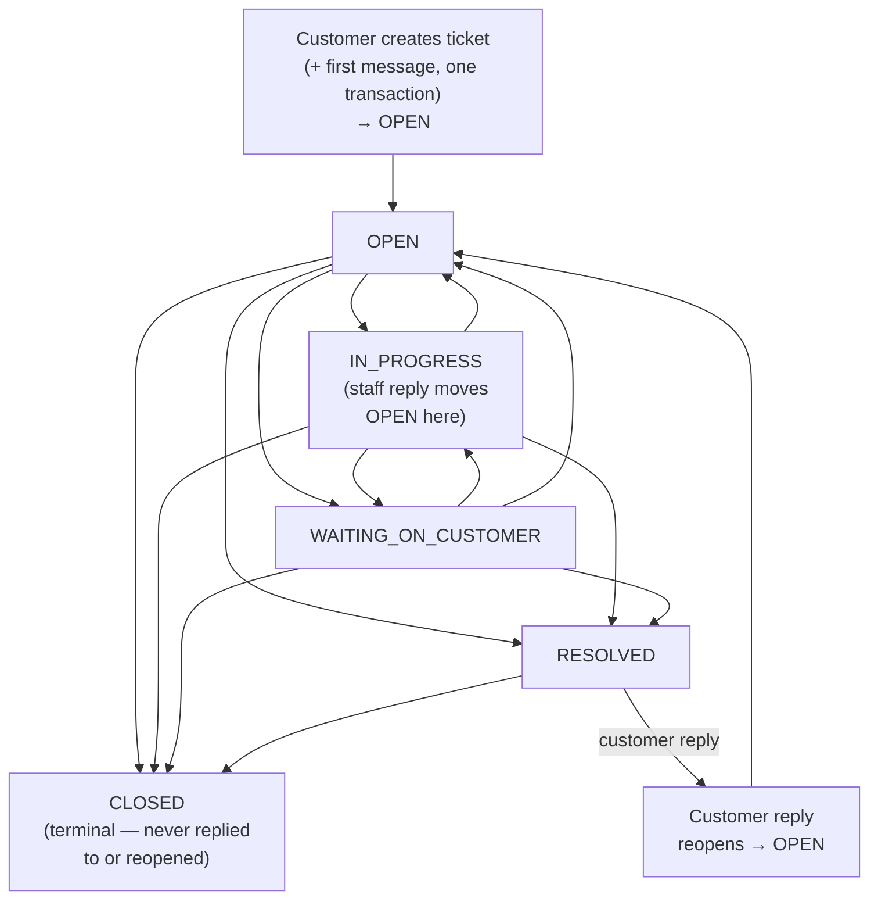

# Support tickets (Admin Control Plane, Phase 8)

Customer support tickets, dashboard-only: a signed-in user creates a
ticket from `/dashboard/support` when they have a problem. **There
is no ticket submission from marketing** — no public or anonymous
form. Staff answer from the admin app.

Branch: `feature/admin-control-plane` (live in production since 2026-11-23; not merged to `main`). The user's visual check of the pages is
still owed.

## Contents

- [What exists](#what-exists)
- [Ownership — a 404, never a 403](#ownership--a-404-never-a-403)
- [The status machine](#the-status-machine)
- [Ticket lifecycle](#ticket-lifecycle)
- [Who may do what](#who-may-do-what)
- [Pages (not dialogs)](#pages-not-dialogs)
- [i18n + tests](#i18n--tests)
- [What is NOT done / honest limits](#what-is-not-done--honest-limits)

## What exists

Service module: `packages/modules/support/` (`@sendcms/support`) —
`src/service.ts`, `src/validators.ts`, `src/queries.ts` (React Query
hooks for both apps), `src/transitions.ts` (the status machine, pure
— see below). Enforcement lives in the service, not in the routes or
the UI. Routes are thin handlers under `apps/api/app/api/v1/`.

Models: `SupportTicket` (owner `userId`, `subject`, `status`,
`priority`, `assignedToId`, `messages`) and `TicketMessage`
(append-only — `createdAt` only, never edited). `AuditResource`
gained `SUPPORT_TICKET`.

| Action                                                               | Who                | Route                                                  |
| -------------------------------------------------------------------- | ------------------ | ------------------------------------------------------ |
| Create a ticket (+ first message, one transaction)                   | Signed-in customer | `POST /api/v1/support/tickets`                         |
| List my tickets                                                      | Signed-in customer | `GET /api/v1/support/tickets`                          |
| Read my ticket + thread                                              | Signed-in customer | `GET /api/v1/support/tickets/[ticketId]`               |
| Reply to my ticket                                                   | Signed-in customer | `POST /api/v1/support/tickets/[ticketId]/reply`        |
| List every ticket (status / priority / assignee / search, paginated) | Staff              | `GET /api/v1/admin/support/tickets`                    |
| Read any ticket + thread                                             | Staff              | `GET /api/v1/admin/support/tickets/[ticketId]`         |
| Reply                                                                | Staff              | `POST /api/v1/admin/support/tickets/[ticketId]/reply`  |
| Change status (reason required)                                      | Staff              | `POST /api/v1/admin/support/tickets/[ticketId]/status` |
| Assign to a staff member (reason required)                           | Staff              | `POST /api/v1/admin/support/tickets/[ticketId]/assign` |
| Staff list (for the assign picker)                                   | Staff              | `GET /api/v1/admin/support/staff`                      |

## Ownership — a 404, never a 403

A customer sees and touches **only their own tickets**. Reading or
replying to another user's ticket is a **404**, never a 403 — a 403
would leak that the ticket exists. The ownership check doubles as
the not-found case.

## The status machine

`TICKET_TRANSITIONS` lives in `src/transitions.ts` — a pure module
with no runtime imports, so client components can import it without
pulling the service (and its `@sendcms/database` import) into the
browser bundle. The service imports it from there too. The admin UI
only offers the transitions the service will accept; anything else
is a **409**.

| From                  | Can move to                                                |
| --------------------- | ---------------------------------------------------------- |
| `OPEN`                | `IN_PROGRESS`, `WAITING_ON_CUSTOMER`, `RESOLVED`, `CLOSED` |
| `IN_PROGRESS`         | `WAITING_ON_CUSTOMER`, `RESOLVED`, `CLOSED`, `OPEN`        |
| `WAITING_ON_CUSTOMER` | `IN_PROGRESS`, `RESOLVED`, `CLOSED`, `OPEN`                |
| `RESOLVED`            | `OPEN`, `CLOSED`                                           |
| `CLOSED`              | — (terminal)                                               |

**CLOSED is terminal:** a closed ticket is never replied to or
reopened — the customer opens a new ticket instead. A customer reply
to a RESOLVED ticket **reopens it to OPEN**. A staff reply never
reopens a resolved ticket — the admin reopens it with an explicit
status change, or the customer reopens it by replying. A staff reply
moves `OPEN` / `IN_PROGRESS` / `WAITING_ON_CUSTOMER` tickets to
`IN_PROGRESS`; a RESOLVED ticket stays RESOLVED.

Status changes and assignments require a **reason** (max 500 chars)
and are audited with the old/new values — see
[admin-audit-trail](./admin-audit-trail.md). Closing asks for
confirmation first in the UI — it is final.

## Ticket lifecycle

## Who may do what

| Action                                   | Capability / role                      |
| ---------------------------------------- | -------------------------------------- |
| Read tickets (admin)                     | `VIEW_CUSTOMER_DATA`                   |
| Reply, change status, assign, staff list | `MANAGE_USERS` **or the SUPPORT role** |
| Create / read / reply to own tickets     | Any signed-in user (ownership only)    |

**SUPPORT staff do full ticket work** (owner decision, 2026-11-22:
support staff exist to answer tickets and queries). Replying,
changing a status, and assigning all need `MANAGE_USERS` or the
SUPPORT role — enforced in the service by `requireTicketWrite`
(`packages/modules/support/src/service.ts`). A plain signed-in user
gets a 403 on every admin ticket action. Assigning is restricted to
staff: the assignee must be the platform owner or hold a staff
`adminRole`, else **422**; an unknown assignee is a 404. Full role
matrix: see [authorization](./authorization.md).

Audit detail never carries a message body — only the subject, the
status/priority values, and the reason. Ticket bodies may hold
sensitive customer information.

## Pages (not dialogs)

Per the Phase 8 UX rule, everything is a proper page — a popup
appears only at confirmation time (closing a ticket). The same rule
applies to the billing checkout — see
[billing-providers](./billing-providers.md#public-plans--pricing-page).

- Dashboard: `/dashboard/support` (list: status filter, pagination,
  URL-as-state), `/dashboard/support/new` (new-ticket form page),
  `/dashboard/support/[ticketId]` (thread + reply form; CLOSED shows
  a read-only note). Server pages fetch via the service and pass
  `initialData`; client components use the React Query hooks.
- Admin: `/admin/support` (queue: debounced subject search,
  status/priority/assignee filters, pagination),
  `/admin/support/[ticketId]` (thread + reply + status change +
  assign). Sidebar: "Support" in the Operations group (admin) and in
  the Application group (dashboard), `RiCustomerServiceLine`.

## i18n + tests

- `packages/i18n/locales/{en,ur}/admin/support.json` (62 keys) and
  `{en,ur}/dashboard/support.json` (43 keys), real Urdu script in
  `ur`. `pnpm --filter @sendcms/i18n validate`: en + ur 100% in sync.
  (i18n is en + ur only — the other 8 locales are coming-soon by
  owner decision; see
  [internationalization](./internationalization.md).)
- Tests: `tests/support.test.ts`, 19 tests — ownership 404s (read +
  reply), `listMyTickets` only queries own tickets, reply reopens
  RESOLVED, reply to CLOSED 409 (customer + admin), invalid
  transitions 409 (CLOSED→OPEN, RESOLVED→IN_PROGRESS), assign 422
  for non-staff / 404 for unknown / success + audit for staff, plain
  user 403 on admin list and on reply, SUPPORT can read + reply +
  change status + assign, admin reply → IN_PROGRESS + audit,
  create-in-one-transaction + `ticket-created` audit. No real DB.

## What is NOT done / honest limits

- ⚠️ **No per-ticket notifications.** The customer is not emailed when
  staff reply — a follow-up through the outbox.
- **No customer-side search** (status filter only); no "unassigned"
  queue filter on the admin side (the assignee filter lists staff
  only).
- **No live verification.** Unit tests are mocked and the four app
  builds pass; the user's visual check of the pages is still owed.
