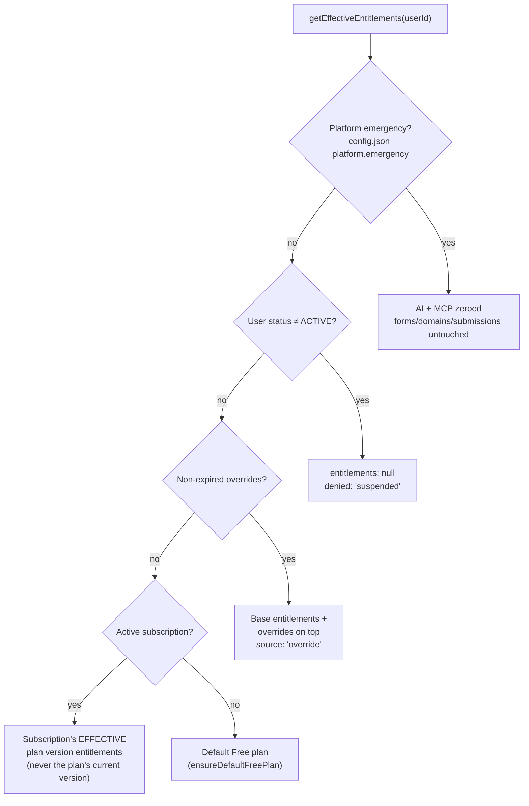

# Usage metering (Admin Control Plane)

How SendCMS measures what a user has consumed, which plan's limits
apply, and where those limits are enforced. The code is
`packages/modules/plans/` (`@sendcms/plans`); the behavior is
[plans-and-entitlements](./plans-and-entitlements.md) — this doc is
the metering half of that phase, written for the reader who needs
the precedence chain and the enforcement points in one place.

## Contents

- [The precedence chain](#the-precedence-chain)
- [The ledger](#the-ledger)
- [How "used" is computed per meter](#how-used-is-computed-per-meter)
- [Enforcement points](#enforcement-points)
- [AI usage records](#ai-usage-records)
- [MCP usage records](#mcp-usage-records)
- [What limits never do](#what-limits-never-do)
- [Known limitations](#known-limitations)

## The precedence chain

`getEffectiveEntitlements(userId)` in
`packages/modules/plans/src/service.ts` returns `{ entitlements,
source, planVersionId, denied?, emergency, overriddenMeters }`.
The checks run in this order — the first match wins:

1. **Platform emergency** — `platform.emergency` in the
   workspace-root `config/config.json`. When on, AI + MCP are
   zeroed for everyone. Forms, domains, and submissions are
   never restricted by this flag. The flag is read by
   `readPlatformConfig()`, cached per process, restart to apply.
   The emergency switch never disables form submission, the
   inbox, or any non-AI service.
2. **Suspension** — a non-`ACTIVE` user gets
   `entitlements: null` + `denied: "suspended"`. Their MCP keys
   stop working (checked explicitly in `checkMcpAccess`); their
   AI resolution throws; their submit quota is zero.
3. **Per-user overrides** — non-expired `EntitlementOverride`
   rows (one per meter, `value` null = unlimited, reason
   required, audited). Applied on top of the base entitlements;
   `source` becomes `"override"` and `overriddenMeters` lists
   them. `API_KEYS` and `MCP_REQUESTS` overrides cannot be null
   (rejected with 400).
4. **Active subscription** — the subscription's **effective plan
   version** entitlements (the `planVersionId` on the
   `Subscription` row), never the plan's current version. A plan
   edit creates a new version; existing subscriptions keep their
   terms.
5. **Default Free plan** — `ensureDefaultFreePlan()` creates the
   Free plan (slug `free`, published version 1) when none exists,
   idempotent under concurrency (unique-slug P2002 → re-read).
   Its version 1 mirrors the old hardcoded limits exactly (API
   keys 10, AI 100 calls/day, MCP 120/min + 2000/hour,
   everything else unlimited). If the admin deliberately
   archived the Free plan, the resolver falls back to the
   in-memory `FREE_PLAN_V1_ENTITLEMENTS` instead of resurrecting
   it. Never throws for a missing plan; 404 only for an unknown
   user.

The entitlements shape is `PlanEntitlementsSchema` (strict Zod)
— see [plan-versioning](./plan-versioning.md) for the keys. A
stored version that fails validation is corrupt data and fails
loudly (500), never silently enforced wrong.

## The ledger

`UsageLedger` (`packages/database/prisma/schema.prisma:911`) is
the append-only metering record: `userId`, `meter`, `quantity`,
`unit`, `period` (bucket start — month / day / hour, UTC),
`sourceEvent`, `idempotencyKey` (`@unique`), `resourceId`,
`createdAt` only.

- `recordUsage` returns the existing row on an
  `idempotencyKey` conflict instead of double-counting — a retry
  or double-submit never inflates usage.
- `getUsage` sums quantities for a user + meter in one bucket.
- `checkLimit(userId, meter)` returns `{ allowed, limit, used,
remaining }` from the effective entitlements + the current
  period.
- `consumeQuota` is check + record in one step; when over the
  limit nothing is recorded and `allowed` is false.
- The ledger is a reporting record for most meters — the live
  counts are the enforcement source (next section). There is no
  `UsageAggregate` table; aggregates are computed on read from
  the ledger / live counts, and the ledger is indexed for the
  admin's query patterns (`[userId, meter, period]`,
  `[userId, meter, createdAt]`).

## How "used" is computed per meter

| Meter          | "Used" is                                                              | Why not the ledger                                                             |
| -------------- | ---------------------------------------------------------------------- | ------------------------------------------------------------------------------ |
| `FORMS`        | Live count of the user's forms                                         | The ledger would drift from reality after deletes                              |
| `DOMAINS`      | Live count of the user's domains                                       | Same                                                                           |
| `API_KEYS`     | Live count of active keys                                              | Same; the hardcoded `MAX_ACTIVE_API_KEYS = 10` is kept as the fallback default |
| `SUBMISSIONS`  | `Submission` rows in the current calendar month                        | The ledger is a reporting record; the table is the truth                       |
| `AI_REQUESTS`  | `AiDailyUsage` counters summed across the user's forms for today (UTC) | Per-form daily counters, unchanged since Phase 12                              |
| `MCP_REQUESTS` | Current-hour `ApiKeyRateLimit` counters summed across the user's keys  | The per-minute limit is enforced per key in the MCP limiter                    |

## Enforcement points

Every enforcement point wraps the entitlement check so a
plans-module error never breaks the core path — the check
returns null and the operation proceeds with the platform
default (**fail-open**). The one exception is the submission
quota itself, which is the only limit that can reject a
submission (402).

| Operation                              | Limit                                         | Behaviour                                                                                                                                                                                  |
| -------------------------------------- | --------------------------------------------- | ------------------------------------------------------------------------------------------------------------------------------------------------------------------------------------------ |
| Form create (`@sendcms/forms`)         | `FORMS`                                       | 409 only when the limit is a number and the live count reaches it                                                                                                                          |
| Domain register (`@sendcms/domains`)   | `DOMAINS`                                     | Same pattern                                                                                                                                                                               |
| API key create (`@sendcms/api-keys`)   | `API_KEYS`                                    | Replaces the hardcoded 10 (kept as fallback)                                                                                                                                               |
| MCP `tools/call` (`@sendcms/mcp`)      | `mcpRequestsPerMinute` / `mcpRequestsPerHour` | Per-key-owner entitlements; the 120/min + 2000/hour constants stay as defaults when the entitlement is null or the lookup fails                                                            |
| AI rescore (`@sendcms/submissions`)    | `aiRequestsPerDay`                            | The cap **value** comes from the form owner's effective plan (was the global env default for every form); the per-form daily usage counter (`AiDailyUsage`) is unchanged                   |
| Public submit (`@sendcms/submissions`) | `SUBMISSIONS` (monthly)                       | **402 only when the submission quota itself is exhausted**; on accept, one `UsageLedger` row (idempotencyKey = submission id). IP rate limits are anti-abuse, not entitlements — untouched |

Proven by `tests/plans.test.ts` (43 tests) and the enforcement
tests in the form/domain/key suites.

## AI usage records

`AiUsageRecord` (`schema.prisma:1030`) is the per-call AI
attribution record — one row per model call, written
best-effort (`recordAiUsage` never throws) via the `onUsage`
callback the four capability functions gained in
`packages/ai`. See [ai-billing-and-access](./ai-billing-and-access.md).

| Field                    | Meaning                                                                                                                       |
| ------------------------ | ----------------------------------------------------------------------------------------------------------------------------- |
| `billingMode`            | `BYOK` / `PLATFORM` — **never mixed**. BYOK usage never consumes platform credits; platform usage is never attributed to BYOK |
| `tokensIn` / `tokensOut` | When the provider reports them (AI SDK 7 `inputTokens` / `outputTokens`); null otherwise                                      |
| `costMicros`             | Micro-dollars, **only** when the provider reports a reliable cost — never an estimate, never a price-table lookup             |
| `status`                 | `SUCCESS` / `FAILED` / `RETRY`                                                                                                |
| `sourceEvent`            | The purpose: `spam-rescore`, `digest`, `suggest-fields`, `draft-reply`, `key-test`                                            |
| `resourceId`             | Form / submission id                                                                                                          |

`getAiUsageSummary` returns BYOK and PLATFORM totals
separately — calls, success/failed, tokens, cost — plus a
total. They are never mixed. `listAiUsage` filters by user /
provider / billingMode / status / sourceEvent / date,
paginated. The admin AI usage pages read these two endpoints
(`VIEW_AI_USAGE`).

The AI rescore cap is a separate, older counter:
`AiDailyUsage` (form + day, Phase 12) counts the rescore calls
per form per day; Phase 4 changed only the cap **value** (from
the global env default to the form owner's
`aiRequestsPerDay`). A multi-form owner gets the same cap
applied per form.

## MCP usage records

`McpUsageRecord` (`schema.prisma:1128`) is the per-call MCP
record — one row per **executed** tool call, written
best-effort and awaited before the route returns:
`apiKeyId`, `userId`, `tool`, `status` (`SUCCESS` / `FAILED`),
`durationMs` measured around the call. **Never recorded:**
request arguments, results, or anything that could hold
customer data. Calls refused before execution (kill-switch,
suspended user, disallowed tool, over quota) record nothing.
See [mcp-management](./mcp-management.md).

The quota that gates those calls resolves per key in this
order: per-user override (`McpUserSettings.minuteLimit` /
`hourLimit`) → the key owner's effective plan entitlements
(`mcpRequestsPerMinute` / `mcpRequestsPerHour`) → the platform
defaults 120/min + 2000/hour. The counters are the
`ApiKeyRateLimit` rows (one per key, minute + hour fixed
windows); a call over the limit is rejected 429 **without**
incrementing the counter.

## What limits never do

- **AI limits never block form submissions.** Only the
  submission quota itself can reject a submission, with a 402.
  An AI limit, a billing failure, or a plans-module error never
  blocks the submit path (the check is fail-open and the ledger
  write is best-effort).
- **A failed BYOK key never silently switches the user to the
  platform key.** Resolution throws; the caller degrades to the
  non-AI behavior.
- **The emergency flag never disables submissions, the inbox,
  or non-AI services.** It zeroes AI + MCP only.
- **The MCP kill-switch never touches submissions, the inbox,
  or non-MCP services.** It is MCP-only by design.

## Known limitations

- The quota guards are pre-insert checks (count, then create),
  not serializable transactions — two concurrent creates at the
  exact limit can overshoot by one. This matches the codebase's
  existing pattern; the ledger provides the audit trail. A
  strict guarantee would need a DB-level counter per meter.
  (The admin-API rate limiter added in Phase 9 does not have
  this gap — its counter advances in a single atomic upsert.
  See [rate-limiting](./rate-limiting.md).)
- `checkLimit` for `MCP_REQUESTS` reports the hourly aggregate
  only; the per-minute limit is enforced per key inside the MCP
  limiter.
- The emergency flag is cached per process; changing
  `config/config.json` needs a server restart to take effect.
- There are no per-user platform-AI budgets beyond the plan's
  `aiRequestsPerDay` (enforced per form by the worker's daily
  cap). Per-user platform budgets are a follow-up.
