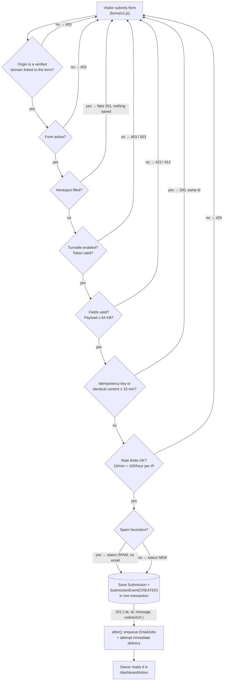
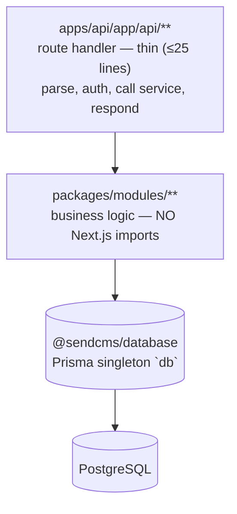
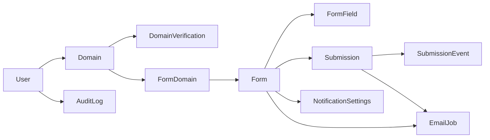

# Architecture

SendCMS is a contact-form backend. Any website embeds a form with one
script tag; submissions go to a public REST endpoint, are validated and
spam-checked, saved durably in Postgres, queued for email notification,
and read back in a dashboard inbox. The legacy comment system was
removed entirely on 2026-11-18 (owner-approved); nothing of it remains
in the schema, routes, or code.

Since the 2026-11-18 monorepo migration (see
[architecture/migration-final-report.md](architecture/migration-final-report.md)),
SendCMS is a pnpm + Turborepo monorepo: six Next.js apps, thirty-one
workspace packages, one standalone service. The root is a pure
workspace root — there is no app, `lib/`, or `public/` at the root.

📌 **Branch note:** this doc describes the `feature/admin-control-plane`
branch, which adds the sixth app (`apps/admin`) and the admin, billing,
AI, and MCP modules. That branch is **not merged to main and not
deployed**. Production is `sendcms.bond`, running the `feature/ai`
branch (see [Deployment](deployment.md)).

## Contents

- [System map](#system-map)
- [The apps and packages](#the-apps-and-packages)
- [Request flow — visitor submits a form](#request-flow--visitor-submits-a-form)
- [Authentication — admin only](#authentication--admin-only)
- [Layered architecture (hard rule)](#layered-architecture-hard-rule)
- [SDK architecture](#sdk-architecture)
- [Data model summary](#data-model-summary)
- [Security model](#security-model)
- [Scaling path](#scaling-path)

## System map

```mermaid
flowchart TB
    Site["Any site\n(Astro / Next.js / Hugo / plain HTML)\n<script src=\".../forms/v1.js\">"]
    Marketing["apps/marketing :3000\nlanding, terms, SEO"]
    Dashboard["apps/dashboard :3002\ncustomer app"]
    Admin["apps/admin :3006\nadmin control plane"]
    Docs["apps/docs :3003"]
    Updates["apps/updates :3004"]
    Api["apps/api :3001\nall REST routes + SDK bundle"]
    Worker["services/email-worker :3005\noutbox drain"]
    DB[("PostgreSQL\nPrisma — @sendcms/database")]

    Site -- "POST /api/public/v1/submit" --> Api
    Dashboard -- "/api/v1/* rewrite" --> Api
    Admin -- "/api/v1/* rewrite" --> Api
    Marketing -- "public /api/public/v1/*" --> Api
    Api --> DB
    Worker --> DB
```

The browser never talks to the database. Every submission goes
site → api app → service module → `@sendcms/database` → PostgreSQL.
The email worker reads the same database and drains the same outbox;
it never serves HTTP to the browser.

## The apps and packages

| App              | Port | Serves                                                                |
| ---------------- | ---- | --------------------------------------------------------------------- |
| `apps/marketing` | 3000 | Landing, terms, sitemap, robots                                       |
| `apps/api`       | 3001 | All API routes + the SDK bundle (`public/forms/v1.js`)                |
| `apps/dashboard` | 3002 | Auth pages + dashboard UI                                             |
| `apps/docs`      | 3003 | User docs, rendered from the repo's `docs/` dir                       |
| `apps/updates`   | 3004 | Changelog page                                                        |
| `apps/admin`     | 3006 | Admin control plane (`/admin/*`) — `feature/admin-control-plane` only |

| Package                     | What it is                                                                                                                                                                             |
| --------------------------- | -------------------------------------------------------------------------------------------------------------------------------------------------------------------------------------- |
| `packages/database`         | Prisma schema + migrations + client + health ping                                                                                                                                      |
| `packages/auth`             | Better Auth factory + providers + browser client                                                                                                                                       |
| `packages/permissions`      | Platform roles + capabilities                                                                                                                                                          |
| `packages/modules/*`        | Business logic — 15 modules: domains, forms, submissions, inbox, notifications, users, analytics, api-keys, admin-users, plans, ai-settings, mcp-admin, platform-ops, billing, support |
| `packages/email`            | Platform email: Resend/SMTP/none provider + auth mailer                                                                                                                                |
| `packages/queue`            | Email outbox queue: claim + retry state machine                                                                                                                                        |
| `packages/security`         | Shared security headers, CSP builder, rate limiter, step-up re-auth, the one `logAudit()` writer                                                                                       |
| `packages/observability`    | Structured logging (`createLogger(scope)`, JSON lines)                                                                                                                                 |
| `packages/shared`           | Framework-free helpers: `cn()`, `ApiError`, `apiFetch`, honeypot contract                                                                                                              |
| `packages/api-client`       | CORS, response/error helpers                                                                                                                                                           |
| `packages/sdk`              | Form SDK source (vanilla TS, esbuild → the bundle)                                                                                                                                     |
| `packages/ai`               | AI providers, spam re-scoring, digest, form-builder, reply drafts                                                                                                                      |
| `packages/mcp`              | MCP server (`POST /api/mcp`, 19 tools) — see [MCP](mcp.md)                                                                                                                             |
| `packages/i18n`             | Locale registry, translator, validation                                                                                                                                                |
| `packages/content`          | Markdown content loader (marketing/updates/docs)                                                                                                                                       |
| `packages/ui`               | shadcn/ui primitives + Logo + ThemeProvider                                                                                                                                            |
| `packages/config`           | Shared tsconfig + ESLint base                                                                                                                                                          |
| `services/email-worker`     | Standalone outbox worker                                                                                                                                                               |
| `infrastructure/cloudflare` | Shared OpenNext config + deploy README                                                                                                                                                 |

The full tree + alias table lives in the `project-guidelines` skill
(`folder-structure.md`). The architecture decisions are recorded in
`docs/architecture/decisions/` (ADR 0001–0010). The admin control
plane has its own architecture doc:
[admin-control-plane/architecture.md](admin-control-plane/architecture.md).

## Request flow — visitor submits a form



In order, the submit pipeline checks:

1. `forms/v1.js` enhances `<form data-cms-form>` on the visitor's
   site (loading / success / error states, duplicate-submit guard,
   honeypot).
2. `POST /api/public/v1/submit` — origin must be a verified domain
   linked to the form (else 403); the form must be active (else 403);
   a filled honeypot gets a fake 201 and nothing is saved; Turnstile
   (if enabled) is verified fail-closed; fields are validated against
   the form's `FormField` config (else 422); payloads over 64 KB get
   413; an idempotency key or identical content within 10 minutes
   returns 200 with the same id; rate limits are 10/min + 100/hour
   per IP plus the form daily limit (else 429); spam heuristics mark
   the submission SPAM, else NEW.
3. Durable save in one transaction: `Submission` +
   `SubmissionEvent(CREATED)` → `201 { ok, id, message, redirectUrl }`.
4. `after()`: enqueue `EmailJob`s (one per enabled
   `NotificationSettings` row) + `processEmailOutbox()` attempts
   immediate delivery.
5. `GET /api/cron/email-outbox` (Bearer `CRON_SECRET`) retries failed
   jobs (backoff 1m / 5m / 15m / 1h / 4h, 5 attempts) — or the email
   worker drains the same outbox every 30 s.
6. Dashboard: the owner reads the submission in `/dashboard/inbox`.

## Authentication — admin only

| System     | Who         | Mechanism                                                                                                  | Storage                   |
| ---------- | ----------- | ---------------------------------------------------------------------------------------------------------- | ------------------------- |
| Admin auth | Form owners | Better Auth 1.7.x — Google/GitHub/Facebook OAuth + email/password (verification required) → session cookie | Server session (database) |

There is no visitor auth: visitors never sign in, and the public API
takes no credentials — the `Origin` allowlist is its authorization.

Auth lives in the api app (the Better Auth handler is
`apps/api/app/api/auth/[...all]/route.ts`); the dashboard app has its
own thin `lib/auth.ts` wrapper because the apps run as separate
servers and cannot share an instance. Admin routes are gated by
`apps/dashboard/proxy.ts` (Next middleware — named `proxy.ts`, not
`middleware.ts`; matcher: `/dashboard/:path*`). Session lookup hits
Prisma, so the proxy runs on the Node.js runtime — it is NOT
edge-safe. Verification gates domain registration and submissions, not
dashboard access. Email/password sign-in is refused while the email is
unverified; OAuth trust varies by provider (Google: profile
`email_verified`; GitHub: `/user/emails` verified flag; Facebook: none —
those users get a verification email on sign-up). First user becomes
PLATFORM_OWNER via an atomic conditional UPDATE + partial unique index
(`User_single_platform_owner_idx`). The session cookie domain is
env-driven (`COOKIE_DOMAIN`, unset = host-only).

## Layered architecture (hard rule)



**Rule:** Route handlers never import `@sendcms/database` — they call
services. Zod schemas live in each module's `./validators` subpath and
are shared by routes and services. Response/error helpers live in
`@sendcms/api-client`. Audit logging goes through the one `logAudit()`
writer in `@sendcms/security`; server logging through
`createLogger(scope)` in `@sendcms/observability`.

## SDK architecture

The form SDK is a dependency-free vanilla-TS bundle
(`packages/sdk/`, built by esbuild to
`apps/api/public/forms/v1.js`, ~7 KB minified):

- **Auto-enhance** — every `<form data-cms-form>` on the page; config
  resolves form data attrs > `init()` options > script tag data attrs;
  API origin resolves script `src` origin > build-time `__APP_URL__`
  (the api app's URL — the bundle is served by the api app, so the
  script origin IS the submit API's origin).
- **SPA-safe** — `MutationObserver` picks up dynamically added forms;
  `astro:page-load` listener covers Astro transitions.
- **No style leakage** — the SDK only styles its own status element
  and the invisible honeypot field; host inputs are untouched.
- **Turnstile** — loaded lazily, only when a site key is configured;
  fail-closed (load failure blocks the submit).
- **No-JS fallback** — the same endpoint accepts a plain form POST and
  answers with a 303 redirect.

Full reference: [SDK](sdk.md). Embed guides: [Astro](embed-astro.md),
[Next.js](embed-nextjs.md), [Hugo](embed-hugo.md),
[plain HTML](embed-html.md).

## Data model summary



- `Domain.domain` is `@unique` (normalized hostname); `Form.id` is the
  public `formId`.
- `Submission.data` is `Json` (fields vary per form); `originDomain` is
  the observed origin host, denormalized on purpose.
- `Submission.status`: NEW | READ | STARRED | ARCHIVED | SPAM.
- `EmailJob` is the notification outbox (`PENDING` → `SENT`/`FAILED`,
  with retries). Verification and password-reset emails are sent
  directly, not through the outbox.
- `DomainVerification.challenge` is a 48-char random token, shared
  across the DNS TXT / meta-tag / file methods; 7-day TTL, 10 attempts.
- `AuditLog` records domain/form/submission/user actions (best-effort,
  never blocks the action) and never records submission content.

## Security model

See [Security](security.md) and the operations runbook
([operations/runbook.md](operations/runbook.md)). In short: Origin
allowlist per form, honeypot + Turnstile + spam heuristics, DB-backed
rate limits, idempotency + content-hash dedupe, durable save before
success, email verification gating, audit logs.

✅ **On this branch (Phase 9):** nonce-based CSP is enforcing on all
five page apps, and the admin API + auth sign-in routes are rate
limited — see
[admin-control-plane/csp.md](admin-control-plane/csp.md) and
[admin-control-plane/rate-limiting.md](admin-control-plane/rate-limiting.md).
Those close the deferred gap recorded in ADR 0008; they are **not
deployed** (this branch is unmerged).

## Scaling path

| Component     | Current                 | Scale-up path                                                                                                   |
| ------------- | ----------------------- | --------------------------------------------------------------------------------------------------------------- |
| Database      | Postgres (Prisma)       | Read replica for the inbox; partition submissions by month at very large volumes                                |
| Rate limiting | DB counts per IP        | Move to Redis/Upstash when the submission table grows hot                                                       |
| Email         | Resend (or SMTP)        | Provider already abstracted (`packages/email/src/provider.ts`); add a second provider behind the same interface |
| SDK bundle    | Single file, 7 KB       | CDN-hosted with long-lived cache headers                                                                        |
| Cron          | Single route, 100/calls | Split per-form or raise the limit with the cron schedule                                                        |
