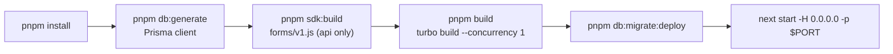

# Deployment

SendCMS is a pnpm + Turborepo monorepo (six Next.js apps, thirty-three
workspace packages, one standalone service) with PostgreSQL (Prisma)
and a vanilla-TS SDK bundle built by esbuild. It runs anywhere
Next.js runs — Vercel, Cloudflare Workers (OpenNext), plain Node /
Docker, Render, Netlify, and Railway are all supported; the
per-platform setup lives in
[deployment/platforms.md](deployment/platforms.md).

📌 **Production domain: `sendcms.bond` (decided 2026-11-20).**
Marketing `https://sendcms.bond`, api `https://api.sendcms.bond`,
dashboard `https://dashboard.sendcms.bond`, docs
`https://docs.sendcms.bond`, updates `https://updates.sendcms.bond`,
admin `https://admin.sendcms.bond`.
The `feature/admin-control-plane` branch is deployed to production on all six Vercel
projects — it is the live branch. (Last verified live 2026-11-23,
Phase 12: marketing, api, dashboard, and admin on `331cc73`, docs +
updates on `857a212` — see the live-commit table in
[production-readiness/live-sites-audit.md](production-readiness/live-sites-audit.md);
HEAD has since moved on, so the next round redeploys the current
HEAD. `feature/ai` was the previous live branch; `main` is not
production.) Deploys are **manual only** — auto-deploy on git
push is disabled via the Ignored Build Step (owner directive
2026-10-05); pushing to main triggers nothing. Follow the
[production deployment checklist](operations/deployment-checklist.md)
for every deploy round.

## Contents

- [Requirements](#requirements)
- [Environment variables](#environment-variables)
- [Database](#database)
- [Build and run](#build-and-run)
- [Health checks](#health-checks)
- [Email outbox cron](#email-outbox-cron)
- [Vercel notes](#vercel-notes)
- [Rollback](#rollback)
- [Cloudflare notes](#cloudflare-notes-phase-10--six-workers-one-per-app)

## Requirements

- Node.js 24+, pnpm 12
- PostgreSQL **17+ (minimum)** — docker-compose pins
  `postgres:17-alpine`, and the migrations rely on it: multi-value
  `ADD VALUE` on an enum needs Postgres ≥ 12 and `gen_random_uuid()`
  needs ≥ 13, both satisfied by 17. No lower version is supported;
  confirm the production database is 17+ before the first
  `migrate deploy` (the dev database is a Prisma Postgres instance
  at `db.prisma.io`).
- The environment variables below

## Environment variables

| Variable                                                                                                            | Required               | Notes                                                                                                                                                                                                         |
| ------------------------------------------------------------------------------------------------------------------- | ---------------------- | ------------------------------------------------------------------------------------------------------------------------------------------------------------------------------------------------------------- |
| `DATABASE_URL`                                                                                                      | yes                    | Postgres connection string. With Prisma Postgres, use `?sslmode=verify-full`.                                                                                                                                 |
| `BETTER_AUTH_SECRET`                                                                                                | yes                    | Random 32+ char secret (`openssl rand -base64 32`). No fallback — the app refuses to start auth without it.                                                                                                   |
| `BETTER_AUTH_URL`                                                                                                   | yes                    | The **api app's** public URL, e.g. `https://api.sendcms.bond` (the auth handler lives there).                                                                                                                 |
| `TRUSTED_ORIGINS`                                                                                                   | yes, in production     | Comma-separated origins allowed to call auth — the dashboard and admin apps' URLs.                                                                                                                            |
| `TRUSTED_PROXY_IPS`                                                                                                 | no                     | Comma-separated trusted proxy IPs for client-IP resolution (rate limiting). Only set behind a proxy you control — a wrong entry lets a client spoof its IP. Unset = no proxy trusted.                         |
| `NEXT_PUBLIC_APP_URL`                                                                                               | yes                    | The **marketing app's** public URL; baked into SDK snippets and email links.                                                                                                                                  |
| `NEXT_PUBLIC_API_URL`                                                                                               | yes                    | The api app's public URL (SDK bundle origin + submit API).                                                                                                                                                    |
| `NEXT_PUBLIC_DASHBOARD_URL`                                                                                         | yes                    | The dashboard app's public URL (auth callback + inbox links).                                                                                                                                                 |
| `NEXT_PUBLIC_DOCS_URL`                                                                                              | yes                    | The docs app's public URL.                                                                                                                                                                                    |
| `NEXT_PUBLIC_UPDATES_URL`                                                                                           | yes                    | The updates app's public URL.                                                                                                                                                                                 |
| `NEXT_PUBLIC_ADMIN_URL`                                                                                             | yes                    | The admin app's public URL (auth callback + admin links).                                                                                                                                                     |
| `NEXT_PUBLIC_AUTH_URL`                                                                                              | yes                    | The api app's public URL (the dashboard and admin apps' auth clients talk to it).                                                                                                                             |
| `COOKIE_DOMAIN`                                                                                                     | production only        | Session cookie domain, when the apps run on subdomains of one domain. Unset = host-only cookies.                                                                                                              |
| `LOG_LEVEL`                                                                                                         | no                     | Structured log level: `info` / `warn` / `error` (default `info`).                                                                                                                                             |
| `WORKER_PORT` / `WORKER_POLL_INTERVAL_MS`                                                                           | no                     | Standalone email worker: port (default 3005) and outbox poll interval in ms (default 30000). The worker binds `PORT` first when a platform injects it (Render/Railway), else `WORKER_PORT`.                   |
| `GOOGLE_CLIENT_ID` / `GOOGLE_CLIENT_SECRET`                                                                         | for Google sign-in     | Google Cloud Console → authorized redirect URI `<BETTER_AUTH_URL>/api/auth/callback/google`.                                                                                                                  |
| `GITHUB_CLIENT_ID` / `GITHUB_CLIENT_SECRET`                                                                         | for GitHub sign-in     | GitHub OAuth app → callback `<BETTER_AUTH_URL>/api/auth/callback/github`.                                                                                                                                     |
| `FACEBOOK_CLIENT_ID` / `FACEBOOK_CLIENT_SECRET`                                                                     | for Facebook sign-in   | Meta app → callback `<BETTER_AUTH_URL>/api/auth/callback/facebook`.                                                                                                                                           |
| `RESEND_API_KEY`                                                                                                    | for email              | Resend API key. The app's key is separate from any key stored in the Muse connector — set it here.                                                                                                            |
| `RESEND_FROM`                                                                                                       | with Resend            | A sending address on a **verified** Resend domain, e.g. `SendCMS <notifications@sendcms.bond>`.                                                                                                               |
| `RESEND_VERIFIED_DOMAINS`                                                                                           | no                     | Optional comma-separated domains verified in Resend — when set, `RESEND_FROM` must belong to one of them (validated at send time).                                                                            |
| `RESEND_WEBHOOK_SECRET`                                                                                             | no                     | Svix signing secret (`whsec_...`) for the Resend delivery webhook (`POST /api/webhooks/resend`). Without it the endpoint answers 503 and no delivery events are recorded.                                     |
| `SENDCMS_DEV_LOG_EMAIL_TOKENS`                                                                                      | no (dev only)          | Dev only: `1` logs full auth-email links (with tokens) instead of redacted ones. Never set in production — the tokens grant account access.                                                                   |
| `SMTP_HOST` / `SMTP_PORT` / `SMTP_USER` / `SMTP_PASS` / `SMTP_FROM`                                                 | SMTP fallback          | Used only when no Resend key is set.                                                                                                                                                                          |
| `CRON_SECRET`                                                                                                       | yes, for email retries | Bearer token for `GET /api/cron/email-outbox`. Without it the outbox still delivers immediately on submit, but retries after an outage never run.                                                             |
| `CRON_HEARTBEAT_URL`                                                                                                | no                     | Optional heartbeat ping URL for the cron run (env wins over `config/config.json` `monitoring.cronHeartbeatUrl`; unset = no ping).                                                                             |
| `TURNSTILE_SECRET_KEY`                                                                                              | for Turnstile          | Cloudflare Turnstile secret. Without it, Turnstile-enabled forms answer 503.                                                                                                                                  |
| `NEXT_PUBLIC_TURNSTILE_SITE_KEY`                                                                                    | for Turnstile          | Turnstile site key (public). The dashboard reads it at build time and injects it into the form embed snippet as `data-turnstile-site-key`; the SDK itself reads no environment variable.                      |
| `AI_PROVIDER`                                                                                                       | no                     | AI provider to use when more than one key is set: `openai` / `anthropic` / `google` / `deepseek` / `openrouter`. Unset = auto-detect from the keys present.                                                   |
| `OPENAI_API_KEY` / `ANTHROPIC_API_KEY` / `GOOGLE_GENERATIVE_AI_API_KEY` / `DEEPSEEK_API_KEY` / `OPENROUTER_API_KEY` | for AI                 | One provider key enables all AI features (spam re-scoring, digest, form-builder, reply drafts). No key = clean no-op; nothing is sent to a model.                                                             |
| `AI_MODEL`                                                                                                          | no                     | Model id override. Defaults: openai `gpt-4o-mini`, anthropic `claude-haiku-4-5`, google `gemini-3.5-flash-lite`, deepseek `deepseek-chat`, openrouter `openai/gpt-4o-mini`.                                   |
| `AI_SPAM_THRESHOLD`                                                                                                 | no                     | 0–100 (default 70). A re-scored submission at/above this is marked SPAM.                                                                                                                                      |
| `AI_DAILY_CALL_CAP`                                                                                                 | no                     | Model calls allowed per form per day (default 100).                                                                                                                                                           |
| `AI_DIGEST_INTERVAL_HOURS`                                                                                          | no                     | Inbox digest interval in hours (default 24 = daily; 168 = weekly).                                                                                                                                            |
| `AI_BYOK_MASTER_KEY`                                                                                                | for BYOK               | 32-byte base64 master key that encrypts customers' own AI keys at rest (envelope encryption). Without it BYOK keys cannot be saved (the platform key keeps working). Generate with `openssl rand -base64 32`. |
| `STRIPE_SECRET_KEY`                                                                                                 | for billing (Stripe)   | Stripe secret key (`sk_test_` / `sk_live_`). Required to enable Stripe.                                                                                                                                       |
| `STRIPE_MODE`                                                                                                       | no                     | Expected Stripe key mode (`test` \| `live`); unset derives from `NODE_ENV` (`production` → live, else test). A test key in production (or vice versa) is refused loudly at checkout.                          |
| `STRIPE_WEBHOOK_SECRET`                                                                                             | for billing (Stripe)   | Webhook signing secret (`whsec_...`) for `POST /api/public/v1/billing/webhooks/stripe`.                                                                                                                       |
| `PAYPAL_CLIENT_ID` / `PAYPAL_CLIENT_SECRET`                                                                         | for billing (PayPal)   | PayPal developer app credentials.                                                                                                                                                                             |
| `PAYPAL_MODE`                                                                                                       | for billing (PayPal)   | `sandbox` (default) or `live` — any other value is a 422 (BIL-009). Live only with live credentials.                                                                                                          |
| `PAYPAL_WEBHOOK_ID`                                                                                                 | for billing (PayPal)   | Webhook id subscribed to billing events; used to verify webhook signatures.                                                                                                                                   |
| `POLAR_ACCESS_TOKEN`                                                                                                | for billing (Polar)    | Polar access token.                                                                                                                                                                                           |
| `POLAR_ENVIRONMENT`                                                                                                 | for billing (Polar)    | `sandbox` (default) or `production` — any other value is a 422 (BIL-054). Sandbox and production tokens are separate.                                                                                         |
| `POLAR_WEBHOOK_SECRET`                                                                                              | for billing (Polar)    | Webhook secret for `POST /api/public/v1/billing/webhooks/polar`.                                                                                                                                              |
| `FREEMIUS_PRODUCT_ID`                                                                                               | for billing (Freemius) | Freemius product id; plan versions map to Freemius plan ids via `FREEMIUS_PLAN_MAP`.                                                                                                                          |
| `FREEMIUS_API_KEY` / `FREEMIUS_SECRET_KEY` / `FREEMIUS_PUBLIC_KEY`                                                  | for billing (Freemius) | Freemius API key, secret key, and public key from the Freemius dashboard.                                                                                                                                     |
| `FREEMIUS_PLAN_MAP`                                                                                                 | for billing (Freemius) | JSON object mapping SendCMS plan version ids to Freemius plan ids; a version with no mapping cannot be sold through Freemius.                                                                                 |
| `FREEMIUS_SANDBOX`                                                                                                  | for billing (Freemius) | `"true"` = sandbox, `"false"` = production; unset = sandbox outside production, production when `NODE_ENV=production`.                                                                                        |
| `GUMROAD_APP_ID` / `GUMROAD_APP_SECRET`                                                                             | no — registered only   | Not required and read by no code (BIL-051 — owner decision 2026-11-28: Gumroad stays registered-only). Gumroad has no checkout or webhook in SendCMS; manual activation only.                                 |
| `PORT`                                                                                                              | platform-injected      | The email worker binds `PORT` first when a platform injects it (Render/Railway), else `WORKER_PORT` (default 3005). Do not set locally.                                                                       |

### Per-project env (Vercel) — only what each project needs

The six Vercel projects used to carry the identical 29-var set, so a
leak of any one project's env exposed the whole platform's secrets
(Phase 16, LVE-020). Each project carries **only** the vars its code
reads — the lists below are the authority, verified against the
`process.env` reads in each app and the packages it imports. Remove
any var not listed for a project from that project's settings.

| Project (`sendcms-*`) | Vars it needs                                                                                                                                                                                                                                                                                                                                                                                                                                                                                                                                                                         |
| --------------------- | ------------------------------------------------------------------------------------------------------------------------------------------------------------------------------------------------------------------------------------------------------------------------------------------------------------------------------------------------------------------------------------------------------------------------------------------------------------------------------------------------------------------------------------------------------------------------------------- |
| `sendcms` (api)       | Everything: `DATABASE_URL`, `BETTER_AUTH_SECRET`, `BETTER_AUTH_URL`, `TRUSTED_ORIGINS`, `COOKIE_DOMAIN` (production), all `NEXT_PUBLIC_*_URL` vars, OAuth `GOOGLE_` / `GITHUB_` / `FACEBOOK_CLIENT_ID` + `_SECRET`, `RESEND_API_KEY`, `RESEND_FROM`, `SMTP_*`, `CRON_SECRET`, `TURNSTILE_SECRET_KEY`, AI keys + `AI_PROVIDER` / `AI_MODEL` / `AI_SPAM_THRESHOLD` / `AI_DAILY_CALL_CAP` / `AI_DIGEST_INTERVAL_HOURS` / `AI_BYOK_MASTER_KEY`, billing keys (`STRIPE_*`, `PAYPAL_*`, `POLAR_*`, `FREEMIUS_*` — no `GUMROAD_*`: nothing reads them, BIL-051).                             |
| `sendcms-dashboard`   | `DATABASE_URL`, `BETTER_AUTH_SECRET` (**same value as api** — they share the session), `BETTER_AUTH_URL`, `COOKIE_DOMAIN` (production, same value as api), `NEXT_PUBLIC_APP_URL`, `NEXT_PUBLIC_API_URL`, `NEXT_PUBLIC_DASHBOARD_URL`, `NEXT_PUBLIC_DOCS_URL`, `NEXT_PUBLIC_UPDATES_URL`, `NEXT_PUBLIC_ADMIN_URL`, `NEXT_PUBLIC_AUTH_URL`, `NEXT_PUBLIC_TURNSTILE_SITE_KEY` (only when forms use Turnstile — the dashboard injects it into the embed snippet). No OAuth secrets, no mail keys, no `CRON_SECRET`, no billing/AI keys — the auth handler and mailer live on the api app. |
| `sendcms-admin`       | Same as dashboard, plus `NEXT_PUBLIC_ADMIN_URL` (its own public URL, used for the sign-in callback).                                                                                                                                                                                                                                                                                                                                                                                                                                                                                  |
| `sendcms-marketing`   | Only public URLs: `NEXT_PUBLIC_APP_URL`, `NEXT_PUBLIC_API_URL`, `NEXT_PUBLIC_DASHBOARD_URL`, `NEXT_PUBLIC_UPDATES_URL`. No secrets at all — no `DATABASE_URL`, no `CRON_SECRET`, no `SMTP_*`, no OAuth secrets.                                                                                                                                                                                                                                                                                                                                                                       |
| `sendcms-docs`        | Only public URLs: `NEXT_PUBLIC_APP_URL`, `NEXT_PUBLIC_DOCS_URL`. No secrets at all.                                                                                                                                                                                                                                                                                                                                                                                                                                                                                                   |
| `sendcms-updates`     | Only public URLs: `NEXT_PUBLIC_APP_URL`, `NEXT_PUBLIC_UPDATES_URL`. No secrets at all.                                                                                                                                                                                                                                                                                                                                                                                                                                                                                                |

Notes: `TRUSTED_ORIGINS` is set on the **api** project only (the auth
handler reads it); the dashboard/admin apps' own Better Auth instances
do session lookups, not OAuth callbacks, so they do not need it. The
standalone email worker is not a Vercel project — it needs
`DATABASE_URL`, `RESEND_API_KEY` / `RESEND_FROM` (or `SMTP_*`), and
`WORKER_PORT` / `WORKER_POLL_INTERVAL_MS` only.

Copy `.env.example` to `.env` for local development. Never commit
`.env` (it is gitignored). The seed script (`pnpm db:seed`) creates
SendCMS demo data — a verified demo user, domain, form, and sample
submissions. It is idempotent and safe to re-run; demo data only, never
run it against a production database.

## Database

```bash
pnpm install
pnpm db:generate      # regenerate the Prisma client
pnpm db:migrate       # prisma migrate dev — create + apply (local only)
pnpm db:migrate:deploy # prisma migrate deploy — apply on a server (production)
```

Migrations are additive. Apply with `prisma migrate deploy` — never
`db:reset` on a live database (it is destructive and requires typed
confirmation for that reason). Before any destructive migration
(`DROP TABLE` / `DROP COLUMN`), follow the pre-migration backup
checklist and schema-rollback procedure in the
[runbook](operations/runbook.md#database-backup-migrations-and-rollback).

Seeding: `pnpm db:seed` is the supported path — it runs
`packages/database/prisma/seed.ts` (demo data: verified demo user,
domain, form, sample submissions; idempotent, safe to re-run; demo
data only, never on production). There is no root `prisma.seed` key
(DOC-031: the old key pointed at a `prisma/seed.ts` that does not
exist, so it was deleted); `prisma db seed` from the repo root is
not supported — use `pnpm db:seed`.

Connection pool (Phase 16, DB-036): each process opens its own pool
of 5 connections (`packages/database/src/client.ts` — `max: 5`), so
the platform holds ~35 connections against Postgres (6 apps + the
email worker) with no PgBouncer/pooler in front of it. That is the
deliberate budget for one small Postgres — do not raise `max` per
process without counting the platform-wide total first. A
`statement_timeout` of 30 s is set on every connection so a runaway
query fails fast instead of wedging a pool connection indefinitely;
30 s is generous against the slowest legitimate queries (admin
overview fan-out, digest aggregation), which complete in milliseconds
to low seconds on indexed data.

## Build and run



```bash
pnpm build            # prisma generate + SDK build + turbo build (sequential, --concurrency 1)
pnpm dev              # same generation steps, then turbo dev (all 6 apps + the email worker)
```

Each app also has a `build:server` script — the single command every
non-Cloudflare platform builds with (Prisma generate, then the SDK
bundle for the api app, then `next build`):

```bash
pnpm --filter @sendcms/<app> build:server   # marketing | api | dashboard | docs | updates | admin
```

`pnpm dev` does the same generation steps, then starts the dev
servers with Turbopack (marketing :3000, api :3001, dashboard :3002,
docs :3003, updates :3004, worker :3005, admin :3006). The SDK bundle
(`apps/api/public/forms/v1.js`) is built from source and gitignored —
never commit it, and make sure CI builds it before testing (the CI
workflow runs `pnpm db:generate` and `pnpm sdk:build`). There is no
root `pnpm start` — each app is started from its own directory
(`pnpm --filter @sendcms/<app> start`) or deployed to its own host.

## Health checks

Three different health endpoints exist — do not confuse them:

| Endpoint               | Service                 | Auth | Response                                                                                                                                                                                                                                                                         |
| ---------------------- | ----------------------- | ---- | -------------------------------------------------------------------------------------------------------------------------------------------------------------------------------------------------------------------------------------------------------------------------------- |
| `GET /api/health`      | api app                 | none | Cheap liveness: `{ "status": "ok", "uptimeSeconds": <seconds> }`. Touches no database, no service, no I/O — a dead database cannot fail it. Point load-balancer / orchestrator liveness checks here.                                                                             |
| `GET /api/health/deep` | api app                 | none | Proves the database is reachable: `{ "status": "ok" \| "error", "database": "connected" \| "disconnected", "latencyMs": <ms>, "timestamp": "<ISO>", "lastCronRun": <ISO \| null> }`. Use where the DB signal matters (docker-compose and `render.yaml` healthchecks point here). |
| `GET /health`          | standalone email worker | none | The worker's health on `WORKER_PORT` (default 3005): polling state, the last run's counts, and the last error. A different service on a different port — not the api app's `/api/health`.                                                                                        |

## Email outbox cron

Submission notifications are delivered immediately on submit (via
`after()`), and failed deliveries are retried by the cron route:

```http
GET /api/cron/email-outbox
Authorization: Bearer <CRON_SECRET>
```

It processes up to 100 due jobs per call. The root `vercel.json`
schedules it **once daily** (`0 0 * * *`, midnight UTC) — the Hobby
plan allows one cron per day, and the owner chose to stay on Hobby
for now (2026-11-20). To go faster later, change the schedule back
to `*/5 * * * *` (or use an external cron service) when the plan
allows it.

Effective retry timing follows the drain, not the ladder alone: the
retry ladder is 1m / 5m / 15m / 1h / 4h over 6 attempts, but with a
once-daily drain a failed job's `nextAttemptAt` passes hours before
the next invocation, so attempts happen on consecutive days and the
job goes terminal `FAILED` after 6 days. With the standalone worker
running (every 30 s) or a 5-minute cron, the ladder paces as written.

```json
{
  "crons": [{ "path": "/api/cron/email-outbox", "schedule": "0 0 * * *" }]
}
```

⚠️ **The route needs the `Authorization` header.** On Vercel, setting
`CRON_SECRET` makes Vercel send `Authorization: Bearer <CRON_SECRET>`
automatically on cron invocations — no proxy is needed. An external
scheduler must send the header itself, and a Cloudflare Cron Trigger
invokes directly with no HTTP (and therefore no header). Without the
header the route answers 401; without `CRON_SECRET` set at all it
answers 503. (See [Email notifications](email-notifications.md).)

### AI background jobs

The same cron hit also runs the two AI background jobs
(`apps/api/app/api/cron/email-outbox/route.ts`; the standalone
email worker runs them too):

- **AI spam re-scoring** — `rescoreNewSubmissions` re-scores
  unscored NEW submissions on AI-enabled forms.
- **AI inbox digest** — `sendDueDigests` sends due per-form digests.

Both jobs are gated on DB-backed feature flags
(`packages/modules/platform-ops/src/flags.ts`, `SYSTEM_FLAGS`):

| Flag key          | Job                | Seeded state |
| ----------------- | ------------------ | ------------ |
| `ai-spam-rescore` | AI spam re-scoring | disabled     |
| `ai-digest`       | AI inbox digest    | disabled     |

The flags are seeded (disabled) by migration
`20261125091400_wave8d_seed_platform_settings`, so they are visible
in `/admin/features` on a fresh deploy. **Post-deploy step:** enable
each flag there (with a reason — toggling is audited) once a platform
AI key is configured; until then the jobs return zero-count no-ops by
design (a missing or disabled flag turns its job off, fail-closed),
which is why "AI is on but nothing is re-scored and no digest
arrives" means "the flag is still off", not a broken cron. The flags
are system flags — they cannot be deleted, only disabled (deleting
one would silently disable its job).

## Vercel notes

- One project per app (see [deployment/platforms.md](deployment/platforms.md)
  for the table). Deploys are **manual only** — the Ignored Build Step
  ("Don't build anything") cancels git-triggered deploys; deploy from
  the dashboard or via the agent when tested and ready — follow the
  [production deployment checklist](operations/deployment-checklist.md),
  which verifies every project serves the same commit.
- Set every variable above in each project's settings before the
  first deploy. `NEXT_PUBLIC_APP_URL` must be the production URL or
  SDK snippets and email links will point at the wrong host.
  `BETTER_AUTH_SECRET` must be the same value on the api, dashboard,
  and admin projects.
- Sixth project `sendcms-admin`: build
  `pnpm --filter @sendcms/admin build:server`, output
  `apps/admin/.next`, host `admin.sendcms.bond` — live on the
  `feature/admin-control-plane` branch like the other five. Set `DATABASE_URL`, `BETTER_AUTH_SECRET` (same
  value as api + dashboard), `BETTER_AUTH_URL`, and the
  `NEXT_PUBLIC_*_URL` vars (including
  `NEXT_PUBLIC_ADMIN_URL=https://admin.sendcms.bond`) before the
  first deploy — and add `https://admin.sendcms.bond` to the
  **api** project's `TRUSTED_ORIGINS`, or the auth handler refuses
  the admin origin.
- `BETTER_AUTH_URL` must be `https://api.sendcms.bond` (the auth
  handler lives only on the api app). OAuth redirect URIs for Google,
  GitHub, and Facebook are set in their consoles; sign-in is verified
  working.

## Rollback

(LVE-013 — added Phase 16, Wave 12. Until this section existed,
there was no written way back from a bad deploy on any platform.)

A rollback returns the **code** to a previous deployment. It never
rolls back the **database**: migrations are additive by design (no
down migrations), so a rolled-back build runs against the newer
schema — check that the old code tolerates it before rolling back,
and if the bad deploy included a migration, read the schema-rollback
procedure in the
[runbook](operations/runbook.md#database-backup-migrations-and-rollback)
(restore from the pre-migration backup) instead of, or as well as,
the code rollback below. A rollback also never reverts environment
variables changed since the good deployment — re-check them.

After any rollback, run the smoke URLs in the
[deployment checklist](operations/deployment-checklist.md) (§2–§3)
and confirm the live commit is the rolled-back one before calling
the incident over. Then fix forward: `git revert` the bad commit
(or fix it), re-run the gates, and redeploy via the checklist —
a rollback is a mitigation, not the fix.

### Vercel (the live platform)

Instant Rollback re-points the production domain at an existing
deployment — no rebuild, seconds. Dashboard: open the project →
Deployments → the three-dot menu on the last known-good deployment
→ **Instant Rollback** → confirm. CLI:
`vercel rollback <deployment-url>`. On the **Hobby** plan you can
only roll back to the immediately previous production deployment;
Pro/Enterprise can pick any deployment that was once live on the
production domain. After a rollback Vercel turns **off**
auto-assignment of production domains — new pushes build but do
not go live until you promote a deployment (dashboard → Deployments
→ ⋯ on the fixed deployment → **Promote**, or `vercel promote`).
Alternative when the code is fine but the build was not (flaky
install, a just-fixed env var): **Redeploy** the same deployment
instead — it rebuilds, so it takes as long as a normal deploy.

### Render

Dashboard: the service → Deploys → the previous deploy →
**Rollback** (Render keeps the last 5 builds on Hobby, 15 on Pro,
30 on Scale). A rollback disables auto-deploy on the service —
re-enable it afterwards, or the next push will not deploy. On the
free plan `preDeployCommand` never runs, so the manual
`pnpm db:migrate:deploy` gate in the
[runbook](operations/runbook.md#deploy-gate--render-free-plan-lve-015)
applies to the rollback target too: confirm the schema the old
code expects is what the database has.

### Cloudflare Workers

`wrangler rollback [VERSION_ID]` from the app directory (no ID =
the previous version), or dashboard → Workers & Pages → the Worker
→ Deployments → the three-dot menu on the version → **Rollback**.
You can only roll back to the 100 most recently published versions,
and versions older than 30 days may be deleted. `wrangler versions
list` shows what is available. A rollback creates a new deployment
at 100% of traffic for the selected version — it does not change
git, so follow up with a roll-forward fix.

### Netlify

Dashboard: the site → Deploys → the previous deploy → **Publish
deploy**. That deploy becomes production immediately (no rebuild).

### Railway / Node / Docker

Redeploy the previous build: Railway dashboard → the service →
Deployments → ⋯ on the previous deployment → **Redeploy**; on a
Node/Docker host, check out the previous commit (or re-tag the
previous image) and rebuild/restart with `build:server` — the
platform has no one-click rollback, so the previous image tag (or
commit SHA) is the rollback artifact. Keep it recorded in the
deploy round note.

## Cloudflare notes (Phase 10 — six Workers, one per app)

- Each app deploys as its own Worker — see
  `infrastructure/cloudflare/README.md` for the table, the dashboard
  steps, and the production URLs. The api app keeps the
  worker name `sendcms`; the others are `sendcms-marketing`,
  `sendcms-dashboard`, `sendcms-docs`, `sendcms-updates`,
  `sendcms-admin`.
- The Worker entry is `.open-next/worker.js` (OpenNext adapter);
  each app's `wrangler.jsonc` holds the R2 cache bucket, the Images
  binding, and the self-reference service binding. The build command
  must be the full chain — `pnpm --filter @sendcms/database
db:generate && pnpm -w run sdk:build && npx @opennextjs/cloudflare
build` (also in each `wrangler.jsonc`'s `build.command` and as that
  app's `build:cf` script). A bare `npx @opennextjs/cloudflare build`
  bakes a stale Prisma client and a missing SDK bundle. Set the same
  command in the dashboard's Build command field; build-time values
  (`NEXT_PUBLIC_*_URL`, Google client id) must come from the dashboard
  build environment, or the built output bakes in localhost and empty
  ids.
- Security headers come from one shared definition in
  `@sendcms/security` — each app's `next.config.mjs` `headers()` plus
  that app's `public/_headers` (nosniff, referrer policy, SAMEORIGIN
  framing, no camera/mic/geolocation). ✅ On this branch (Phase 9)
  a nonce-based Content-Security-Policy is enforcing on all six page
  apps — see
  [admin-control-plane/csp.md](admin-control-plane/csp.md). It is
  **live** wherever the `feature/admin-control-plane` branch is
  deployed (all six Vercel projects — see the live-commit table in
  [production-readiness/live-sites-audit.md](production-readiness/live-sites-audit.md)).
- ✅ The six apps' `wrangler.jsonc` `vars` now use `sendcms.bond`
  (fixed in Wave 12, LVE-006) — the production domain decided
  2026-11-20. The five original files carried `jadoo.bond`
  placeholders until then; only the admin app's `wrangler.jsonc`
  had `sendcms.bond` from the start.
- The R2 cache bucket is still `open-remark-opennext-cache` — it is a
  real Cloudflare resource, so renaming it needs a new bucket created
  in the dashboard first; the cache can be recreated empty. All six
  workers share that one bucket (see the caveat in
  `infrastructure/cloudflare/README.md`). The next `wrangler deploy`
  of the api app creates a new `sendcms` worker; delete the old
  `open-remark` worker in the dashboard once the new one is live.
- The app needs the Node.js runtime for the dashboard proxy (the session
  lookup hits Prisma), so it is not edge-safe; keep the OpenNext
  Node.js compat flag on.
- The email worker (`services/email-worker`) does not deploy to
  Cloudflare Workers — it is a long-running Node process. Its
  production hosting is a separate decision; the cron route
  (`GET /api/cron/email-outbox`) stays the hosted drain until then.
