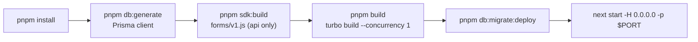

# Deployment

SendCMS is a pnpm + Turborepo monorepo (six Next.js apps, thirty-one
workspace packages, one standalone service) with PostgreSQL (Prisma)
and a vanilla-TS SDK bundle built by esbuild. It runs anywhere
Next.js runs — Vercel, Cloudflare Workers (OpenNext), plain Node /
Docker, Render, Netlify, and Railway are all supported; the
per-platform setup lives in
[deployment/platforms.md](deployment/platforms.md).

📌 **Production domain: `sendcms.bond` (decided 2026-11-20).**
Marketing `https://sendcms.bond`, api `https://api.sendcms.bond`,
dashboard `https://dashboard.sendcms.bond`, docs
`https://docs.sendcms.bond`, updates `https://updates.sendcms.bond`.
The `feature/ai` branch is deployed to production on all five Vercel
projects. The `feature/admin-control-plane` branch (this branch) is
**not deployed**. Deploys are **manual only** — auto-deploy on git
push is disabled via the Ignored Build Step (owner directive
2026-10-05); pushing to main triggers nothing.

## Contents

- [Requirements](#requirements)
- [Environment variables](#environment-variables)
- [Database](#database)
- [Build and run](#build-and-run)
- [Email outbox cron](#email-outbox-cron)
- [Vercel notes](#vercel-notes)
- [Cloudflare notes](#cloudflare-notes-phase-10--five-workers-one-per-app)

## Requirements

- Node.js 24+, pnpm 12
- PostgreSQL (any hosted Postgres; the dev database is a Prisma Postgres
  instance at `db.prisma.io`)
- The environment variables below

## Environment variables

| Variable                                                                                                            | Required               | Notes                                                                                                                                                                                       |
| ------------------------------------------------------------------------------------------------------------------- | ---------------------- | ------------------------------------------------------------------------------------------------------------------------------------------------------------------------------------------- |
| `DATABASE_URL`                                                                                                      | yes                    | Postgres connection string. With Prisma Postgres, use `?sslmode=verify-full`.                                                                                                               |
| `BETTER_AUTH_SECRET`                                                                                                | yes                    | Random 32+ char secret (`openssl rand -base64 32`). No fallback — the app refuses to start auth without it.                                                                                 |
| `BETTER_AUTH_URL`                                                                                                   | yes                    | The **api app's** public URL, e.g. `https://api.sendcms.bond` (the auth handler lives there).                                                                                               |
| `TRUSTED_ORIGINS`                                                                                                   | yes, in production     | Comma-separated origins allowed to call auth — the dashboard and admin apps' URLs.                                                                                                          |
| `NEXT_PUBLIC_APP_URL`                                                                                               | yes                    | The **marketing app's** public URL; baked into SDK snippets and email links.                                                                                                                |
| `NEXT_PUBLIC_API_URL`                                                                                               | yes                    | The api app's public URL (SDK bundle origin + submit API).                                                                                                                                  |
| `NEXT_PUBLIC_DASHBOARD_URL`                                                                                         | yes                    | The dashboard app's public URL (auth callback + inbox links).                                                                                                                               |
| `NEXT_PUBLIC_DOCS_URL`                                                                                              | yes                    | The docs app's public URL.                                                                                                                                                                  |
| `NEXT_PUBLIC_UPDATES_URL`                                                                                           | yes                    | The updates app's public URL.                                                                                                                                                               |
| `NEXT_PUBLIC_ADMIN_URL`                                                                                             | yes                    | The admin app's public URL (auth callback + admin links).                                                                                                                                   |
| `NEXT_PUBLIC_AUTH_URL`                                                                                              | yes                    | The api app's public URL (the dashboard and admin apps' auth clients talk to it).                                                                                                           |
| `COOKIE_DOMAIN`                                                                                                     | production only        | Session cookie domain, when the apps run on subdomains of one domain. Unset = host-only cookies.                                                                                            |
| `LOG_LEVEL`                                                                                                         | no                     | Structured log level: `info` / `warn` / `error` (default `info`).                                                                                                                           |
| `WORKER_PORT` / `WORKER_POLL_INTERVAL_MS`                                                                           | no                     | Standalone email worker: port (default 3005) and outbox poll interval in ms (default 30000). The worker binds `PORT` first when a platform injects it (Render/Railway), else `WORKER_PORT`. |
| `GOOGLE_CLIENT_ID` / `GOOGLE_CLIENT_SECRET`                                                                         | for Google sign-in     | Google Cloud Console → authorized redirect URI `<APP_URL>/api/auth/callback/google`.                                                                                                        |
| `GITHUB_CLIENT_ID` / `GITHUB_CLIENT_SECRET`                                                                         | for GitHub sign-in     | GitHub OAuth app → callback `<APP_URL>/api/auth/callback/github`.                                                                                                                           |
| `FACEBOOK_CLIENT_ID` / `FACEBOOK_CLIENT_SECRET`                                                                     | for Facebook sign-in   | Meta app → callback `<APP_URL>/api/auth/callback/facebook`.                                                                                                                                 |
| `RESEND_API_KEY`                                                                                                    | for email              | Resend API key. The app's key is separate from any key stored in the Muse connector — set it here.                                                                                          |
| `RESEND_FROM`                                                                                                       | with Resend            | A sending address on a **verified** Resend domain, e.g. `SendCMS <notifications@sendcms.bond>`.                                                                                             |
| `SMTP_HOST` / `SMTP_PORT` / `SMTP_USER` / `SMTP_PASS` / `SMTP_FROM`                                                 | SMTP fallback          | Used only when no Resend key is set.                                                                                                                                                        |
| `CRON_SECRET`                                                                                                       | yes, for email retries | Bearer token for `GET /api/cron/email-outbox`. Without it the outbox still delivers immediately on submit, but retries after an outage never run.                                           |
| `TURNSTILE_SECRET_KEY`                                                                                              | for Turnstile          | Cloudflare Turnstile secret. Without it, Turnstile-enabled forms answer 503.                                                                                                                |
| `NEXT_PUBLIC_TURNSTILE_SITE_KEY`                                                                                    | for Turnstile          | Turnstile site key (public, baked into the SDK).                                                                                                                                            |
| `AI_PROVIDER`                                                                                                       | no                     | AI provider to use when more than one key is set: `openai` / `anthropic` / `google` / `deepseek` / `openrouter`. Unset = auto-detect from the keys present.                                 |
| `OPENAI_API_KEY` / `ANTHROPIC_API_KEY` / `GOOGLE_GENERATIVE_AI_API_KEY` / `DEEPSEEK_API_KEY` / `OPENROUTER_API_KEY` | for AI                 | One provider key enables all AI features (spam re-scoring, digest, form-builder, reply drafts). No key = clean no-op; nothing is sent to a model.                                           |
| `AI_MODEL`                                                                                                          | no                     | Model id override. Defaults: openai `gpt-4o-mini`, anthropic `claude-haiku-4-5`, google `gemini-3.5-flash-lite`, deepseek `deepseek-chat`, openrouter `openai/gpt-4o-mini`.                 |
| `AI_SPAM_THRESHOLD`                                                                                                 | no                     | 0–100 (default 70). A re-scored submission at/above this is marked SPAM.                                                                                                                    |
| `AI_DAILY_CALL_CAP`                                                                                                 | no                     | Model calls allowed per form per day (default 100).                                                                                                                                         |
| `AI_DIGEST_INTERVAL_HOURS`                                                                                          | no                     | Inbox digest interval in hours (default 24 = daily; 168 = weekly).                                                                                                                          |

### Per-project env (Vercel) — only what each project needs

The six Vercel projects used to carry the identical 29-var set, so a
leak of any one project's env exposed the whole platform's secrets
(Phase 16, LVE-020). Each project carries **only** the vars its code
reads — the lists below are the authority, verified against the
`process.env` reads in each app and the packages it imports. Remove
any var not listed for a project from that project's settings.

| Project (`sendcms-*`) | Vars it needs                                                                                                                                                                                                                                                                                                                                                                                                                                                                                                                                              |
| --------------------- | ---------------------------------------------------------------------------------------------------------------------------------------------------------------------------------------------------------------------------------------------------------------------------------------------------------------------------------------------------------------------------------------------------------------------------------------------------------------------------------------------------------------------------------------------------------- |
| `sendcms` (api)       | Everything: `DATABASE_URL`, `BETTER_AUTH_SECRET`, `BETTER_AUTH_URL`, `TRUSTED_ORIGINS`, `COOKIE_DOMAIN` (production), all `NEXT_PUBLIC_*_URL` vars, OAuth `GOOGLE_` / `GITHUB_` / `FACEBOOK_CLIENT_ID` + `_SECRET`, `RESEND_API_KEY`, `RESEND_FROM`, `SMTP_*`, `CRON_SECRET`, `TURNSTILE_SECRET_KEY`, `NEXT_PUBLIC_TURNSTILE_SITE_KEY`, AI keys + `AI_PROVIDER` / `AI_MODEL` / `AI_SPAM_THRESHOLD` / `AI_DAILY_CALL_CAP` / `AI_DIGEST_INTERVAL_HOURS` / `AI_BYOK_MASTER_KEY`, billing keys (`STRIPE_*`, `PAYPAL_*`, `POLAR_*`, `FREEMIUS_*`, `GUMROAD_*`). |
| `sendcms-dashboard`   | `DATABASE_URL`, `BETTER_AUTH_SECRET` (**same value as api** — they share the session), `BETTER_AUTH_URL`, `COOKIE_DOMAIN` (production, same value as api), `NEXT_PUBLIC_APP_URL`, `NEXT_PUBLIC_API_URL`, `NEXT_PUBLIC_DASHBOARD_URL`, `NEXT_PUBLIC_DOCS_URL`, `NEXT_PUBLIC_UPDATES_URL`, `NEXT_PUBLIC_ADMIN_URL`, `NEXT_PUBLIC_AUTH_URL`. No OAuth secrets, no mail keys, no `CRON_SECRET`, no billing/AI keys — the auth handler and mailer live on the api app.                                                                                          |
| `sendcms-admin`       | Same as dashboard, plus `NEXT_PUBLIC_ADMIN_URL` (its own public URL, used for the sign-in callback).                                                                                                                                                                                                                                                                                                                                                                                                                                                       |
| `sendcms-marketing`   | Only public URLs: `NEXT_PUBLIC_APP_URL`, `NEXT_PUBLIC_API_URL`, `NEXT_PUBLIC_DASHBOARD_URL`, `NEXT_PUBLIC_UPDATES_URL`. No secrets at all — no `DATABASE_URL`, no `CRON_SECRET`, no `SMTP_*`, no OAuth secrets.                                                                                                                                                                                                                                                                                                                                            |
| `sendcms-docs`        | Only public URLs: `NEXT_PUBLIC_APP_URL`, `NEXT_PUBLIC_DOCS_URL`. No secrets at all.                                                                                                                                                                                                                                                                                                                                                                                                                                                                        |
| `sendcms-updates`     | Only public URLs: `NEXT_PUBLIC_APP_URL`, `NEXT_PUBLIC_UPDATES_URL`. No secrets at all.                                                                                                                                                                                                                                                                                                                                                                                                                                                                     |

Notes: `TRUSTED_ORIGINS` is set on the **api** project only (the auth
handler reads it); the dashboard/admin apps' own Better Auth instances
do session lookups, not OAuth callbacks, so they do not need it. The
standalone email worker is not a Vercel project — it needs
`DATABASE_URL`, `RESEND_API_KEY` / `RESEND_FROM` (or `SMTP_*`), and
`WORKER_PORT` / `WORKER_POLL_INTERVAL_MS` only.

Copy `.env.example` to `.env` for local development. Never commit
`.env` (it is gitignored). The seed script (`pnpm db:seed`) creates
SendCMS demo data — a verified demo user, domain, form, and sample
submissions. It is idempotent and safe to re-run; demo data only, never
run it against a production database.

## Database

```bash
pnpm install
pnpm db:generate      # regenerate the Prisma client
pnpm db:migrate       # prisma migrate dev — create + apply (local only)
pnpm db:migrate:deploy # prisma migrate deploy — apply on a server (production)
```

Migrations are additive. Apply with `prisma migrate deploy` — never
`db:reset` on a live database (it is destructive and requires typed
confirmation for that reason).

## Build and run



```bash
pnpm build            # prisma generate + SDK build + turbo build (sequential, --concurrency 1)
pnpm dev              # same generation steps, then turbo dev (all 6 apps + the email worker)
```

Each app also has a `build:server` script — the single command every
non-Cloudflare platform builds with (Prisma generate, then the SDK
bundle for the api app, then `next build`):

```bash
pnpm --filter @sendcms/<app> build:server   # marketing | api | dashboard | docs | updates | admin
```

`pnpm dev` does the same generation steps, then starts the dev
servers with Turbopack (marketing :3000, api :3001, dashboard :3002,
docs :3003, updates :3004, worker :3005, admin :3006). The SDK bundle
(`apps/api/public/forms/v1.js`) is built from source and gitignored —
never commit it, and make sure CI builds it before testing (the CI
workflow runs `pnpm db:generate` and `pnpm sdk:build`). There is no
root `pnpm start` — each app is started from its own directory
(`pnpm --filter @sendcms/<app> start`) or deployed to its own host.

## Email outbox cron

Submission notifications are delivered immediately on submit (via
`after()`), and failed deliveries are retried by the cron route:

```http
GET /api/cron/email-outbox
Authorization: Bearer <CRON_SECRET>
```

It processes up to 100 due jobs per call. The root `vercel.json`
schedules it **once daily** (`0 0 * * *`, midnight UTC) — the Hobby
plan allows one cron per day, and the owner chose to stay on Hobby
for now (2026-11-20). To go faster later, change the schedule back
to `*/5 * * * *` (or use an external cron service) when the plan
allows it.

```json
{
  "crons": [{ "path": "/api/cron/email-outbox", "schedule": "0 0 * * *" }]
}
```

⚠️ **The route needs the `Authorization` header.** Vercel Cron
cannot send custom headers, so either call it from an external
scheduler that can, or front it with a small proxy that adds the
header. Without the header the route answers 401; without
`CRON_SECRET` set at all it answers 503. (The same rule applies on
every platform — see [Email notifications](email-notifications.md).)

## Vercel notes

- One project per app (see [deployment/platforms.md](deployment/platforms.md)
  for the table). Deploys are **manual only** — the Ignored Build Step
  ("Don't build anything") cancels git-triggered deploys; deploy from
  the dashboard or via the agent when tested and ready.
- Set every variable above in each project's settings before the
  first deploy. `NEXT_PUBLIC_APP_URL` must be the production URL or
  SDK snippets and email links will point at the wrong host.
  `BETTER_AUTH_SECRET` must be the same value on the api, dashboard,
  and admin projects.
- Sixth project `sendcms-admin`: build
  `pnpm --filter @sendcms/admin build:server`, output
  `apps/admin/.next`, host `admin.sendcms.bond`. Deploy the
  `feature/admin-control-plane` branch on it (the admin code is not
  on `feature/ai`). Set `DATABASE_URL`, `BETTER_AUTH_SECRET` (same
  value as api + dashboard), `BETTER_AUTH_URL`, and the
  `NEXT_PUBLIC_*_URL` vars (including
  `NEXT_PUBLIC_ADMIN_URL=https://admin.sendcms.bond`) before the
  first deploy — and add `https://admin.sendcms.bond` to the
  **api** project's `TRUSTED_ORIGINS`, or the auth handler refuses
  the admin origin.
- `BETTER_AUTH_URL` must be `https://api.sendcms.bond` (the auth
  handler lives only on the api app). OAuth redirect URIs for Google,
  GitHub, and Facebook are set in their consoles; sign-in is verified
  working.

## Cloudflare notes (Phase 10 — six Workers, one per app)

- Each app deploys as its own Worker — see
  `infrastructure/cloudflare/README.md` for the table, the dashboard
  steps, and the placeholder production URLs. The api app keeps the
  worker name `sendcms`; the others are `sendcms-marketing`,
  `sendcms-dashboard`, `sendcms-docs`, `sendcms-updates`,
  `sendcms-admin`.
- The Worker entry is `.open-next/worker.js` (OpenNext adapter);
  each app's `wrangler.jsonc` holds the R2 cache bucket, the Images
  binding, and the self-reference service binding. The build command
  must be the full chain — `pnpm --filter @sendcms/database
db:generate && pnpm -w run sdk:build && npx @opennextjs/cloudflare
build` (also in each `wrangler.jsonc`'s `build.command` and as that
  app's `build:cf` script). A bare `npx @opennextjs/cloudflare build`
  bakes a stale Prisma client and a missing SDK bundle. Set the same
  command in the dashboard's Build command field; build-time values
  (`NEXT_PUBLIC_*_URL`, Google client id) must come from the dashboard
  build environment, or the built output bakes in localhost and empty
  ids.
- Security headers come from one shared definition in
  `@sendcms/security` — each app's `next.config.mjs` `headers()` plus
  that app's `public/_headers` (nosniff, referrer policy, SAMEORIGIN
  framing, no camera/mic/geolocation). ✅ On this branch (Phase 9)
  a nonce-based Content-Security-Policy is enforcing on all six page
  apps — see
  [admin-control-plane/csp.md](admin-control-plane/csp.md). It is
  **not deployed** (this branch is unmerged).
- ⚠️ The five original apps' `wrangler.jsonc` `vars` still use
  `jadoo.bond` hosts as placeholders (`https://jadoo.bond`,
  `https://api.jadoo.bond`, …) even though the production domain is
  now decided (`sendcms.bond`); only the admin app's `wrangler.jsonc`
  already uses `sendcms.bond`. Update the five files together when
  the Cloudflare path is next deployed.
- The R2 cache bucket is still `open-remark-opennext-cache` — it is a
  real Cloudflare resource, so renaming it needs a new bucket created
  in the dashboard first; the cache can be recreated empty. All six
  workers share that one bucket (see the caveat in
  `infrastructure/cloudflare/README.md`). The next `wrangler deploy`
  of the api app creates a new `sendcms` worker; delete the old
  `open-remark` worker in the dashboard once the new one is live.
- The app needs the Node.js runtime for the dashboard proxy (the session
  lookup hits Prisma), so it is not edge-safe; keep the OpenNext
  Node.js compat flag on.
- The email worker (`services/email-worker`) does not deploy to
  Cloudflare Workers — it is a long-running Node process. Its
  production hosting is a separate decision; the cron route
  (`GET /api/cron/email-outbox`) stays the hosted drain until then.
