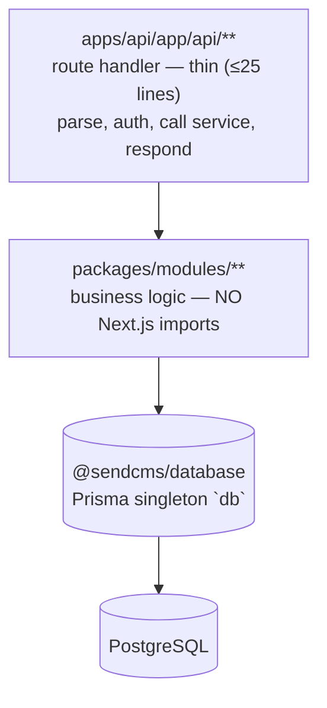

# Developing in the SendCMS monorepo

SendCMS is a pnpm + Turborepo monorepo: six Next.js apps, thirty-three
workspace packages, one standalone service, and one infrastructure
folder. The root holds no app code — there is no `app/`, `lib/`,
`components/`, `content/`, `styles/`, or `public/` at the root since
Phase 8 — but it is not bare: it carries the workspace config, the
repo-wide test suite (`tests/`), the docs (`docs/`), and shared
tooling such as `postcss.config.mjs` and `render.yaml`. The full
layout lives in the
`project-guidelines` skill (`folder-structure.md`); this document is
the day-to-day guide for working in it.

📌 **Branch note:** this doc describes the `feature/admin-control-plane`
branch (sixth app `apps/admin`, admin/AI/MCP modules, 46 test files).
That branch is **live in production** (deployed 2026-11-23); it is not
merged to `main`. Production is `sendcms.bond` on the
`feature/admin-control-plane` branch.

## Contents

- [Layout (short version)](#layout-short-version)
- [Commands](#commands)
- [Dev ports](#dev-ports)
- [The layered flow (hard rule)](#the-layered-flow-hard-rule)
- [Adding something](#adding-something)
- [Tests](#tests)
- [Commits](#commits)
- [Gotchas](#gotchas)
- [Troubleshooting](#troubleshooting)

## Layout (short version)

```
apps/            marketing (3000), api (3001), dashboard (3002), docs (3003),
                 updates (3004), admin (3006)
packages/        config, shared, api-client, sdk, content, ui, database,
                 auth, permissions, email, queue, security, observability,
                 ai, mcp, i18n
packages/modules/  domains, forms, submissions, inbox, notifications, users,
                 analytics, api-keys, admin-users, plans, ai-settings,
                 mcp-admin, platform-ops, billing, support, coupons, cron
services/        email-worker (3005)
infrastructure/  cloudflare/ (shared OpenNext config + deploy README)
tests/           the whole test suite — 144 files (see "Tests" below)
docs/            user docs (served by apps/docs) + architecture/ + this file
```

Every workspace package is private (`"private": true`) and versioned
`0.1.0`. Cross-package imports use the `@sendcms/*` names
(`workspace:*` in `package.json`); pnpm only links a workspace
package where it is declared as a dependency, so a new import needs a
matching dependency entry — and a package that extends
`@sendcms/config` must declare `@sendcms/config` as a devDependency
or the `extends` fails (TS6053).

## Commands

```bash
pnpm install        # install + regenerate the lockfile (workspace-aware)
pnpm dev            # db:generate + sdk:build + turbo dev (all 6 apps + the worker)
pnpm build          # db:generate + sdk:build + turbo build --concurrency 1
pnpm typecheck      # tsc --noEmit (root) — run before declaring work done
pnpm lint           # eslint (root config ignores generated output workspace-wide)
pnpm test           # vitest run (tests/)
pnpm db:generate    # regenerate the Prisma client (output: packages/database/generated/prisma)
pnpm db:migrate     # prisma migrate dev locally (deploy on a server)
pnpm db:seed        # demo data (idempotent; demo data only, never on production)
pnpm sdk:build      # esbuild the SDK bundle → apps/api/public/forms/v1.js
```

Migration hygiene (descriptive names, `migrate dev` validation,
enum-add comments, the `(createdAt, id)` tie-break rule, and the
destructive-warning gate) lives in the
[runbook](../operations/runbook.md#migration-hygiene-db-043).

`pnpm build` runs the app builds **sequentially** (`--concurrency 1`):
the six apps' parallel builds contend on `next/font/google` and fail
intermittently (ADR 0006). Do not remove the flag without re-verifying
a full parallel build.

Per-app / per-package commands use `pnpm --filter`:

```bash
pnpm --filter @sendcms/api build:cf        # OpenNext Cloudflare build for the api app
pnpm --filter @sendcms/marketing build:cf  # same for the marketing app
pnpm --filter @sendcms/database db:generate
```

## Dev ports

| App / service | Port | URL (dev)                    |
| ------------- | ---- | ---------------------------- |
| marketing     | 3000 | http://localhost:3000        |
| api           | 3001 | http://localhost:3001        |
| dashboard     | 3002 | http://localhost:3002        |
| docs          | 3003 | http://localhost:3003        |
| updates       | 3004 | http://localhost:3004        |
| email worker  | 3005 | http://localhost:3005/health |
| admin         | 3006 | http://localhost:3006        |

`pnpm dev` starts all seven. To start one app, use
`pnpm --filter @sendcms/<app> dev` — but note the apps depend on each
other at runtime: the dashboard's sign-in links point at the api app
(`NEXT_PUBLIC_AUTH_URL`), and the landing's embed snippet points at
the api app (`NEXT_PUBLIC_API_URL`). Start the api app alongside the
dashboard for auth flows. The five public URL vars
(`NEXT_PUBLIC_APP_URL`, `NEXT_PUBLIC_API_URL`,
`NEXT_PUBLIC_DASHBOARD_URL`, `NEXT_PUBLIC_DOCS_URL`,
`NEXT_PUBLIC_UPDATES_URL`) default to the dev ports above; see
`.env.example`.

## The layered flow (hard rule)



- Route handlers never import `@sendcms/database` — they call services.
- Zod schemas live in each module's `./validators` subpath, shared by
  routes + services. Client hooks live in the `./queries` subpaths.
- `ApiError` lives in `@sendcms/shared`; response/error/CORS helpers
  in `@sendcms/api-client`; `pingDatabase` in `@sendcms/database`.
- Audit logging: the one `logAudit()` writer lives in
  `@sendcms/security` (called only from services). Server logging:
  `createLogger(scope)` from `@sendcms/observability` (JSON lines),
  not `console` — except the auth mailer's dev verification-link line
  (its exact `[auth-email]` format is greppable; the live journey
  depends on it).
- Auth + the audit writer are the documented exceptions to the
  "services only import the database" rule (ADR 0002, ADR 0008).

## Adding something

- **A new app** (`apps/<name>`): copy an existing app's scaffold
  (package.json, tsconfig, next.config.mjs, eslint.config.mjs,
  no-op `proxy.ts`, `wrangler.jsonc` + `open-next.config.ts` if it
  deploys to Cloudflare). `next.config.mjs` needs
  `turbopack.root` = the workspace root (pnpm symlinks point outside
  the app dir) and `transpilePackages` listing every `@sendcms/*`
  package it imports. A nested app also needs its own `proxy.ts` or
  it inherits the workspace-root one. Dev port: the next free one
  after 3006.
- **A new package** (`packages/<name>`): only with a real
  responsibility — no empty placeholders. It needs `package.json`
  (with `exports` / `main` / `types` → `./src/index.ts`, or
  TypeScript cannot resolve its entry point), a tsconfig extending
  `@sendcms/config`, and `@sendcms/config` in devDependencies. A
  package that uses `process` or Node APIs must also declare
  `@types/node` AND list it in its tsconfig `types` (pnpm's isolated
  `node_modules` breaks the typeRoots walk-up). Nested groups
  (`packages/modules/*`, `services/*`) need their own glob line in
  `pnpm-workspace.yaml` — the `packages/*` glob matches direct
  children only.
- **A new module** (`packages/modules/<name>`): service + `./validators`
  - `./queries` subpaths, following ADR 0003. Keep the dependency
    graph acyclic (submissions → domains/notifications is the only
    cross-module edge so far).
- **A new route** (`apps/api/app/api/**`): follow the
  `project-guidelines` skill (`route-creation.md`) — thin handler,
  service call, `handleApiError`, CORS via `@sendcms/api-client`.
- **A new test**: put it in `tests/` (see below).

## Tests

The whole suite lives at the root in `tests/` — **by the owner's
explicit decision (Phase 13, 2026-11-19) the tests stay there and do
not co-locate with the packages they cover**. The audit's Phase 13 row
said "tests moved with code"; the owner overruled it: one suite, one
place, one command (`pnpm test`).

- 46 files (vitest). The root `package.json` declares the
  workspace packages the tests import as devDependencies, because the
  root app no longer depends on them. The Phase 9 acceptance record
  ([admin-control-plane/acceptance-matrix.md](../admin-control-plane/acceptance-matrix.md))
  reports 615/615 passing on this branch.
- Services import `db` and Prisma enums from the single
  `@sendcms/database` module, so a test mock of that module must spread
  the real module (`importOriginal`) and override only `db`, or the
  enum imports break. A `vi.mock` factory must not close over a
  top-level `const` — use `vi.hoisted`.
- The SDK tests load the real built bundle
  (`apps/api/public/forms/v1.js`) — run `pnpm sdk:build` before
  testing (CI does this; `pnpm dev` does it too).
- The live journey scripts live outside the repo
  (`~/workspace/scripts/phase*-journey.mjs`); they run the five dev
  servers + the worker against the dev database and assert the whole
  flow end to end (65 checks in the Phase 10/13 version).

## Commits

One logically complete unit per commit, on the feature branch only,
in the repo's style (`type(scope): description`, lowercase
imperative, <72 chars). Never push to `main` from here, never merge,
never open a PR unless the owner asks. The husky pre-commit hook runs
lint + format:check + typecheck; it needs `pnpm` on PATH
(`export PATH="$HOME/.local/bin:$PATH"`) and, since the workspace
grew to 6 apps + 33 packages, the eslint step can OOM on the default
2 GB heap — commit with `NODE_OPTIONS=--max-old-space-size=4096`.
Prettier must cover all staged files (including `git mv` renames).
Stage by explicit paths — never `git add -A` (the untracked
`.dev-server-*.log` files and `apps/api/public/forms/` must never be
staged). Delete `apps/<app>/.open-next/` before committing (the
Cloudflare build output trips the whole-workspace lint).

## Gotchas

- After deleting/moving routes, `rm -rf .next` before typecheck
  (stale `.next/types`); a stale `tsconfig.tsbuildinfo` can also mask
  errors — delete it when errors look inconsistent.
- `.gitignore` build-output patterns must be unanchored (`.next/`,
  `.open-next/`, `public/forms/`) or nested apps' output gets staged.
- `next.config.mjs` files are loaded by plain Node and cannot import
  TypeScript — shared config for them must be plain `.mjs` with an
  adjacent `.d.ts` (the `packages/security/src/headers.mjs` pattern).
- `infrastructure/` is not excluded from the root tsconfig, so the
  root `tsc` typechecks the shared OpenNext config — the root keeps
  `@opennextjs/cloudflare` as a devDep for its types.
- The root has no `.env` file in the sandbox (it was lost in a
  runtime restart); dev servers + journey runs need `DATABASE_URL`
  (+ `CRON_SECRET=test-cron-secret`) passed in the exec environment,
  never written to a file.

## Troubleshooting

**Turbopack cache death.** After deleting or moving a route, the
build or typecheck fails on stale generated types (`.next/types`)
or behaves as if the old route still exists. Delete the app's
`.next` dir (`rm -rf apps/<app>/.next`) and any stale
`tsconfig.tsbuildinfo`, then rebuild. The same fix applies when
errors look inconsistent with the source on disk — a stale cache,
not the code, is usually the cause.

**Missing `.env`.** The repo ships `.env.example`, not `.env`.
Without a root `.env`, `pnpm dev` and the `db:*` scripts fail
(dotenv-cli reports a missing env file instead of a cryptic
`DATABASE_URL` error). Copy `.env.example` to `.env` and fill in
`DATABASE_URL` + `BETTER_AUTH_SECRET` at minimum. In the sandbox
there is deliberately no `.env` file — pass `DATABASE_URL` (and
`CRON_SECRET=test-cron-secret` for journey runs) in the exec
environment instead; never write secrets to a file.

**Port conflicts.** Dev ports are fixed: marketing 3000, api 3001,
dashboard 3002, docs 3003, updates 3004, worker 3005, admin 3006.
If a dev server fails with `EADDRINUSE`, another process (often a
previous `pnpm dev` that survived a restart) holds the port — find
it (`lsof -i :3001` or `fuser 3001/tcp`) and stop it; do not change
the port in `package.json`, because the `NEXT_PUBLIC_*` URLs and
the auth origins assume the fixed ports.

**Missing SDK bundle.** `apps/api/public/forms/v1.js` is gitignored
build output. If the embed snippet 404s, or the SDK tests exercise
a stale bundle, run `pnpm sdk:build` (it is part of `pnpm dev` and
`pnpm build`, but a fresh checkout or a deleted file needs the
explicit step). CI builds it before testing.

**`pnpm: command not found`.** pnpm lives at `~/.local/bin/pnpm`
and drops off `PATH` in fresh shells — including git-hook shells
(the pre-commit hook fails with `pnpm: not found`). Run
`export PATH="$HOME/.local/bin:$PATH"` first, or call the full
path. Do not reinstall pnpm.
