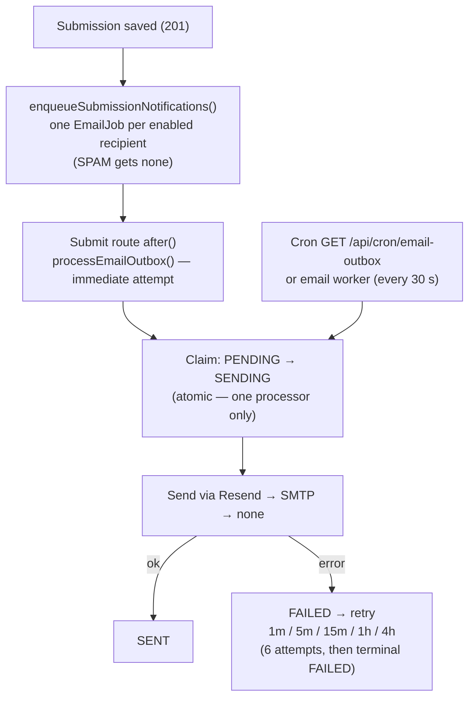

# Email notifications

When a visitor submits a form, SendCMS saves the submission first and
then queues one notification email per enabled recipient of that form
(`NotificationSettings` — one row per address, toggled on the form
detail page). Delivery runs through the `EmailJob` outbox, so a dead
mail provider delays the email, never the submission.



## Contents

- [Provider](#provider)
- [Locales (i18n)](#locales-i18n)
- [Outbox and retries](#outbox-and-retries)
- [Cron worker](#cron-worker)
- [Standalone worker](#standalone-worker)
- [Test email](#test-email)
- [Failure modes](#failure-modes)

## Provider

One send path for all platform mail (verification, password reset,
submission notifications), in priority order:

| #   | Provider                 | Setup                                                                                                                                                                                                                                                                                                                                                          |
| --- | ------------------------ | -------------------------------------------------------------------------------------------------------------------------------------------------------------------------------------------------------------------------------------------------------------------------------------------------------------------------------------------------------------- |
| 1   | **Resend** (recommended) | Set `RESEND_API_KEY`. Create a key at https://resend.com/api-keys and verify a sending domain at https://resend.com/domains. Set `RESEND_FROM` to an address on that verified domain (e.g. `SendCMS <notifications@yourdomain.com>`). Resend rejects mail from unverified domains, so the From address is its own setting and never silently reused from SMTP. |
| 2   | **Platform SMTP**        | `SMTP_HOST`, `SMTP_USER`, `SMTP_PASS` (+ optional `SMTP_FROM`, `SMTP_PORT`). Kept from Phase 2.                                                                                                                                                                                                                                                                |
| 3   | **None**                 | Auth mail logs the link in dev and throws in production; outbox jobs fail with a clear error and are retried.                                                                                                                                                                                                                                                  |

No provider is needed to develop against the outbox: jobs queue and
fail honestly, which is how the outage path is tested.

## Locales (i18n)

Platform emails are **not English-only**. The supported email locales
are English (`en`) and Urdu (`ur`); the strings live in the shared
`email` domain (`packages/i18n/locales/{en,ur}/email.json`, 37 keys),
rendered synchronously by `getEmailTranslator` in
`packages/email/src/email-i18n.ts`. A locale without an email
dictionary renders English.

How the locale is chosen, per email kind:

| Email | Recipient locale |
| ----- | ---------------- |
| Verification / password reset | The user's stored `User.locale`, resolved by the auth factory at send time (`packages/auth/src/auth.ts`); no preference → English |
| Submission notification | The form owner's stored locale, resolved at enqueue time (for the stored subject) and again at send time from the job's denormalized `ownerId` (for the body) |
| Digest | The form owner's stored locale, resolved in `sendDueDigests` and stored on the job payload (`locale`); jobs enqueued before this shipped carry no locale and render English |
| Reply to a submission | The form owner's stored locale, stored on the job payload at enqueue; the reply **body** is the owner's own words and is never translated, only the chrome (heading, footer, button) |
| Test notification | The requesting owner's stored locale |

Template chrome (headings, buttons, footers, subjects, the
"Received" line) follows the recipient locale, and dates/times in
the templates use the locale-aware `formatDate`/`formatTime`
helpers. The `<html>` element carries `lang` and `dir` (`rtl` for
Urdu). User-generated content — form field values, the digest
summary/highlights, the reply body — is rendered as written, never
translated.

## Outbox and retries

- `enqueueSubmissionNotifications()` runs after the submission
  transaction commits (inside `submitForm`, best-effort — an enqueue
  failure is logged, the submission is already safe). Spam
  submissions get no notification.
- Delivery is attempted immediately after the response is sent
  (the public submit route's `after()` hook) and retried by the cron
  worker. Each attempt flips PENDING → SENDING first, so two
  processors never send the same job twice.
- Retry backoff: 1m, 5m, 15m, 1h, 4h. After 6 attempts the job stays
  FAILED with `lastError` and no further retry — visible in the
  Notifications delivery log (`/dashboard/notifications`). A failed
  job can be retried from there: the delivery log's Requeue button
  (FAILED tab) puts it back to PENDING with a fresh ladder. A job
  still SENDING more than 10 minutes after its claim is treated as
  stuck (its processor died mid-send) and is automatically reclaimed
  by the next drain — or requeued manually from the SENDING tab once
  it is past the lease.
- `providerMessageId` records the Resend/SMTP message id for
  delivery tracking. `SENT` means only "provider accepted": the
  signed Resend webhook (`POST /api/webhooks/resend`,
  `RESEND_WEBHOOK_SECRET`) records the real outcome on the job
  (`deliveryStatus`), and a hard bounce or complaint suppresses the
  recipient (EML-005). Notification and digest mail carries a signed
  per-recipient unsubscribe URL + `List-Unsubscribe` header (EML-011);
  `RESEND_FROM` is validated at send time and fails fast with a named
  error when missing or on an unverified domain (EML-008).

## Cron worker

`GET /api/cron/email-outbox` processes up to 100 due jobs. Auth is a
shared secret: the scheduler sends
`Authorization: Bearer <CRON_SECRET>`. Without `CRON_SECRET` the
route answers 503; without the header it answers 401.

The root `vercel.json` schedules it **once daily** (`0 0 * * *`,
midnight UTC) — the Hobby plan allows one cron per day (owner decision
2026-11-20; reply emails can wait up to a day). To go faster later,
change the schedule to `*/5 * * * *` when the plan allows it.

> **Cron vs worker (EML-013):** the daily cron is the *fallback*
> drain — it exists so a job is never stranded when no worker is
> running. The *prompt* path is the standalone worker's attempts
> (every 30 s) and the submit route's immediate `after()` drain.
> With the worker fixed (templates render under tsx again), a job
> enqueued after midnight is normally sent within one poll interval,
> not at the next midnight; the cron only catches what the worker
> missed.

```json
{
  "crons": [
    {
      "path": "/api/cron/email-outbox",
      "schedule": "0 0 * * *"
    }
  ]
}
```

⚠️ **Vercel Cron cannot send custom headers.** The cron route needs
`Authorization: Bearer <CRON_SECRET>`, so call it from an external
scheduler that can send the header, or front it with a small proxy
that adds the header. Set `CRON_SECRET` in the project env vars.
See [Deployment](deployment.md#email-outbox-cron).

## Standalone worker

For deployments that run a long-lived process, `services/email-worker`
drains the outbox on a timer instead of (or alongside) the cron route:

```bash
pnpm --filter @sendcms/email-worker start
```

It polls every `WORKER_POLL_INTERVAL_MS` (default 30_000), processes
up to 100 due jobs per poll, and serves a health endpoint at
`GET http://localhost:<WORKER_PORT>/health` (`WORKER_PORT`, default
3005). The health response reports `polling`, the last run's counts,
and the last error. The worker shuts down gracefully on SIGTERM/SIGINT
(it finishes the in-flight poll before exiting), and a failed poll
never kills it — the next poll retries. Running the worker and the cron
together is safe: the PENDING → SENDING claim means a job is owned by
exactly one processor. In dev, `pnpm dev` starts the worker alongside
the six apps.

## Delivery webhooks (EML-005)

`SENT` means the provider accepted the mail — nothing more. Resend
reports what happened after acceptance to
`POST /api/webhooks/resend` (Svix-signed with `RESEND_WEBHOOK_SECRET`;
register the endpoint in the Resend dashboard and subscribe to
`email.delivered`, `email.delivery_delayed`, `email.bounced` and
`email.complained`). The outcome is stored on the job
(`deliveryStatus` / `deliveryUpdatedAt`, visible in the delivery
log), and a hard bounce or a complaint suppresses the recipient, so
no further job is ever enqueued to that address. A soft (transient)
bounce is recorded as no delivery status and does not suppress.

## Unsubscribe (EML-011)

Notification and digest mail carries a signed per-recipient
unsubscribe URL (footer link + `List-Unsubscribe` header).
Clicking it records a suppression and disables that recipient's
notification settings, so no further job is enqueued for them.
`RESEND_FROM` is validated at send time (present, parses as an
address, on a domain in `RESEND_VERIFIED_DOMAINS` when that list is
configured) and fails fast with a named error instead of burning
retries on a provider rejection (EML-008); admin health reports the
sender status (`email.resendFrom`).

## Test email

On a form's detail page (Notifications section), "Send a test
notification" sends a sample email straight through the provider —
not via the outbox queue, since there is no submission to render from.
It returns the provider and message id, or the provider's error. The
send is recorded in the delivery log as a SENT test email, so recent
test sends are visible on the notifications page.

## Failure modes

| Situation                                          | What happens                                                                                                                                                                                                                                                                        |
| -------------------------------------------------- | ----------------------------------------------------------------------------------------------------------------------------------------------------------------------------------------------------------------------------------------------------------------------------------- |
| No provider configured                             | The job stays PENDING with `lastError` set and a retry scheduled (1m, 5m, 15m, 1h, 4h). After 6 attempts it becomes FAILED. FAILED is terminal — the next cron run does not send it; fix the config, then requeue the job from the delivery log (Requeue button on the FAILED tab). |
| Provider rejects (bad key, unverified From domain) | Same, with the provider's message in `lastError`.                                                                                                                                                                                                                                   |
| Submission deleted before delivery                 | Job FAILED, "Submission or form no longer exists", no retry (unrecoverable).                                                                                                                                                                                                        |
