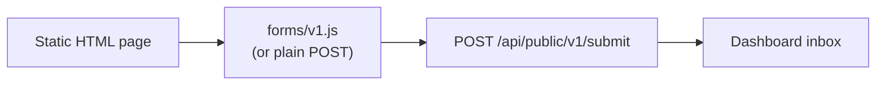

# Embedding SendCMS in plain HTML

No framework, no build step. Works on any static site, WordPress page
(with a Custom HTML block), or hand-written HTML file — paste one
script tag and a normal form, or post the form directly with no
JavaScript at all.



## Contents

- [Prerequisites](#prerequisites)
- [1. Paste the snippet](#1-paste-the-snippet)
- [2. No JavaScript at all](#2-no-javascript-at-all)
- [3. Check it works](#3-check-it-works)

## Prerequisites

- A SendCMS account with a verified domain and a form (see
  [Getting started](getting-started.md))
- Your **userId** and the form's **formId** from the dashboard
  (form detail page → "Embed on your site")

| Placeholder    | Replace with                                                               |
| -------------- | -------------------------------------------------------------------------- |
| `YOUR_APP`     | Your SendCMS deployment URL (the api app, e.g. `https://api.sendcms.bond`) |
| `YOUR_USER_ID` | Your public user id (form detail page)                                     |
| `YOUR_FORM_ID` | The form's id (form detail page)                                           |

## 1. Paste the snippet

```html
<script
  src="https://YOUR_APP/forms/v1.js"
  data-user-id="YOUR_USER_ID"
  data-form-id="YOUR_FORM_ID"
></script>

<form data-cms-form>
  <label>
    Name
    <input name="name" required />
  </label>
  <label>
    Email
    <input name="email" type="email" required />
  </label>
  <label>
    Message
    <textarea name="message" required></textarea>
  </label>
  <button type="submit">Send</button>
</form>
```

Replace `YOUR_APP`, `YOUR_USER_ID`, and `YOUR_FORM_ID` with your values.
The form's fields must match the fields configured on the form in the
dashboard — extra field names are rejected by the API.

The SDK enhances the form in place: loading / success / error states,
duplicate-submit protection, and a honeypot bot trap are built in.
Your own CSS applies to the form as usual — the SDK only styles its
status message and the invisible honeypot field.

## 2. No JavaScript at all

If you would rather not load the SDK, post the form directly to the
REST API. It answers with a redirect instead of JSON:

```html
<form action="https://YOUR_APP/api/public/v1/submit" method="post">
  <input type="hidden" name="userId" value="YOUR_USER_ID" />
  <input type="hidden" name="formId" value="YOUR_FORM_ID" />
  <input name="name" required />
  <input name="email" type="email" required />
  <textarea name="message" required></textarea>
  <button type="submit">Send</button>
</form>
```

On success the browser is redirected to the form's redirect URL, or
back to the page with `?cms_submitted=1` appended. On error it is
redirected back with `?cms_error=<message>`. See
[REST API](rest-api.md) for the details.

## 3. Check it works

1. Submit the form on your site. You should see the success message
   (or your configured redirect).
2. Open **Inbox** in the SendCMS dashboard — the submission appears
   there with the page URL and origin domain.
3. If it returns 403, the page's origin is not a verified domain linked
   to the form — see [Troubleshooting](troubleshooting.md).

Full SDK reference: [SDK](sdk.md).
