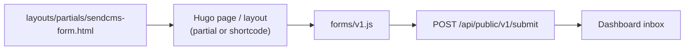

# Embedding SendCMS in Hugo

Add a SendCMS contact form to a Hugo site as a reusable partial, then
include it from any layout or shortcode. One script tag, one normal
HTML form — no build plugin needed.



## Contents

- [Prerequisites](#prerequisites)
- [1. Create a contact form partial](#1-create-a-contact-form-partial)
- [2. Include the partial in a page](#2-include-the-partial-in-a-page)
- [3. Check it works](#3-check-it-works)
- [Self-hosting note](#self-hosting-note)

## Prerequisites

- A Hugo site
- A SendCMS account with a verified domain and a form (see
  [Getting started](getting-started.md))
- Your **userId** and the form's **formId** from the dashboard
  (form detail page → "Embed on your site")

| Placeholder    | Replace with                                                               |
| -------------- | -------------------------------------------------------------------------- |
| `YOUR_APP`     | Your SendCMS deployment URL (the api app, e.g. `https://api.sendcms.bond`) |
| `YOUR_USER_ID` | Your public user id (form detail page)                                     |
| `YOUR_FORM_ID` | The form's id (form detail page)                                           |

## 1. Create a contact form partial

Create `layouts/partials/sendcms-form.html`:

```html
<script src="https://YOUR_APP/forms/v1.js"></script>

<form data-cms-form data-user-id="YOUR_USER_ID" data-form-id="YOUR_FORM_ID">
  <label>
    Name
    <input name="name" required />
  </label>
  <label>
    Email
    <input name="email" type="email" required />
  </label>
  <label>
    Message
    <textarea name="message" required></textarea>
  </label>
  <button type="submit">Send</button>
</form>
```

Replace `YOUR_APP`, `YOUR_USER_ID`, and `YOUR_FORM_ID` with your values.
The form's fields must match the fields configured on the form in the
dashboard — extra field names are rejected by the API.

> **Do not paste the markup into a Markdown (`.md`) content file.**
> Hugo's default Goldmark renderer strips raw HTML (`unsafe = false`
> by default), so a `<script>` + `<form>` pasted into `.md` silently
> disappears — no form, no error. That is exactly why the partial /
> shortcode paths below exist: markup in a layout or shortcode is
> never stripped. If you insist on inline HTML in Markdown, enable
> it explicitly in `hugo.toml` (or `config.toml`):
>
> ```toml
> [markup.goldmark.renderer]
> unsafe = true
> ```
>
> The shortcode below is still the recommended path.

### Turnstile

If the form has Turnstile enabled, the SDK needs its site key: add
`data-turnstile-site-key="…"` to the script tag (or to the form, or
pass it to `SendCMS.init()`). Without the key the SDK never loads
Turnstile and the API rejects every submission with 422
(`"Verification is required for this form."`). The snippet copied
from the dashboard already includes the key when Turnstile is on —
and shows a warning instead of a snippet when no site key is
configured. Full reference: [SDK — Turnstile](sdk.md#turnstile).

## 2. Include the partial in a page

In any layout or content file, for example `layouts/page/contact.html`:

```html
{{ define "main" }}
<article>
  <h1>{{ .Title }}</h1>
  {{ .Content }}
</article>

<section aria-label="Contact form">{{ partial "sendcms-form.html" . }}</section>
{{ end }}
```

Or include it from a shortcode (`layouts/shortcodes/sendcms-form.html`
with the same markup, used as `` in Markdown).

## 3. Check it works

1. Submit the form on your site. You should see the success message
   (or your configured redirect).
2. Open **Inbox** in the SendCMS dashboard — the submission appears
   there with the page URL and origin domain.
3. If it returns 403, the page's origin is not a verified domain linked
   to the form — see [Troubleshooting](troubleshooting.md).

Full SDK reference: [SDK](sdk.md). Direct endpoint:
[REST API](rest-api.md).

## Self-hosting note

If you self-host SendCMS, replace `https://YOUR_APP` with your
deployment URL in the `<script>` tag.
