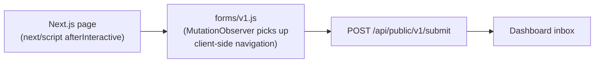

# Embedding SendCMS in Next.js

Add a SendCMS contact form to a Next.js site (App Router or Pages
Router) with `next/script` and a normal HTML form. Put the ids on the
**form** itself — a form's own data attributes win over the script
tag's in the SDK's config resolution, and they are re-read on every
scan, so they work regardless of how the script tag was loaded.



## Contents

- [Prerequisites](#prerequisites)
- [1. Add the form to a page](#1-add-the-form-to-a-page)
- [2. Client-side navigation](#2-client-side-navigation)
- [3. Check it works](#3-check-it-works)
- [Alternative: server action / route handler](#alternative-server-action--route-handler)

## Prerequisites

- A Next.js site (App Router or Pages Router)
- A SendCMS account with a verified domain and a form (see
  [Getting started](getting-started.md))
- Your **userId** and the form's **formId** from the dashboard
  (form detail page → "Embed on your site")

| Placeholder    | Replace with                                                               |
| -------------- | -------------------------------------------------------------------------- |
| `YOUR_APP`     | Your SendCMS deployment URL (the api app, e.g. `https://api.sendcms.bond`) |
| `YOUR_USER_ID` | Your public user id (form detail page)                                     |
| `YOUR_FORM_ID` | The form's id (form detail page)                                           |

## 1. Add the form to a page

Put `data-user-id` and `data-form-id` on the **form** itself — that is
the most reliable place for them: the form's own attributes win over
the script tag's in the SDK's config resolution, and they survive any
difference in how the script tag is loaded. Add the script with
`next/script` (or a plain `<script>` tag).

```tsx
// app/contact/page.tsx
import Script from "next/script"

export default function ContactPage() {
  return (
    <>
      <Script src="https://YOUR_APP/forms/v1.js" strategy="afterInteractive" />
      <form
        data-cms-form
        data-user-id="YOUR_USER_ID"
        data-form-id="YOUR_FORM_ID"
      >
        <label>
          Name
          <input name="name" required />
        </label>
        <label>
          Email
          <input name="email" type="email" required />
        </label>
        <label>
          Message
          <textarea name="message" required />
        </label>
        <button type="submit">Send</button>
      </form>
    </>
  )
}
```

Replace `YOUR_APP`, `YOUR_USER_ID`, and `YOUR_FORM_ID` with your values.
The form's fields must match the fields configured on the form in the
dashboard — extra field names are rejected by the API.

For the Pages Router the same markup works inside any page component
(`next/script` with `strategy="afterInteractive"`).

## 2. Client-side navigation

The SDK watches the DOM with a `MutationObserver` and enhances forms
whenever they appear, so client-side navigation needs no extra code.
If you add a form dynamically after the SDK has loaded, call
`window.SendCMS.scan()` after inserting it — or `window.SendCMS.init()`
to (re-)register callbacks. In App Router those manual
`window.SendCMS.*` calls must live in a Client Component (`"use
client"` at the top of the file) — a Server Component cannot touch
`window`. The snippet above needs no `"use client"` itself.

### Turnstile

If the form has Turnstile enabled, the SDK needs its site key: add
`data-turnstile-site-key="…"` to the `<Script>` tag (or to the form,
or pass it to `SendCMS.init()`). Without the key the SDK never loads
Turnstile and the API rejects every submission with 422
(`"Verification is required for this form."`). The snippet copied
from the dashboard already includes the key when Turnstile is on —
and shows a warning instead of a snippet when no site key is
configured. Full reference: [SDK — Turnstile](sdk.md#turnstile).

## 3. Check it works

1. Submit the form on your site. You should see the success message
   (or your configured redirect).
2. Open **Inbox** in the SendCMS dashboard — the submission appears
   there with the page URL and origin domain.
3. If it returns 403, the page's origin is not a verified domain linked
   to the form — see [Troubleshooting](troubleshooting.md).

Full SDK reference: [SDK](sdk.md).

## Alternative: server action / route handler

If you prefer to submit from your own backend instead of the browser,
POST from your server to the REST API ([REST API](rest-api.md)) with
your `userId`/`formId` and an `Origin` header of one of your verified
domains. The SDK is the simpler path for most sites.
