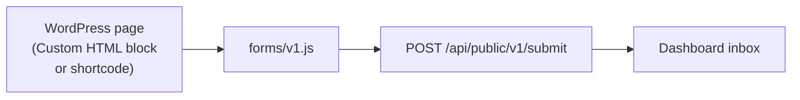

# Embedding SendCMS in WordPress

Add a SendCMS contact form to a WordPress site with one script tag
and a normal HTML form — either paste both into a Custom HTML block,
or enqueue the script from your theme and render the form with a
shortcode. The second path works no matter which role edits the page.



## Contents

- [Prerequisites](#prerequisites)
- [1. Custom HTML block](#1-custom-html-block)
- [Who can paste a script tag](#who-can-paste-a-script-tag)
- [2. functions.php: script + shortcode (works for all roles)](#2-functionsphp-script--shortcode-works-for-all-roles)
- [3. Check it works](#3-check-it-works)

## Prerequisites

- A WordPress site (self-hosted, or WordPress.com with a plan that
  allows custom plugins/themes — script tags do not work on
  WordPress.com's free plan)
- A SendCMS account with a verified domain and a form (see
  [Getting started](getting-started.md))
- Your **userId** and the form's **formId** from the dashboard
  (form detail page → "Embed on your site")

| Placeholder    | Replace with                                                               |
| -------------- | -------------------------------------------------------------------------- |
| `YOUR_APP`     | Your SendCMS deployment URL (the api app, e.g. `https://api.sendcms.bond`) |
| `YOUR_USER_ID` | Your public user id (form detail page)                                     |
| `YOUR_FORM_ID` | The form's id (form detail page)                                           |

## 1. Custom HTML block

If the person editing the page has the `unfiltered_html` capability
(see below), paste the SDK snippet and a normal form into a
**Custom HTML block** — exactly as in [plain HTML](embed-html.md):

```html
<script
  src="https://YOUR_APP/forms/v1.js"
  data-user-id="YOUR_USER_ID"
  data-form-id="YOUR_FORM_ID"
></script>

<form data-cms-form>
  <label>
    Name
    <input name="name" required />
  </label>
  <label>
    Email
    <input name="email" type="email" required />
  </label>
  <label>
    Message
    <textarea name="message" required></textarea>
  </label>
  <button type="submit">Send</button>
</form>
```

Replace `YOUR_APP`, `YOUR_USER_ID`, and `YOUR_FORM_ID` with your values.
The form's fields must match the fields configured on the form in the
dashboard — extra field names are rejected by the API.

### Turnstile

If the form has Turnstile enabled, the SDK needs its site key: add
`data-turnstile-site-key="…"` to the script tag (or to the form).
Without the key the SDK never loads Turnstile and the API rejects
every submission with 422
(`"Verification is required for this form."`). The snippet copied
from the dashboard already includes the key when Turnstile is on.
Full reference: [SDK — Turnstile](sdk.md#turnstile).

## Who can paste a script tag

WordPress filters saved content with `wp_kses` unless the user who
saves the page has the `unfiltered_html` capability ("allows user to
post HTML markup or even JavaScript code in pages, posts, comments
and widgets"). Without it, the filter silently strips the `<script>`
tag — and, since WordPress 5.0.1, the `<form>` element too — when the
page is saved, with no warning. The form simply never appears.

| Role | Single site | Multisite |
| ---- | ----------- | --------- |
| Super Admin | — | Yes |
| Administrator | Yes | No |
| Editor | Yes | No |
| Author, Contributor, Subscriber | No | No |

Two gotchas:

- **Who saves matters, not who pasted.** If an Administrator adds
  the snippet and an Author later edits and saves the same page,
  WordPress filters the content for the Author on that save and the
  script disappears.
- **It can be switched off for everyone.** If `DISALLOW_UNFILTERED_HTML`
  is defined in `wp-config.php`, nobody can save unfiltered HTML —
  not even an Administrator. Use the `functions.php` path below.

If anyone without the capability has to edit the page, do not use
the Custom HTML block path — use the shortcode path instead.

## 2. functions.php: script + shortcode (works for all roles)

Theme code is never passed through `wp_kses`, so this path works no
matter which role edits the page. Add both pieces to your theme's
`functions.php` — use a **child theme**, or a code-snippets plugin,
so a theme update does not wipe them.

First, enqueue the SDK script:

```php
// functions.php — load the SendCMS SDK on every page.
function sendcms_enqueue_form_script() {
    wp_enqueue_script(
        'sendcms-form',
        'https://YOUR_APP/forms/v1.js',
        array(),
        null,
        true
    );
}
add_action( 'wp_enqueue_scripts', 'sendcms_enqueue_form_script' );
```

Then register a shortcode that renders the form. Shortcode output is
generated when the page is displayed, not saved as post content, so
`wp_kses` never touches it — any role can type `[sendcms_form]` into
a paragraph on any page:

```php
// functions.php — [sendcms_form] renders the contact form.
function sendcms_form_shortcode() {
    ob_start();
    ?>
    <form data-cms-form data-user-id="YOUR_USER_ID" data-form-id="YOUR_FORM_ID">
      <label>
        Name
        <input name="name" required />
      </label>
      <label>
        Email
        <input name="email" type="email" required />
      </label>
      <label>
        Message
        <textarea name="message" required></textarea>
      </label>
      <button type="submit">Send</button>
    </form>
    <?php
    return ob_get_clean();
}
add_shortcode( 'sendcms_form', 'sendcms_form_shortcode' );
```

Replace `YOUR_APP`, `YOUR_USER_ID`, and `YOUR_FORM_ID` with your values.
The user and form ids live on the `<form>` itself — the SDK reads
them from there first — so the enqueued script needs no extra
attributes. If the form has Turnstile enabled, add
`data-turnstile-site-key="…"` to the `<form>` tag as well; without it
the API rejects every submission with 422
(`"Verification is required for this form."`).

## 3. Check it works

1. Submit the form on your site. You should see the success message
   (or your configured redirect).
2. Open **Inbox** in the SendCMS dashboard — the submission appears
   there with the page URL and origin domain.
3. If it returns 403, the page's origin is not a verified domain linked
   to the form — see [Troubleshooting](troubleshooting.md).
4. If the form is missing from the page entirely, reopen the page in
   the editor: a stripped `<script>` or `<form>` tag means the page
   was last saved by a user without `unfiltered_html` — switch to the
   shortcode path above.

Full SDK reference: [SDK](sdk.md). Direct endpoint:
[REST API](rest-api.md).
