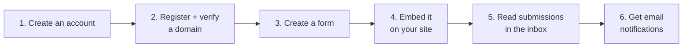

# Getting started with SendCMS

SendCMS is a contact-form backend for any website — Astro, Next.js, Hugo,
WordPress, or plain HTML. You register your domain, create a form, paste one
script tag, and every submission lands in a dashboard inbox with spam
filtering and email notifications. No server code on your site, no API keys.



## Contents

- [1. Create an account](#1-create-an-account)
- [2. Register and verify a domain](#2-register-and-verify-a-domain)
- [3. Create a form](#3-create-a-form)
- [4. Put the form on your site](#4-put-the-form-on-your-site)
- [5. Read submissions in the inbox](#5-read-submissions-in-the-inbox)
- [6. Email notifications](#6-email-notifications)
- [What SendCMS does not do](#what-sendcms-does-not-do)

## 1. Create an account

1. Open the app and go to **Sign up**.
2. Sign up with Google, GitHub, or Facebook — or with email and password.
3. If you signed up with email and password, check your inbox for the
   verification email and click the link. **You cannot register a domain
   until your email is verified.**
4. Sign in. The first account ever created on an instance becomes the
   platform owner.

Notes on OAuth email verification:

| Provider     | Email trusted?                                                                                                                                                            |
| ------------ | ------------------------------------------------------------------------------------------------------------------------------------------------------------------------- |
| **Google**   | Yes — when Google reports the address as verified.                                                                                                                        |
| **GitHub**   | Yes — when GitHub reports the address as verified.                                                                                                                        |
| **Facebook** | No — Facebook confirms the address exists, not that it is verified. Facebook sign-ins land unverified and get a verification email; click it before registering a domain. |

If you signed in before verifying, the dashboard shows a
**Resend verification email** button on the account page. Verification
links are valid for 24 hours. Password-reset links are valid for 1 hour.

## 2. Register and verify a domain

Submissions are accepted only from domains you own and verified. This is
what stops anyone else from pointing a form at your inbox.

1. Go to **Domains → New domain** and enter your domain — `example.com`.
   Schemes, paths, ports, and a leading `www.` are stripped automatically,
   so `https://www.example.com/blog` registers as `example.com`.
2. Pick a verification method. All three use the **same 48-character
   challenge** — switching methods never changes the value.

### DNS TXT (recommended)

Add a TXT record at your DNS provider:

| Field | Value                                          |
| ----- | ---------------------------------------------- |
| Name  | `sendcms._domainkey.example.com`               |
| Value | the 48-character code shown on the domain page |

Wait for DNS propagation (usually minutes, sometimes up to an hour),
then click **Check verification**. A verification stays pending for 7
days and allows 10 attempts; after that, start a new verification.

### Meta tag

Add this tag inside the `<head>` of your site's home page, then click
**Check verification**:

```html
<meta name="sendcms-verification" content="YOUR_48_CHAR_CODE" />
```

### Verification file

Save a file named `sendcms-verification.txt` containing only the code
(no extra text) and upload it to your site's **public folder** — the same
place `ads.txt` goes — so it is served at:

```text
https://example.com/sendcms-verification.txt
```

The domain page offers a **Download** button that saves the file with the
right name and contents. Then click **Check verification**.

A domain shows **Verified** once a check passes. You can suspend a
verified domain at any time (its forms stop accepting submissions from
it) and reactivate it later. A domain linked to a form cannot be deleted
until it is unlinked.

## 3. Create a form

1. Go to **Forms → New form** and give it a name, e.g. `Contact us`.
2. Every new form starts with three required fields: **name** (text),
   **email** (email), **message** (long text). Add, edit, or remove fields
   from the form detail page — 10 types are available (text, email, long
   text, number, select, checkbox, radio, URL, phone, date).
3. Link at least one **verified** domain on the form detail page. Only
   linked domains can submit to the form. A pending domain cannot be
   linked.
4. Optional settings on the form detail page:

   | Setting                 | What it does                                                                                                                                               |
   | ----------------------- | ---------------------------------------------------------------------------------------------------------------------------------------------------------- |
   | **Success message**     | Shown after a successful submit.                                                                                                                           |
   | **Redirect URL**        | Where the visitor goes after submitting (SDK and no-JS fallback follow it; the REST API returns it in the response).                                       |
   | **Daily limit**         | Maximum submissions per day (empty = unlimited).                                                                                                           |
   | **Honeypot**            | On by default; an invisible trap field catches bots.                                                                                                       |
   | **Turnstile**           | Cloudflare Turnstile challenge; needs `TURNSTILE_SECRET_KEY` (and `NEXT_PUBLIC_TURNSTILE_SITE_KEY` for the SDK). Turnstile failures reject the submission. |
   | **Notification emails** | One or more addresses that receive an email per submission. Each address can be enabled or disabled.                                                       |

5. Note the form's **formId** and your **userId** on the form detail page
   (the "Embed on your site" section shows a ready-made snippet). Both
   are public identifiers — they go in your site's code.

## 4. Put the form on your site

The fastest way is the SDK — one script tag plus a normal HTML form.
See [SDK](sdk.md) for the full reference and [REST API](rest-api.md) for
the direct endpoint and the no-JS fallback.

```html
<script
  src="https://YOUR_APP/forms/v1.js"
  data-user-id="YOUR_USER_ID"
  data-form-id="YOUR_FORM_ID"
></script>

<form data-cms-form>
  <input name="name" placeholder="Your name" required />
  <input name="email" type="email" placeholder="you@example.com" required />
  <textarea name="message" placeholder="Your message" required></textarea>
  <button type="submit">Send</button>
</form>
```

Framework-specific guides: [Astro](embed-astro.md),
[Next.js](embed-nextjs.md), [Hugo](embed-hugo.md),
[plain HTML](embed-html.md).

## 5. Read submissions in the inbox

Go to **Inbox**. Submissions appear with sender, message preview, form,
origin domain, and time. Tabs filter All / Unread / Read / Starred /
Archived / Spam; search matches name, email, message, origin, and page
URL; filters narrow by form, domain, and date. Opening a submission
marks it read. Actions — read/unread, star, archive/restore, spam /
not-spam, delete — work on one submission or in bulk.

Submissions flagged as spam still appear in the inbox (Spam tab) but
never trigger a notification email.

## 6. Email notifications

Each form's notification recipients get an email per submission
(form name, sender, all field values, page URL, origin domain, link to
the inbox). Delivery runs through an outbox with retries — if the email
provider is down, the submission is still saved and the notification is
retried later (1m, 5m, 15m, 1h, 4h). See
[Email notifications](email-notifications.md) for provider setup and the
delivery log.

## What SendCMS does not do

- No API keys. A submission is accepted only when its `Origin` is a
  verified domain linked to the form.
- No per-site SMTP setup. Notifications use one platform provider
  (Resend, or SMTP as a fallback).
- No accounts for your visitors. Your visitors never sign in — only you
  have a SendCMS account.
