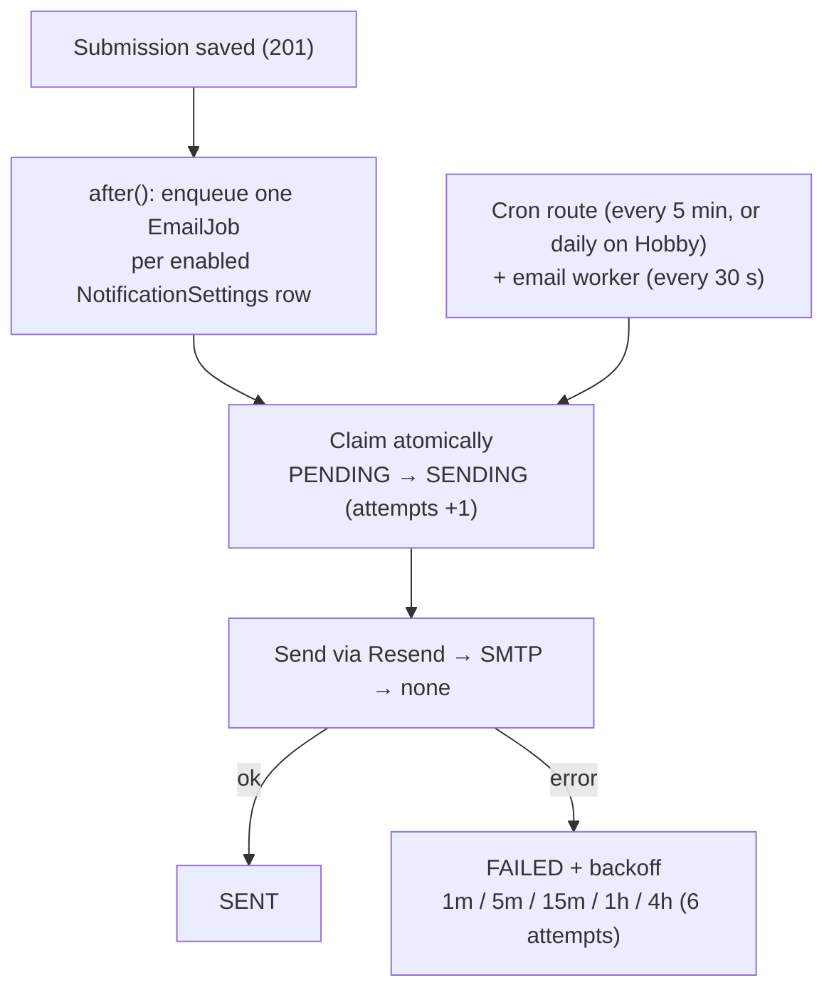

# Operations runbook

How SendCMS runs in production. Deployment (builds, dashboard steps,
per-app wrangler files) lives in [Deployment](../deployment.md) and
`infrastructure/cloudflare/README.md`; this document is the
day-to-day operating picture: what runs where, what the env vars do,
and what to check when something is wrong.

📌 **Production is `sendcms.bond`** (decided 2026-11-20), running the
`feature/ai` branch on Vercel. The `feature/admin-control-plane`
branch (this branch) is **not deployed** — the ✅ items marked
"on this branch" below exist in code here, not in production.

## Contents

- [What runs where](#what-runs-where)
- [Environment variables (per app)](#environment-variables-per-app)
- [The email outbox (how notifications actually flow)](#the-email-outbox-how-notifications-actually-flow)
- [Database backup, migrations, and rollback](#database-backup-migrations-and-rollback)
- [Logs and the audit log](#logs-and-the-audit-log)
- [Security posture (what is and isn't in place)](#security-posture-what-is-and-isnt-in-place)
- [When something is wrong](#when-something-is-wrong)
- [Incidents](#incidents)
- [Failover, per tier (PRF-017 — accepted risk)](#failover-per-tier-prf-017--accepted-risk)

## What runs where

Five Cloudflare Workers, one per app (Phase 10). Each app owns its
`wrangler.jsonc` + `open-next.config.ts`; the shared OpenNext config
(R2 incremental cache) lives in `infrastructure/cloudflare/`.

| App       | Worker name         | Serves                                          |
| --------- | ------------------- | ----------------------------------------------- |
| marketing | `sendcms-marketing` | Landing, terms, sitemap, robots                 |
| api       | `sendcms`           | All API routes, auth, public submit, SDK bundle |
| dashboard | `sendcms-dashboard` | Auth pages + dashboard                          |
| docs      | `sendcms-docs`      | User docs                                       |
| updates   | `sendcms-updates`   | Changelog                                       |

All five share one R2 bucket (`open-remark-opennext-cache`) for the
incremental cache — it is a real Cloudflare resource, so renaming it
needs a new bucket created in the dashboard first. The workers also
share the Images binding and the self-reference service binding
(`WORKER_SELF_REFERENCE` → the worker's own name).

The **email worker** (`services/email-worker`) does **not** deploy to
Cloudflare Workers — it is a long-running Node process (`GET /health`
on `WORKER_PORT`, default 3005; polls the outbox every
`WORKER_POLL_INTERVAL_MS`, default 30 s; graceful SIGTERM/SIGINT
shutdown). Its production hosting is a separate decision. Until it is
hosted, the cron route (`GET /api/cron/email-outbox`) is the hosted
drain for failed deliveries — schedule it every 5 minutes with a
`Bearer <CRON_SECRET>` header (on Vercel Hobby it currently runs once
daily; see [Deployment](../deployment.md#email-outbox-cron)).

The **admin app** (`apps/admin`, :3006, `admin.sendcms.bond`) exists
only on the `feature/admin-control-plane` branch — it is not deployed
and not part of the five-worker Cloudflare set above. Its own
`wrangler.jsonc` already uses `sendcms.bond` vars.

⚠️ The five original apps' `wrangler.jsonc` `vars` still use
`jadoo.bond` hosts as placeholders (`https://jadoo.bond`,
`https://api.jadoo.bond`, `https://dashboard.jadoo.bond`, …) even
though the production domain is decided. When the domain is decided
for the Cloudflare path, change the `vars` in all five
`wrangler.jsonc` files together — and the `FALLBACK_APP_URL` in the
per-app `lib/utils.ts` files, which uses the same placeholder.

## Environment variables (per app)

Secrets are set in the Cloudflare dashboard per worker, never in a
file. `wrangler.jsonc` holds only non-secret `vars` (plus a comment
listing the secrets each worker needs). The full table with
descriptions is in [Deployment](../deployment.md#environment-variables).

| Variable                                                  | Where                            | Notes                                                                                      |
| --------------------------------------------------------- | -------------------------------- | ------------------------------------------------------------------------------------------ |
| `DATABASE_URL`                                            | api, dashboard, admin            | Postgres connection string (`?sslmode=verify-full` for Prisma Postgres).                   |
| `BETTER_AUTH_SECRET`                                      | api, dashboard, admin            | Random 32+ char secret. No fallback — auth refuses to start without it.                    |
| `BETTER_AUTH_URL`                                         | api                              | The api app's public URL (the auth handler lives there).                                   |
| `TRUSTED_ORIGINS`                                         | api                              | Comma-separated origins allowed to call auth (the dashboard and admin apps' URLs).         |
| `NEXT_PUBLIC_APP_URL`                                     | all six                          | The marketing app's public URL.                                                            |
| `NEXT_PUBLIC_API_URL`                                     | marketing, dashboard, api, admin | The api app's public URL (SDK bundle origin + submit API).                                 |
| `NEXT_PUBLIC_DASHBOARD_URL`                               | marketing, dashboard, api, admin | The dashboard app's public URL (auth callback + inbox links).                              |
| `NEXT_PUBLIC_DOCS_URL`                                    | marketing, docs                  | The docs app's public URL.                                                                 |
| `NEXT_PUBLIC_UPDATES_URL`                                 | marketing, updates               | The updates app's public URL.                                                              |
| `NEXT_PUBLIC_AUTH_URL`                                    | dashboard, admin                 | The api app's public URL (the auth client talks to it).                                    |
| `GOOGLE_CLIENT_ID` / `GOOGLE_CLIENT_SECRET`               | api                              | Google OAuth. Redirect URI: `<API_URL>/api/auth/callback/google`.                          |
| `GITHUB_CLIENT_ID` / `GITHUB_CLIENT_SECRET`               | api                              | GitHub OAuth (only offered when set).                                                      |
| `FACEBOOK_CLIENT_ID` / `FACEBOOK_CLIENT_SECRET`           | api                              | Facebook OAuth (only offered when set).                                                    |
| `RESEND_API_KEY`                                          | api                              | Resend API key (set separately in deployment env).                                         |
| `RESEND_FROM`                                             | api                              | A sending address on a verified Resend domain.                                             |
| `SMTP_*`                                                  | api                              | SMTP fallback when no Resend key is set.                                                   |
| `CRON_SECRET`                                             | api                              | Bearer token for the email-outbox cron.                                                    |
| `TURNSTILE_SECRET_KEY` / `NEXT_PUBLIC_TURNSTILE_SITE_KEY` | api                              | Cloudflare Turnstile (forms that enable it answer 503 without the secret).                 |
| `COOKIE_DOMAIN`                                           | api, dashboard, admin            | Production only, when the apps run on subdomains of one domain. Unset = host-only cookies. |
| `LOG_LEVEL`                                               | all                              | `info` / `warn` / `error` (default `info`).                                                |
| `WORKER_PORT` / `WORKER_POLL_INTERVAL_MS`                 | email worker                     | Defaults 3005 / 30000.                                                                     |

## The email outbox (how notifications actually flow)

1. A submission is saved (201). In `after()`, the submit route
   enqueues one `EmailJob` per enabled `NotificationSettings` row and
   runs `processEmailOutbox()` once for immediate delivery.
2. A due job is claimed atomically (`PENDING` → `SENDING`, attempts
   incremented), sent via Resend → SMTP → none, then marked `SENT`
   or, on failure, `FAILED` with a backoff (1m / 5m / 15m / 1h / 4h,
   6 attempts). A job whose send fails with no provider configured
   stays `PENDING` — the send is retried, never lost.
3. The cron route and the email worker both drain the same outbox
   (`processEmailOutbox({ limit })`); the worker polls every 30 s,
   the cron every 5 min. Either can run alone; running both is safe
   (claiming is atomic). On the Hobby plan the cron runs only once
   daily (`0 0 * * *`, owner decision 2026-11-20) — it is the
   _fallback_ drain, not the prompt path: with the worker running, a
   job is normally sent within one poll interval, and the cron only
   catches what the worker missed (EML-013). When the plan allows
   it, the schedule goes back to `*/5 * * * *`.
4. The same cron hit (and the worker) also runs the AI background
   jobs — spam re-scoring (`rescoreNewSubmissions`) and the inbox
   digest (`sendDueDigests`). Both are gated on the `ai-spam-rescore`
   / `ai-digest` feature flags, seeded disabled by migration
   `20261125091400_wave8d_seed_platform_settings`; enable them in
   `/admin/features` once a platform AI key is configured. If the
   jobs return zero counts, check the flags first — a missing or
   disabled flag turns its job off by design (see
   [Deployment](../deployment.md#ai-background-jobs)).
5. Auth mail (verification + password reset) is sent directly, and
   with no provider configured the dev server logs the link
   (`[auth-email] …`) while production fails loudly. When a
   configured provider fails the send, the failure is logged at
   error level (recipient + kind) and a durable, retryable outbox
   job (type `EMAIL_VERIFICATION` / `PASSWORD_RESET`) is enqueued,
   so the next drain retries it — the user is not left waiting on a
   mail that silently never existed (EML-009).

## Database backup, migrations, and rollback

There are **no down migrations by design** (0 in the repo). Schema
rollback therefore means one of the two procedures below — never
hand-editing `_prisma_migrations` (that table is edited only via a
restore, never by hand: a hand-edited row makes `migrate deploy`
disagree with the database about what has applied).

### Pre-destructive-migration backup (required)

Any migration containing `DROP TABLE` or `DROP COLUMN` must pass
this checklist item in review **before** it is applied anywhere
shared:

1. Take a backup first: `pg_dump -Fc` against the target database
   (or a provider snapshot on Prisma Postgres), and keep it with a
   stated retention (at least until the migration has been verified
   in production).
2. Verify the backup restores: restore it to a scratch database and
   confirm the app boots against it (a backup that has never been
   restored is not a backup).
3. Only then run `pnpm db:migrate:deploy`.

The historical removal of the comment system (migration
`20261118084500_remove_comment_system`, 9 tables + 3 enums, DB-019)
was owner-approved but shipped with **no** backup step recorded
anywhere — that gap is recorded here so it is not repeated, not as
a defect in the removal decision itself.

### Schema-rollback procedure

To roll the schema back to before migration N:

1. **Restore from backup (the only full rollback):** restore the
   backup taken before migration N. This loses every write made
   after N — say so in the incident record before doing it.
2. **Or a compensating forward migration (DDL only):** hand-write a
   new migration that reverses the DDL (re-create the table/column,
   re-add the enum value where Postgres allows it). This recovers
   the schema shape, **not the data**: anything dropped by `DROP
TABLE` / `DROP COLUMN` cannot be recovered by a forward
   migration — only the backup has it. Enum values cannot be
   dropped at all, so a rollback across an enum-add migration
   leaves the value in place (harmless) or needs the table
   recreated.
3. Never edit `_prisma_migrations` by hand to "un-apply" a
   migration — that corrupts the applied-migration record. The
   restore path rewrites the table correctly; the forward path
   leaves it alone (N stays applied, N+1 reverses it).

**Not the same as plan-version rollback.** The "rollback" in
[plan-versioning.md](../admin-control-plane/plan-versioning.md) is
a business-domain operation — running a new migration back to a
previous plan version for a subscription. It touches plan data, not
the schema. Do not confuse the two when reading incident notes.

### Pre-deploy auth check (DB-006)

Migration `20261117224500_switch_auth_to_better_auth` reshapes the
auth tables (drops OAuth tokens, sessions, verification tokens, and
resets `emailVerified`). Its header claims "sendcms was never
deployed, so no production rows existed" — that claim is
**unverified against the production database** and is recorded as
such, not as a fact. Before applying this migration on **any** new
environment, assert the `User` / `Account` / `Session` row counts
are 0 (or the expected seed-only counts). If they are not, stop:
the migration fails part-way on its `NOT NULL` adds and destroys
auth state on a populated DB.

### Backups and point-in-time recovery (PRF-016 — UNVERIFIED)

**No backup evidence exists for the production Prisma Postgres
database, and none is claimed here.** No backup schedule, snapshot
policy, PITR setting, `pg_dump` step, or retention statement exists
anywhere in the repo or its deployment configs, and no restore has
ever been tested. The owner must confirm in the Prisma dashboard
what the plan provides and record the answers here:

- Automated backups? (yes/no)
- PITR window? (hours/days, or none)
- Retention? (days)

**Status: NOT CONFIRMED — owner-side, unverified.** Until the
answers are recorded, treat the production DB as having no proven
backup. If the plan provides nothing, the fallback is an
owner-side setup task: a scheduled `pg_dump -Fc` job (or provider
snapshot) with a stated retention — not a repo change.

**Restore drill (run once the mechanism is known, then yearly):**
restore the latest backup to a scratch database, point a local api
server at it, and confirm sign-in, the dashboard inbox, and one
public submit all work. Record the drill date and result here.

### Deploy gate — Render free plan (LVE-015)

Render's `preDeployCommand` (`pnpm db:migrate:deploy` on the api
service) is a **paid-plan feature and never runs on the free plan**.
A Render deploy is therefore **blocked** until `pnpm
db:migrate:deploy` has been run manually against the production
`DATABASE_URL` and confirmed applied. Deploying code against an
unmigrated DB is the failure this gate prevents — see
[deployment/platforms.md](../deployment/platforms.md#render).

### Migration hygiene (DB-043)

- **Descriptive names, permanent once applied.** A migration
  directory name describes the change (`add_<thing>`,
  `seed_<thing>`); never a bare generic word (`init`, `update`,
  `fix`) unless it is the first migration. Renaming a directory
  breaks `_prisma_migrations` matching, so a misleading name
  (e.g. `20260520103642_init`, which only changes a column default)
  is never renamed — it is grandfathered and documented instead.
- **Validate with `migrate dev` against a live shadow DB.**
  Migrations must be produced by `prisma migrate dev`, not offline
  `prisma migrate diff`. The one exception is
  `20261117185033_add_contact_form_models` (the largest migration,
  generated offline — its header says so honestly; it applies
  cleanly from a fresh database). No new migration may carry a "no
  shadow DB" disclaimer.
- **Multi-value enum adds carry the PG ≤ 11 warning comment** that
  migrations #28/#32/#33 carry for the same pattern (adding two
  values to one enum in one migration needs Postgres ≥ 12).
  Migration #36 (`20261122070123_add_step_up_verification`) lacks
  the comment — applied migrations are never edited, so the
  convention is recorded here for future ones instead.
- **Tie-break rule:** a "first row" pick orders by `(createdAt,
id)`, never by `createdAt` alone — two rows can share the
  earliest timestamp (DB-044: the RBAC backfill's `ORDER BY
"createdAt" ASC LIMIT 1` was arbitrary on ties).
- **Cuid PKs in hand-written data migrations.** New rows use the
  repo's `cuid()` convention (or deterministic literal ids in seed
  SQL) — never `gen_random_uuid()` / `uuid_generate` (DB-044).
- **Destructive-warning gate:** a `migration.sql` containing
  Prisma's "data will be lost" warning header must ship a
  `destructive-acknowledged.md` in its own directory, recording
  the approval — see `tests/migration-hygiene.test.ts`. The three
  historical migrations that carry the header
  (`20260509102410_add_commenter_and_likes`,
  `20260616043423_rbac_roles`, `20261122050526_add_countries_table`)
  are grandfathered in that test with their reasons; they are not
  edited.
- **Minimum Postgres is 17** (see [Deployment](../deployment.md#requirements)
  — docker-compose pins `postgres:17-alpine`).

### Drift check (DB-020)

The single-platform-owner partial unique index
(`User_single_platform_owner_idx`) is hand-written in migration
`20261117190655_single_platform_owner` because Prisma cannot
express a partial index; it is documented in a comment on
`User.platformRole` in `schema.prisma`. The drift check — `prisma
migrate diff --from-migrations --to-schema` reporting exactly this
one index and nothing else — **stays open**: it needs a shadow DB,
which does not exist on db.prisma.io (owner decision 2026-11-24:
fresh-DB test only, no shadow DB).

## Logs and the audit log

- Server logs are JSON lines (`createLogger(scope)` from
  `@sendcms/observability`): `{ timestamp, level, scope, message,
...fields }` on stdout (info/warn) or stderr (error). An `error`
  field holding an Error is flattened to `{ name, message, stack }`.
  Scope values: `api`, `submissions`, `email-worker`, `audit`.
  `LOG_LEVEL` gates the level.
- The **audit log** (`AuditLog` table) records domain, form,
  submission, and user actions (CREATE/UPDATE/DELETE/VERIFY/SUSPEND/
  REACTIVATE) via the one `logAudit()` writer in `@sendcms/security`.
  It never blocks the action it records (best-effort, never throws)
  and never records submission content. There is no admin UI for
  reading it — query the table directly. (On the
  `feature/admin-control-plane` branch there is an audit explorer at
  `/admin/audit-logs` — see
  [admin-control-plane/admin-audit-trail.md](../admin-control-plane/admin-audit-trail.md).)
- What to check first when something is wrong: the api worker's logs
  for `scope: "api"` errors (unhandled API errors) and
  `scope: "submissions"` errors (failed notification enqueue); the
  worker's logs for `scope: "email-worker"` poll failures; and the
  `EmailJob` table for stuck `PENDING` jobs (a job stuck past its
  5th attempt is `FAILED` — terminal, needs a human look).

## Security posture (what is and isn't in place)

- Security headers come from one shared definition in
  `@sendcms/security` (each app's `next.config.mjs` `headers()` +
  that app's `public/_headers`). ✅ On this branch (Phase 9) a
  nonce-based Content-Security-Policy is **enforcing** on all five
  page apps — see
  [admin-control-plane/csp.md](../admin-control-plane/csp.md). It is
  **not deployed** (this branch is unmerged); production still has
  no CSP.
- ✅ On this branch (Phase 9) the admin REST API and the auth routes
  **are rate limited** (admin API 600/min + 10,000/hour per user;
  sign-in 20/min per IP + 10/min per email) — see
  [admin-control-plane/rate-limiting.md](../admin-control-plane/rate-limiting.md).
  In production (the `feature/ai` branch) the gap from ADR 0008 still
  stands: the public submit API is the only rate-limited surface
  (DB-backed: 10/min + 100/hour per IP, per-form daily cap).
- Registration is enable/disable-able from dashboard settings; new
  users are never auto-approved (the admin manually approves each
  account); email verification after registration is mandatory.
  Sensitive profile actions (password/email changes, 2FA changes)
  require email-OTP verification on top of password confirmation.
- ✅ On this branch there **is** an MCP server (`POST /api/mcp`,
  19 tools, bearer API keys — see [MCP](../mcp.md)) and AI features
  (`packages/ai`: spam re-scoring, digest, form-builder, reply
  drafts). Both are live on the `feature/ai` production branch; the
  admin-side MCP controls live on this branch only.

## When something is wrong

| Symptom                                                      | First check                                                                                                                                                                                                                                                                  |
| ------------------------------------------------------------ | ---------------------------------------------------------------------------------------------------------------------------------------------------------------------------------------------------------------------------------------------------------------------------- |
| Submissions not arriving in the inbox                        | The api worker's logs; then the `Submission` table (was it saved?) vs the `EmailJob` table (was the notification enqueued?). A 201 with no inbox row means the save failed — check the submit route's `scope: "submissions"` error.                                          |
| AI re-scoring / digests never run (cron returns zero counts) | The `ai-spam-rescore` / `ai-digest` flags in `/admin/features` — both are seeded **disabled** and gate their jobs (missing/disabled = job off, by design). Enable with a reason once a platform AI key is configured. See [Deployment](../deployment.md#ai-background-jobs). |
| Emails not arriving                                          | `EmailJob` rows for the form (stuck `PENDING` = the drain isn't running — check the cron schedule / worker health; `FAILED` = provider error, read the job's error). Then the Resend dashboard.                                                                              |
| Sign-in fails with 403                                       | `BETTER_AUTH_URL` vs the request `Origin` (the api app's URL must match) and `TRUSTED_ORIGINS` (must include the dashboard and admin apps' URLs).                                                                                                                            |
| Verification link lands on the wrong host                    | `NEXT_PUBLIC_DASHBOARD_URL` (the callback URL is built from it on the server).                                                                                                                                                                                               |
| Dashboard shows a 500 on `/sign-in`                          | The callback-URL helper falls back to `NEXT_PUBLIC_DASHBOARD_URL` during SSR — check it is set.                                                                                                                                                                              |
| CI fails on a fresh checkout                                 | `pnpm db:generate` and `pnpm sdk:build` run before typecheck/lint/test (the Prisma client and the SDK bundle are both gitignored).                                                                                                                                           |

## Incidents

(DOC-051 — added Phase 16, Wave 11. There is no on-call rotation and no
paging: SendCMS is a single-owner operation. This section exists so an
outage is handled the same way every time instead of ad hoc, and so a
user filing a ticket gets a written response-time commitment.)

### Severity

| Severity | Meaning                                      | Examples                                                                                                     |
| -------- | -------------------------------------------- | ------------------------------------------------------------------------------------------------------------ |
| SEV-1    | The platform is down or losing customer data | api returns 5xx on submit / sign-in for all users; database unreachable; submissions accepted but not stored |
| SEV-2    | A core flow is broken for many users         | email notifications not sending (outbox stuck); dashboard inbox not loading; one provider's checkout failing |
| SEV-3    | Degraded or single-user impact               | one form's notifications delayed; one user's sign-in failing; a docs page rendering wrong                    |
| SEV-4    | Cosmetic / no user impact                    | typo on a marketing page; a stale changelog entry                                                            |

### First actions (declare → mitigate → communicate → record)

1. **Declare.** Decide the severity from the table above and say it out
   loud (in the incident note — see step 4): what is broken, since when,
   and who is affected. A SEV-1/2 is declared even before the cause is
   known; do not wait for a diagnosis to call it an incident.
2. **Mitigate before diagnosing.** Stop the bleeding first: for a bad
   deploy, roll back (see [Deployment](../deployment.md) rollback notes
   and "Database backup, migrations, and rollback" above — restore from
   the pre-migration backup, never hand-edit `_prisma_migrations`); for
   a stuck email outbox, trigger the cron route / restart the email
   worker; for a provider outage (Resend, Stripe, PayPal), confirm the
   provider status page and wait it out — do not retry blindly against
   a down provider. Mitigation is "users can submit / sign in again",
   not "the root cause is fixed".
3. **Communicate.** Tell affected users what happened and what is being
   done, in the same place they report problems: reply to their support
   ticket (see "Support response times" below) and, for a SEV-1/2 that
   lasts more than an hour, post a note on the changelog
   (`updates` app) once service is restored. Never promise a fix time
   before the mitigation is verified.
4. **Record.** Write a short post-incident note and keep it with the
   repo's operations docs (a dated entry under `docs/operations/`):
   what broke, the severity, the timeline (detected / declared /
   mitigated / resolved), what fixed it, and one follow-up action so
   the same failure is caught sooner next time. The note is the
   deliverable — an incident with no note will repeat silently.

### Escalation path

There is no second responder: the platform owner is the only person
who can touch production (deploy, restore a backup, rotate a secret).
Escalation therefore means **escalating to the provider**, not to a
person:

- **Vercel / Cloudflare down** → provider status page; no code change
  will help — communicate and wait.
- **Database provider (Prisma Postgres) down** → provider status page
  and dashboard; if the outage outlasts the provider's own recovery,
  restore from the latest backup to a new database (see "Failover, per
  tier" below).
- **Email / payment provider down** → provider status page; submissions
  keep working (the outbox retries), checkouts wait for the provider.
- **Owner unavailable** → there is no backup responder. Nothing in
  production is touched until the owner returns; the incident note
  records the delay honestly. This is an accepted risk (see below).

### Support response times

Support tickets come only from the signed-in user's dashboard
(`/dashboard/support`); there is no public/anonymous submission.
Response times are **owner-only, best effort** — written down here so
it is a commitment, not an assumption:

- **SEV-1/2 (platform down or a core flow broken):** first response
  within 1 business day; the ticket is the incident record until the
  post-incident note exists.
- **SEV-3 (degraded / single-user):** first response within 2 business
  days.
- **SEV-4 / questions:** first response within 5 business days.

"Best effort" means exactly that: no SLA penalty, no 24/7 cover, no
weekend guarantee. If the owner is away, tickets wait — the auto-reply
(if any) must say so rather than imply a faster response.

## Failover, per tier (PRF-017 — accepted risk)

(PRF-017 — added Phase 16, Wave 11. There is no replica, no
multi-region configuration, and no automated failover anywhere in the
system. The table below is the honest failure story per tier, recorded
as an **accepted risk** by the owner rather than as a design that
does not exist.)

| Tier                                                                          | What happens on loss                                                                                                                                                                | Recovery path                                                                                                                                                                                                                                                                                                                                                              | RTO / RPO                                                                                                                                                                                        |
| ----------------------------------------------------------------------------- | ----------------------------------------------------------------------------------------------------------------------------------------------------------------------------------- | -------------------------------------------------------------------------------------------------------------------------------------------------------------------------------------------------------------------------------------------------------------------------------------------------------------------------------------------------------------------------- | ------------------------------------------------------------------------------------------------------------------------------------------------------------------------------------------------ |
| Database (single Prisma Postgres, one `DATABASE_URL`, no replica)             | Full platform outage: api, dashboard, and admin all need the DB for every request. Submissions cannot be saved; sign-in cannot work.                                                | Restore from backup (see "Backups and point-in-time recovery" above — **status still NOT CONFIRMED**: no backup schedule or PITR window is verified for the production database, and no restore has ever been tested). Until that is confirmed, the fallback is an owner-side `pg_dump -Fc` restore to a new database and a `DATABASE_URL` rotation in the deployment env. | **RTO: hours** (manual restore + env rotation + redeploy). **RPO: last verified backup** — unquantified until the backup story is confirmed; treat as "up to a day of writes" in the worst case. |
| Vercel region loss (all six apps on Vercel, default region, no `regions` key) | The affected app(s) are unreachable until Vercel recovers or reroutes; there is no second region to fail over to.                                                                   | None in-repo: wait for Vercel. The Cloudflare Workers path (Phase 10, per-app `wrangler.jsonc`) is a separate deployment target, not a live standby — failing over to it is a manual redeploy, not a switch.                                                                                                                                                               | **RTO: provider-dependent (hours). RPO: n/a** (stateless apps; no data lives in the region).                                                                                                     |
| Email worker loss (standalone Node process, or the cron drain)                | No new failure for submissions (they still save, 201) — but notification emails stop: jobs sit `PENDING` in the outbox. The cron route (once daily on Hobby) is the fallback drain. | Restart the worker process, or trigger the cron route manually (`GET /api/cron/email-outbox` with `Bearer <CRON_SECRET>`). Check `oldestPendingAgeMinutes` on the admin health page to confirm the drain caught up.                                                                                                                                                        | **RTO: minutes** once noticed — but detection is manual (no alerting; see the runbook symptom table). **RPO: none** — queued jobs are durable in the DB and send on the next drain.              |
| Payment / email provider loss (Stripe / PayPal / Resend)                      | Checkouts (that provider) or outbound mail fail; the rest of the platform keeps working.                                                                                            | Wait for the provider; no local failover exists (there is no automatic provider fallback for checkout or mail). Failed checkouts are retried by the customer; failed mail retries from the outbox.                                                                                                                                                                         | **RTO: provider-dependent. RPO: none** (no platform data is lost).                                                                                                                               |

**Accepted risk (owner decision to record, Wave 11):** single region,
single database, no replica, no automated failover. The mitigations
are the backup story (unconfirmed — owner to confirm in the Prisma
dashboard), the durable email outbox (nothing is lost when the worker
dies), and this written procedure. If the platform grows past the
point where "RTO: hours" is acceptable, the next step is a read
replica + PITR confirmation first — not a second region.
