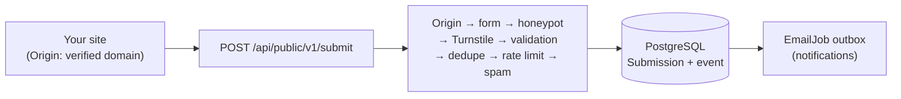

# REST API

Base URL: `https://YOUR_APP` (your SendCMS deployment — in production,
the api app, e.g. `https://api.sendcms.bond`). There is no API
version in the path beyond `/v1/` and no API key — authentication is the
`Origin` header (see below). The public surface is the single submit
endpoint; the session-cookie admin API under `/api/v1/` is used by the
dashboard and is not documented for external use.



## Contents

- [POST /api/public/v1/submit](#post-apipublicv1submit)
- [Responses](#responses)
- [CORS](#cors)
- [Idempotency and duplicates](#idempotency-and-duplicates)
- [No-JS fallback (form posts)](#no-js-fallback-form-posts)
- [Authenticated admin API](#authenticated-admin-api)

## POST /api/public/v1/submit

Accepts a submission for a form. Works with a JSON body, a
`application/x-www-form-urlencoded` body, or `multipart/form-data`
(the no-JS fallback).

### JSON request

```http
POST /api/public/v1/submit
Content-Type: application/json
Origin: https://your-site.example
```

```json
{
  "userId": "YOUR_USER_ID",
  "formId": "YOUR_FORM_ID",
  "fields": {
    "name": "Ali",
    "email": "ali@example.com",
    "message": "Hello"
  },
  "idempotencyKey": "unique-per-submit-optional",
  "pageUrl": "https://your-site.example/contact",
  "turnstileToken": "TOKEN_IF_TURNSTILE_ENABLED"
}
```

| Field               | Required | Notes                                                                                                                                                   |
| ------------------- | -------- | ------------------------------------------------------------------------------------------------------------------------------------------------------- |
| `userId`            | yes      | Your public user id (dashboard → API & SDK).                                                                                                            |
| `formId`            | yes      | The form's id (form detail page).                                                                                                                       |
| `fields`            | yes      | Object of field values. Keys must match the form's configured fields; unknown keys are rejected. At most 50 keys; each value at most 10,000 characters. |
| `idempotencyKey`    | no       | 1–100 chars. Replaying the same key returns the original submission instead of creating a duplicate.                                                    |
| `pageUrl`           | no       | Where the submission came from (max 2,048 chars).                                                                                                       |
| `turnstileToken`    | no       | Required when Turnstile is enabled on the form.                                                                                                         |
| `_sendcms_honeypot` | no       | Top-level key, not inside `fields`. If non-empty and honeypot is enabled, the request gets a fake success and nothing is saved.                         |

Field values are validated per the form's field config: required fields
must be present, emails must look like emails, URLs must start with
`http://` or `https://`, dates must be `YYYY-MM-DD`, numbers must be
finite, select/radio values must be one of the configured options,
checkbox values must be arrays of configured options. The whole JSON
payload must stay under 64 KB.

### Responses

| Status  | Meaning                                                                                                                                                                                                                          |
| ------- | -------------------------------------------------------------------------------------------------------------------------------------------------------------------------------------------------------------------------------- |
| **201** | Submission saved. Body: `{ "ok": true, "id": "<submission id>", "message": "<form success message>", "redirectUrl": "<form redirect URL or null>" }`.                                                                            |
| **200** | Duplicate — same `idempotencyKey`, or identical content within 10 minutes. Same body, same `id`.                                                                                                                                 |
| **400** | Malformed JSON or body. Body: `{ "error": "Malformed JSON body." }`. A well-formed body with missing/invalid fields is 422 instead.                                                                                              |
| **403** | Form inactive, origin not allowed, or Turnstile verification failed. The origin must be a **verified domain linked to the form** — an unlinked or unverified domain, a missing `Origin`, and a non-HTTP origin are all rejected. |
| **404** | Unknown `userId`/`formId` pair. An unknown path under `/api/public/v1/` also returns 404, as JSON `{ "error": "Not found" }` — not an HTML page.                                                                                 |
| **405** | Wrong method for the endpoint (e.g. `GET` on `/submit`). Body: `{ "error": "Method not allowed" }`, with an `Allow` header listing the supported methods.                                                                        |
| **413** | Payload over 64 KB.                                                                                                                                                                                                              |
| **422** | Field validation failed (missing required field, bad email, unknown field, bad option, value too long). The response names the problem field.                                                                                    |
| **429** | Rate limit: 10 submissions/min or 100/hour per IP, the form's daily limit reached, or the form owner's monthly submission quota exhausted.                                                                                       |
| **503** | Turnstile is enabled on the form but the server has no `TURNSTILE_SECRET_KEY` configured.                                                                                                                                        |

Spam is not an error: a submission that trips the spam heuristics
(more than 3 links, or the same word repeated 10+ times in one value)
is saved with status `SPAM` and returns **201**. It shows in the inbox
Spam tab and triggers no notification.

## CORS

Preflight (`OPTIONS`) always answers 204, but it carries
`Access-Control-Allow-Origin` only when the request's origin is a
**verified domain** — any other origin gets a bare 204 with no CORS
headers, so the browser blocks the request. A successful or duplicate
response echoes the request's `Origin` in
`Access-Control-Allow-Origin` — only when that origin is allowed
(verified and linked to the form). Error responses follow the same
rule with one exception: errors that happen before the service checks
the allowlist — validation (422), the size guard (413), malformed JSON
(400), and the form-lookup 404 — echo CORS when the origin is a
verified domain, so a browser client can read the validation message;
an origin the service explicitly rejected for the form, or a
non-verified origin, still gets no CORS headers on errors.

## Idempotency and duplicates

Send a client-generated `idempotencyKey` (e.g. a UUID per submit click)
to make retries safe. Without a key, submissions with identical content
to the same form within 10 minutes are treated as duplicates and return
the original submission id with 200.

## No-JS fallback (form posts)

Post a plain HTML form to the same URL. The form must include
`userId` and `formId` as hidden inputs; every other input becomes a
field (repeated names become arrays; file inputs are dropped). The
honeypot field is `_sendcms_honeypot`.

```html
<form action="https://YOUR_APP/api/public/v1/submit" method="post">
  <input type="hidden" name="userId" value="YOUR_USER_ID" />
  <input type="hidden" name="formId" value="YOUR_FORM_ID" />
  <input name="name" required />
  <input name="email" type="email" required />
  <textarea name="message" required></textarea>
  <button type="submit">Send</button>
</form>
```

- **Success** → `303` redirect to the form's redirect URL, or back to
  the `Referer` with `?cms_submitted=1` appended.
- **Error** → `303` redirect to the `Referer` with
  `?cms_error=<message>` appended (or a JSON error body when there is no
  `Referer`).

## Authenticated admin API

The dashboard uses a session-cookie API under `/api/v1/` (domains,
forms, inbox, email jobs) — it is not a public API and is not
documented for external use. The public surface is the single submit
endpoint above. AI hosts use the separate [MCP server](mcp.md)
(`POST /api/mcp`, bearer API key) instead.
