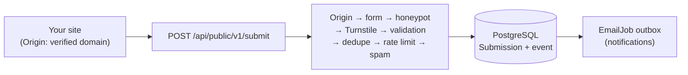

# REST API

Base URL: `https://YOUR_APP` (your SendCMS deployment — in production,
the api app, e.g. `https://api.sendcms.bond`). There is no API
version in the path beyond `/v1/` and no API key for the submit
endpoint — authentication is
the request's effective origin: the `Origin` header, or the `Referer`
origin when `Origin` is absent (see below). `pageUrl` is never an
authorization signal. The public surface is the submit endpoint plus
the public GET endpoints and billing webhooks listed in
[Other public endpoints](#other-public-endpoints); the session-cookie
admin API under `/api/v1/` is used by the dashboard and is not
documented for external use. (Owner API keys exist for MCP —
`POST /api/mcp`, bearer key — not for submit; see [MCP](mcp.md).)



## Contents

- [POST /api/public/v1/submit](#post-apipublicv1submit)
- [Stability](#stability)
- [Responses](#responses)
- [CORS](#cors)
- [Idempotency and duplicates](#idempotency-and-duplicates)
- [No-JS fallback (form posts)](#no-js-fallback-form-posts)
- [Other public endpoints](#other-public-endpoints)
- [Authenticated admin API](#authenticated-admin-api)

## Stability

The public API is **beta**: the `/v1/` paths may change without a
migration path, and there is no deprecation policy yet — pin your
integration to the documented shapes and re-check this page after
upgrades. The submit endpoint's contract (status codes, the
`{ ok, id, message, redirectUrl }` body, the idempotency rules) is
stable in practice, but new fields may appear and undocumented
behaviour may change.

## POST /api/public/v1/submit

Accepts a submission for a form. Works with a JSON body, a
`application/x-www-form-urlencoded` body, or `multipart/form-data`
(the no-JS fallback).

### JSON request

```http
POST /api/public/v1/submit
Content-Type: application/json
Origin: https://your-site.example
```

```json
{
  "userId": "YOUR_USER_ID",
  "formId": "YOUR_FORM_ID",
  "fields": {
    "name": "Ali",
    "email": "ali@example.com",
    "message": "Hello"
  },
  "idempotencyKey": "unique-per-submit-optional",
  "pageUrl": "https://your-site.example/contact",
  "turnstileToken": "TOKEN_IF_TURNSTILE_ENABLED"
}
```

| Field               | Required | Notes                                                                                                                                                   |
| ------------------- | -------- | ------------------------------------------------------------------------------------------------------------------------------------------------------- |
| `userId`            | yes      | Your public user id (dashboard → API & SDK).                                                                                                            |
| `formId`            | yes      | The form's id (form detail page).                                                                                                                       |
| `fields`            | yes      | Object of field values. Keys must match the form's configured fields; unknown keys are rejected. At most 50 keys; each value at most 10,000 characters. |
| `idempotencyKey`    | no       | 1–100 chars. Replaying the same key returns the original submission instead of creating a duplicate.                                                    |
| `pageUrl`           | no       | Where the submission came from (max 2,048 chars).                                                                                                       |
| `turnstileToken`    | no       | Required when Turnstile is enabled on the form.                                                                                                         |
| `_sendcms_honeypot` | no       | Top-level key, not inside `fields`. If non-empty and honeypot is enabled, the request gets a fake success and nothing is saved.                         |

Field values are validated per the form's field config: required fields
must be present, emails must look like emails, URLs must start with
`http://` or `https://`, dates must be `YYYY-MM-DD`, numbers must be
finite, select/radio values must be one of the configured options,
checkbox values must be arrays of configured options. The whole JSON
payload must stay under 64,000 bytes (see the 413 row below — the
route checks `Content-Length` when present; the service checks the
sanitized fields' JSON length).

### Origin and Referer

Authorization is the request's **effective origin**: the `Origin`
header, or the origin of the `Referer` header when `Origin` is
absent (plain form posts send no `Origin`, but browsers send a
`Referer` — that is why the fallback exists). A request with neither
header is rejected with 403, even when `pageUrl` names a verified
domain: `pageUrl` is informational only and is never treated as
proof of origin. Non-browser clients (curl, a server, a script) must
therefore send an `Origin` — or a `Referer` — whose host is a
verified domain linked to the form; sending only `pageUrl` is not
enough.

### Responses

| Status  | Meaning                                                                                                                                                                                                                                                                                                                                                                                          |
| ------- | ------------------------------------------------------------------------------------------------------------------------------------------------------------------------------------------------------------------------------------------------------------------------------------------------------------------------------------------------------------------------------------------------ |
| **201** | Submission saved. Body: `{ "ok": true, "id": "<submission id>", "message": "<form success message>", "redirectUrl": "<form redirect URL or null>" }`.                                                                                                                                                                                                                                            |
| **200** | Duplicate — same `idempotencyKey`, or identical content within 10 minutes. Same body, same `id`.                                                                                                                                                                                                                                                                                                 |
| **400** | Malformed JSON or body. Body: `{ "error": "Malformed JSON body." }`. A well-formed body with missing/invalid fields is 422 instead.                                                                                                                                                                                                                                                              |
| **403** | Form inactive, origin not allowed, or Turnstile verification failed. The origin must be a **verified domain linked to the form** — an unlinked or unverified domain, a missing `Origin` **and** `Referer`, and a non-HTTP origin are all rejected. A request with no `Origin` but a `Referer` from a verified domain linked to the form is accepted; `pageUrl` alone never authorizes a request. |
| **404** | Unknown `userId`/`formId` pair. An unknown path under `/api/public/v1/` also returns 404, as JSON `{ "error": "Not found" }` — not an HTML page.                                                                                                                                                                                                                                                 |
| **405** | Wrong method for the endpoint (e.g. `GET` on `/submit`). Body: `{ "error": "Method not allowed" }`, with an `Allow` header listing the supported methods.                                                                                                                                                                                                                                        |
| **413** | Payload over 64,000 bytes. The route rejects a request whose `Content-Length` exceeds 64,000; the service also rejects sanitized field data whose JSON exceeds 64,000 bytes (a chunked body with no `Content-Length` skips the early check and is caught by the service check).                                                                                                                  |
| **422** | Field validation failed (missing required field, bad email, unknown field, bad option, value too long). The response names the problem field. Also: Turnstile is enabled on the form and no `turnstileToken` was sent — `"Verification is required for this form."`                                                                                                                              |
| **429** | Rate limit: 10 submissions/min or 100/hour per IP, the form's daily limit reached, or the form owner's monthly submission quota exhausted. There is no 402: quota exhaustion is a 429 (with a `Retry-After` until the next UTC month).                                                                                                                                                           |
| **503** | Turnstile is enabled on the form but the server has no `TURNSTILE_SECRET_KEY` configured.                                                                                                                                                                                                                                                                                                        |

Spam is not an error: a submission that trips the spam heuristics
(more than 3 links, or the same word repeated 10+ times in one value)
is saved with status `SPAM` and returns **201**. It shows in the inbox
Spam tab and triggers no notification.

## CORS

Preflight (`OPTIONS`) always answers 204, but it carries
`Access-Control-Allow-Origin` only when the request's origin is a
**verified domain** — any other origin gets a bare 204 with no CORS
headers, so the browser blocks the request. A successful or duplicate
response echoes the request's `Origin` in
`Access-Control-Allow-Origin` — only when that origin is allowed
(verified and linked to the form). Error responses follow the same
rule with one exception: errors that happen before the service checks
the allowlist — validation (422), the size guard (413), malformed JSON
(400), and the form-lookup 404 — echo CORS when the origin is a
verified domain, so a browser client can read the validation message;
an origin the service explicitly rejected for the form, or a
non-verified origin, still gets no CORS headers on errors.

## Idempotency and duplicates

Send a client-generated `idempotencyKey` (e.g. a UUID per submit click)
to make retries safe. Without a key, submissions with identical content
to the same form within 10 minutes are treated as duplicates and return
the original submission id with 200.

## No-JS fallback (form posts)

Post a plain HTML form to the same URL. The form must include
`userId` and `formId` as hidden inputs; every other input becomes a
field (repeated names become arrays; file inputs are dropped). The
honeypot field is `_sendcms_honeypot`.

```html
<form action="https://YOUR_APP/api/public/v1/submit" method="post">
  <input type="hidden" name="userId" value="YOUR_USER_ID" />
  <input type="hidden" name="formId" value="YOUR_FORM_ID" />
  <input name="name" required />
  <input name="email" type="email" required />
  <textarea name="message" required></textarea>
  <button type="submit">Send</button>
</form>
```

- **Success** → `303` redirect to the form's redirect URL, or back to
  the `Referer` with `?cms_submitted=1` appended.
- **Error** → `303` redirect to the `Referer` with
  `?cms_error=<message>` appended (or a JSON error body when there is no
  `Referer`).

Nothing reads those params for you — the API writes them, your page
has to display them. Add this small script to the page with the form
(it reads the params on load and renders a banner; `textContent`
escapes the error message, which can contain literal `"` characters,
so it is safe to display as-is):

```html
<script>
  // No-JS fallback result: ?cms_submitted=1 / ?cms_error=<message>.
  ;(function () {
    var params = new URLSearchParams(window.location.search)
    var error = params.get("cms_error")
    var ok = params.get("cms_submitted") === "1"
    if (!error && !ok) return
    var banner = document.createElement("p")
    banner.className = "sc-status sc-status--" + (ok ? "success" : "error")
    banner.setAttribute("role", "status")
    // textContent (not innerHTML): the error message is rendered as
    // plain text, so quotes and markup in it cannot break the page.
    banner.textContent = ok ? "Thanks! Your message has been sent." : error
    var form = document.querySelector("form")
    if (form) form.after(banner)
    else document.body.appendChild(banner)
  })()
</script>
```

## Other public endpoints

The public surface is not only the submit endpoint. Every route
below is unauthenticated unless stated otherwise.

### `GET /api/public/v1/plans`

Every published, non-private plan with its current published version
(price + limits) — the same data the marketing pricing page reads.
No auth. Returns a **bare JSON array** (no envelope):

```json
[
  {
    "id": "plan_…",
    "name": "Free",
    "slug": "free",
    "description": null,
    "kind": "FREE",
    "version": {
      "id": "ver_…",
      "version": 1,
      "priceAmount": null,
      "priceCurrency": "USD",
      "billingInterval": "MONTHLY",
      "trialDays": 0,
      "entitlements": {
        "forms": null,
        "domains": null,
        "submissionsPerMonth": 100,
        "apiKeys": 10,
        "aiRequestsPerDay": 100,
        "mcpRequestsPerMinute": 120,
        "mcpRequestsPerHour": 2000,
        "aiProviders": ["openai", "anthropic", "google", "deepseek", "openrouter"],
        "aiByokAllowed": true,
        "aiPlatformAllowed": true,
        "features": []
      }
    }
  }
]
```

`entitlements` is a strict object of per-plan limits: `forms`,
`domains`, `submissionsPerMonth`, `aiRequestsPerDay`,
`mcpRequestsPerMinute`, `mcpRequestsPerHour` are integers ≥ 0 or
`null` (`null` = unlimited, except the two MCP windows, where `null`
means "use the platform default"); `apiKeys` is always an integer
(never `null` — an unbounded key count is an abuse vector);
`aiProviders` is the allowlist of AI providers a subscription on
that plan may use (`openai`, `anthropic`, `google`, `deepseek`,
`openrouter`); `aiByokAllowed` / `aiPlatformAllowed` are booleans;
`features` is an array of feature-flag strings.

Draft versions, unpublished plans, and private plans never appear.

### `GET /api/public/v1/billing/countries`

The full country list for a checkout country select. No auth.
Returns a **bare JSON array** (no envelope) of `{ "code", "name" }`
objects, e.g. `[{ "code": "US", "name": "United States" }]`.

### Billing webhooks

`POST /api/public/v1/billing/webhooks/{stripe,paypal,polar,freemius}`
— one URL per provider. Configure the matching URL in the
provider's dashboard (Stripe / PayPal / Polar / Freemius). No
session: the provider's verified webhook signature **is** the
authorization (Stripe signature, PayPal verify-webhook-signature,
Polar `validateEvent`, Freemius HMAC-SHA256), checked against the
raw body. The routes are per-IP rate-limited. Webhook events are
idempotent on (`provider`, `providerEventId`): an already-processed
event id is recorded as a `BillingEvent` and skipped, never applied
twice — so a duplicate delivery is safe and still answers 2xx so the
provider stops retrying. Any other method answers 405.

### `GET /api/public/v1/unsubscribe`

The one-click unsubscribe link from notification emails. Not a JSON
API: it takes a signed `?token=…` (HMAC over email + form scope),
records the suppression, and answers a plain HTML confirmation page.
A missing or invalid token is a 400. There is no login and no other
way to call it — the token is the whole authorization.

### Unknown paths

Any other path under `/api/public/v1/` returns 404 as JSON
`{ "error": "Not found" }`, with no CORS headers.

## Authenticated admin API

The dashboard uses a session-cookie API under `/api/v1/` (domains,
forms, inbox, email jobs) — it is not a public API and is not
documented for external use. The session-cookie admin/user API is
not documented here; `apps/api/app/api/` is the source of truth.
AI hosts use the separate [MCP server](mcp.md)
(`POST /api/mcp`, bearer API key) instead.
