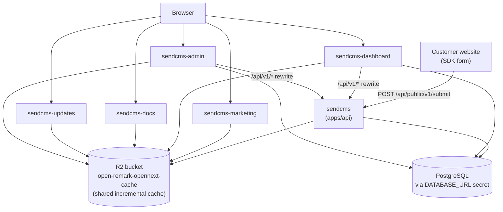

# Cloudflare infrastructure (Phase 10)

SendCMS deploys as **one Cloudflare Worker per Next.js app** via
OpenNext. Each app owns its own `wrangler.jsonc` +
`open-next.config.ts` in its own directory; the OpenNext R2-cache
config is shared from here (`open-next.config.ts`, re-exported by
each app). There is no root `wrangler.jsonc`.

## Contents

- [The six workers](#the-six-workers)
- [How a request flows](#how-a-request-flows)
- [Shared config](#shared-config)
- [Deploying (owner-side, Cloudflare dashboard)](#deploying-owner-side-cloudflare-dashboard)
- [Secrets per app](#secrets-per-app)
- [Production URLs](#production-urls)
- [Shared R2 bucket — known caveat](#shared-r2-bucket--known-caveat)
- [What does NOT deploy here](#what-does-not-deploy-here)

## The six workers

| App              | Worker name         | Cloudflare Root directory | Serves                                                              |
| ---------------- | ------------------- | ------------------------- | ------------------------------------------------------------------- |
| `apps/api`       | `sendcms`           | `apps/api`                | Auth handler, all `/api/*` routes, the SDK bundle                   |
| `apps/marketing` | `sendcms-marketing` | `apps/marketing`          | Landing, terms, SEO routes                                          |
| `apps/dashboard` | `sendcms-dashboard` | `apps/dashboard`          | Dashboard + auth pages                                              |
| `apps/docs`      | `sendcms-docs`      | `apps/docs`               | The user docs                                                       |
| `apps/updates`   | `sendcms-updates`   | `apps/updates`            | The changelog                                                       |
| `apps/admin`     | `sendcms-admin`     | `apps/admin`              | Admin app (`/admin/*`) — 🚧 control-plane branch only, not deployed |

The api app keeps the existing `sendcms` worker name (and its R2
bucket + self-reference), so the current deployment's bindings keep
working. The other five are new workers. Every app's `wrangler.jsonc`
sets `compatibility_date: "2026-11-13"` with the `nodejs_compat`
flag, serves `.open-next/worker.js` as its entry, and binds
`.open-next/assets` as static assets.

## How a request flows

All six workers bind the same R2 bucket for the OpenNext
incremental cache (see [Shared R2 bucket](#shared-r2-bucket--known-caveat)).
Only the api, dashboard, and admin workers talk to PostgreSQL —
marketing, docs, and updates serve static content and need no
database connection.

## Shared config

`open-next.config.ts` (this directory, re-exported by each app's
own `open-next.config.ts`) enables only the R2 incremental cache:

- **Incremental cache:** R2 (`NEXT_INC_CACHE_R2_BUCKET` =
  `open-remark-opennext-cache`, bound in each `wrangler.jsonc`).
- **Queue and tag cache:** dummy defaults. The apps have no
  time-based revalidation (no `revalidate` intervals) and no D1
  database for a tag cache; the `revalidatePath` calls target
  dynamic dashboard routes, which are never cached.

## Deploying (owner-side, Cloudflare dashboard)

For each app, create a Workers project with:

- **Root directory:** `apps/<app>` (the build command runs there).
- **Build command:** the `build.command` in that app's `wrangler.jsonc`
  (`pnpm --filter @sendcms/database db:generate && pnpm -w run sdk:build
&& npx @opennextjs/cloudflare build`). Or run it locally first:
  `pnpm --filter @sendcms/<app> build:cf`, then `wrangler deploy`
  from the app directory.
- **Vars:** the `vars` in that app's `wrangler.jsonc` (see
  [Production URLs](#production-urls) — most still carry
  placeholders).
- **Secrets:** the list in that app's `wrangler.jsonc` comment
  (dashboard → Settings → Variables, or `wrangler secret put`).
  See [Secrets per app](#secrets-per-app).

Notes:

- `pnpm build:cf` writes `apps/<app>/.open-next/` (gitignored
  build output). Delete those dirs before committing — the
  pre-commit lint traverses them if present and fails on the
  generated files.
- Bindings already configured in the dashboard must also live in
  the app's `wrangler.jsonc`, otherwise the next `wrangler deploy`
  drops them: `NEXT_INC_CACHE_R2_BUCKET` (R2 incremental cache),
  `WORKER_SELF_REFERENCE` (the adapter's queue/revalidation
  self-reference), and `IMAGES` (Next.js image optimization via
  Cloudflare Images).

## Secrets per app

Secrets are never stored in `wrangler.jsonc`. Set them in the
Cloudflare dashboard (or `wrangler secret put`):

| App                                           | Secrets                                                                                                                                                                                                   |
| --------------------------------------------- | --------------------------------------------------------------------------------------------------------------------------------------------------------------------------------------------------------- |
| `apps/api`                                    | `DATABASE_URL`, `BETTER_AUTH_SECRET`, `BETTER_AUTH_URL`, `GOOGLE_CLIENT_ID`, `GOOGLE_CLIENT_SECRET`, `RESEND_API_KEY`, `CRON_SECRET` (plus `GITHUB_` / `FACEBOOK_` client secrets and `SMTP_*` when used) |
| `apps/dashboard`                              | `DATABASE_URL`, `BETTER_AUTH_SECRET`                                                                                                                                                                      |
| `apps/admin`                                  | `DATABASE_URL`, `BETTER_AUTH_SECRET`                                                                                                                                                                      |
| `apps/marketing`, `apps/docs`, `apps/updates` | None (static content only)                                                                                                                                                                                |

## Production URLs

📌 **The production domain is decided: `sendcms.bond`.**
Production runs on Vercel today at `https://sendcms.bond` with the
`api`, `dashboard`, `docs`, and `updates` subdomains (plus
`admin.sendcms.bond` reserved for the admin app). The Cloudflare
`vars` have not all caught up yet:

| App              | `vars` in `wrangler.jsonc` today | Target                           |
| ---------------- | -------------------------------- | -------------------------------- |
| `apps/admin`     | ✅ `*.sendcms.bond`              | `https://admin.sendcms.bond`     |
| `apps/api`       | ⚠️ `*.jadoo.bond` placeholders   | `https://api.sendcms.bond`       |
| `apps/marketing` | ⚠️ `*.jadoo.bond` placeholders   | `https://sendcms.bond`           |
| `apps/dashboard` | ⚠️ `*.jadoo.bond` placeholders   | `https://dashboard.sendcms.bond` |
| `apps/docs`      | ⚠️ `*.jadoo.bond` placeholders   | `https://docs.sendcms.bond`      |
| `apps/updates`   | ⚠️ `*.jadoo.bond` placeholders   | `https://updates.sendcms.bond`   |

The five `jadoo.bond` files still carry their "until the production
domain decision" comments — that decision has since been made, so
switching their `vars` to `sendcms.bond` is an owner step (in the
dashboard, or in the `wrangler.jsonc` files). Change the vars,
never the code: each app reads only the URLs it links to, and
`NEXT_PUBLIC_*` values are baked into the browser bundle at build
time, so changing one means rebuilding. The shared fallback
(`FALLBACK_APP_URL`) follows the same rule.

## Shared R2 bucket — known caveat

All six workers bind the same R2 bucket (`open-remark-opennext-cache`,
the legacy name — renaming needs a new bucket in the dashboard) for
the OpenNext incremental cache. The apps are dynamic (no `revalidate`
intervals; the dashboard's `revalidatePath` calls target dynamic
routes that are never cached), so the cache is near-empty in practice —
but identical paths across apps (e.g. `/` on marketing vs the
dashboard's 404) share cache keys. If the cache ever matters, give
each app its own bucket.

## What does NOT deploy here

- **The email worker** (`services/email-worker`) is a long-running Node
  process — it does not run on Cloudflare Workers. Its production
  hosting is a separate decision (a VM/VPS process, or a scheduled
  trigger); the cron route (`GET /api/cron/email-outbox`) stays the
  hosted drain until then.
- **The old `open-remark` worker** in the dashboard is the pre-SendCMS
  deployment — delete it once the `sendcms` worker is live (owner
  step, unchanged from the pre-migration deployment notes).
