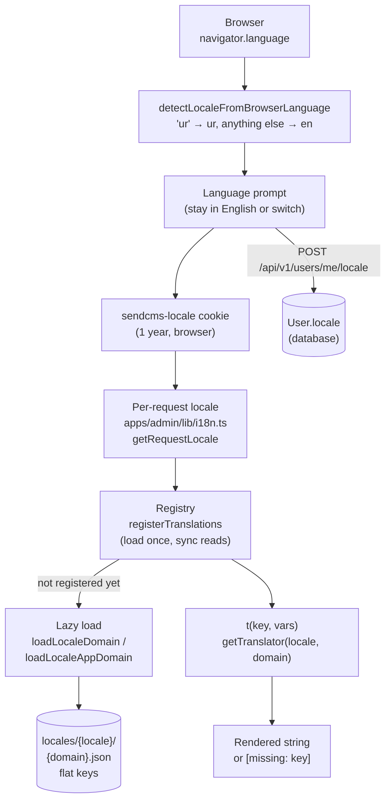

# `@sendcms/i18n`

Domain-based translations for the SendCMS admin app (and, in part,
the dashboard). English is the source locale. Framework-free (only
`Intl` + JSON) so it is safe to import from server components,
client components, and services alike.

📌 **Honest state:** English and Urdu are complete; the other 8
locales are coming-soon by the owner's explicit decision
(2026-11-21). Do not present 10 locales as done. Full detail —
including the acceptance record — is in
[docs/admin-control-plane/internationalization.md](../../docs/admin-control-plane/internationalization.md).

## Contents

- [The honest state](#the-honest-state)
- [The 10 locales](#the-10-locales)
- [How a translation is resolved](#how-a-translation-is-resolved)
- [Structure](#structure)
- [Domains](#domains)
- [The translator](#the-translator)
- [Formatting helpers](#formatting-helpers)
- [Using it in the admin app](#using-it-in-the-admin-app)
- [Locale detection, switching, and persistence](#locale-detection-switching-and-persistence)
- [Validation](#validation)
- [RTL rules](#rtl-rules)
- [How the apps use it](#how-the-apps-use-it)
- [Adding a locale](#adding-a-locale)
- [Adding a domain](#adding-a-domain)

## The honest state

| Fact                             | Value                                                                         |
| -------------------------------- | ----------------------------------------------------------------------------- |
| Complete locales                 | `en`, `ur`                                                                    |
| Domain files per complete locale | 60 (19 shared + 27 admin + 14 dashboard)                                      |
| Key parity                       | 100% in sync between `en` and `ur` (`pnpm --filter @sendcms/i18n validate`)   |
| Coming-soon locales              | `es`, `ar`, `fr`, `de`, `hi`, `bn`, `id`, `it` — 0 files each                 |
| Arabic RTL                       | Not built — `ar` has no files, so no RTL rendering of Arabic exists to verify |
| Urdu RTL                         | Built — sidebar on the right, `dir="rtl"` (see [RTL rules](#rtl-rules))       |

## The 10 locales

Registry: `src/locales.ts` (`SUPPORTED_LOCALES`). `status` is
`complete` or `coming-soon`; `SELECTABLE_LOCALES` is the
complete-only filter the language picker actually offers.

| Code | Language   | Direction | Status      |
| ---- | ---------- | :-------: | ----------- |
| `en` | English    |    LTR    | complete    |
| `ur` | Urdu       |    RTL    | complete    |
| `es` | Spanish    |    LTR    | coming-soon |
| `ar` | Arabic     |    RTL    | coming-soon |
| `fr` | French     |    LTR    | coming-soon |
| `de` | German     |    LTR    | coming-soon |
| `hi` | Hindi      |    LTR    | coming-soon |
| `bn` | Bengali    |    LTR    | coming-soon |
| `id` | Indonesian |    LTR    | coming-soon |
| `it` | Italian    |    LTR    | coming-soon |

`DEFAULT_LOCALE` is `en`. `detectLocaleFromBrowserLanguage` maps a
`navigator.language` tag to a renderable locale: Urdu if the primary
subtag is `ur`, English otherwise — never to a translation key or an
incomplete locale.

## How a translation is resolved



The locale comes from the request (cookie → detection), never from
a hardcoded default in a component. One honest limit: the database
copy is the durable record, not the live source — nothing in the
admin layout reads `User.locale` on load, so today the cookie
decides the language and the stored preference does not yet follow
the user across devices. See
[internationalization.md](../../docs/admin-control-plane/internationalization.md#locale-detection-switching-and-persistence).

## Structure

```
packages/i18n/
  src/
    locales.ts    # Locale registry (10 locales, dir, status) + detection
    translate.ts  # createTranslator + {name} interpolation + plurals
    format.ts     # Intl date/time/number/currency/percent/relative helpers
    load.ts       # Registry + dynamic domain loading + path helpers
    index.ts      # Barrel
  locales/
    en/           # Source locale (complete, 60 files)
      {domain}.json          # Shared domains
      admin/{domain}.json    # Admin-app domains
      dashboard/{domain}.json # Customer-dashboard domains
    ur/           # Urdu, RTL (complete, 60 files)
    es/ ar/ fr/ de/ hi/ bn/ id/ it/  # Coming soon (no directories yet)
  scripts/
    validate-translations.mjs
```

- **Never one large file per locale.** Every domain is its own JSON file
  with flat key-value string pairs (the VARKA model).
- Shared domains live at the locale root (`common`, `actions`, `errors`,
  `validation`, …). App-specific domains live under an app subfolder
  (`admin/navigation.json`, `admin/dashboard.json`).
- Placeholders are `{name}`. Keep them identical across locales. Technical
  identifiers, provider names (`SendCMS`, `API`, `MCP`, `AI`, `URL`) and
  code snippets stay unchanged in every locale.
- Values are real translations, never English as a placeholder: the Urdu
  files are real Urdu script.

## Domains

The domain lists live in `src/load.ts` (`SHARED_DOMAINS`,
`ADMIN_DOMAINS`, `DASHBOARD_DOMAINS`). 19 + 27 + 14 = 60 files per
complete locale.

| Shared domains (`locales/{locale}/{domain}.json`) |                |                 |
| ------------------------------------------------- | -------------- | --------------- |
| `actions`                                         | `admins`       | `appearance`    |
| `auth`                                            | `common`       | `confirmations` |
| `email`                                           | `empty-states` | `errors`        |
| `forms`                                           | `language`     | `notifications` |
| `pagination`                                      | `profile`      | `security`      |
| `settings`                                        | `tables`       | `users`         |
| `validation`                                      |                |                 |

| Admin domains (`locales/{locale}/admin/{domain}.json`) |                       |                 |
| ------------------------------------------------------ | --------------------- | --------------- |
| `activity`                                             | `ai`                  | `announcements` |
| `audit-logs`                                           | `billing`             | `coupons`       |
| `dashboard`                                            | `features`            | `health`        |
| `jobs`                                                 | `landing`             | `mcp`           |
| `navigation`                                           | `overview`            | `payments`      |
| `plans`                                                | `plans-subscriptions` | `security`      |
| `settings`                                             | `step-up`             | `submissions`   |
| `subscriptions`                                        | `support`             | `translations`  |
| `trials`                                               | `usage`               | `users`         |

| Dashboard domains (`locales/{locale}/dashboard/{domain}.json`) |              |                 |
| -------------------------------------------------------------- | ------------ | --------------- |
| `account`                                                      | `ai`         | `analytics`     |
| `api`                                                          | `api-keys`   | `billing`       |
| `domains`                                                      | `forms`      | `inbox`         |
| `landing`                                                      | `navigation` | `notifications` |
| `overview`                                                     | `support`    |                 |

## The translator

`src/translate.ts` — framework-free, `{name}` interpolation +
plural support. A missing key renders as `[missing: key]` so it is
visible in dev and never silently becomes an empty string.

- **Interpolation:** `{name}` placeholders; unknown placeholders
  are left as-is. `t("welcome", { name: "Zaheer" })` →
  `"Welcome back, Zaheer"`.
- **Plurals:** `formatPlural(locale, count, forms)` picks the form
  via `Intl.PluralRules`, e.g.
  `{ one: "{count} user", other: "{count} users" }`. A missing
  plural form renders `[missing: plural]`.
- **Missing keys:** `getTranslator(locale, domain)` returns a
  translator over the registered messages; an unregistered domain
  yields `[missing: key]` for every key — deliberate, so a gap is
  visible instead of being papered over with English.

## Formatting helpers

`src/format.ts` — locale-aware formatting via `Intl`. Every helper
resolves the locale first: an unknown or unsupported locale falls
back to English instead of throwing a `RangeError`.

| Helper               | Does                                                                            |
| -------------------- | ------------------------------------------------------------------------------- |
| `formatDate`         | `Intl.DateTimeFormat`                                                           |
| `formatTime`         | `Intl.DateTimeFormat` (hour + minute)                                           |
| `formatNumber`       | `Intl.NumberFormat`                                                             |
| `formatCurrency`     | `Intl.NumberFormat` with `style: "currency"`                                    |
| `formatPercent`      | `Intl.NumberFormat` with `style: "percent"`                                     |
| `formatRelativeTime` | `Intl.RelativeTimeFormat` with `numeric: "auto"`                                |
| `formatRelativeDate` | Relative distance to now ("2 days ago") in the locale, via `formatRelativeTime` |

Dates, times, numbers, currency, and percentages go through these
helpers so they follow the active locale.

## Using it in the admin app

```ts
import commonEn from "@sendcms/i18n/locales/en/common.json"
import { registerTranslations, getTranslator } from "@sendcms/i18n"

// Register once (e.g. in the app shell); reads are then synchronous.
registerTranslations("en", "common", commonEn)
const t = getTranslator("en", "common")
t("save") // "Save"
t("welcome", { name: "Zaheer" }) // "Welcome back, Zaheer"
```

For a domain that is not needed on first paint, lazy-load it instead:

```ts
import { loadLocaleDomain } from "@sendcms/i18n"
const messages = await loadLocaleDomain("ur", "common")
```

Never use Node `fs` to read translations at runtime — the package
is imported by client components too. The two supported mechanisms,
in order of preference, are the registry (static JSON import +
`registerTranslations` / `registerAppTranslations`, synchronous
reads) and dynamic import (`loadLocaleDomain` /
`loadLocaleAppDomain`, resolved at build time).

Server components get their translator from the app's i18n adapter
(`apps/admin/lib/i18n.ts` — `getTranslator(locale, domain)`); client
components use the `useTranslation(domain)` hook.

## Locale detection, switching, and persistence

The owner's spec (2026-11-21), implemented in the admin app:

1. **Detect** from the browser/system: `navigator.language`,
   mapped by `detectLocaleFromBrowserLanguage` to `en` or `ur`.
2. **Ask, don't force.** A popup asks whether to stay in English
   or switch to the detected language. No detection → English.
3. **Persist twice.** The choice is stored in the browser (the
   `sendcms-locale` cookie, 1-year) **and** in the database
   (`User.locale`). The write path is `setUserLocale` /
   `getUserLocale` in `@sendcms/users`, exposed as
   `POST /api/v1/users/me/locale` on the api app. The cookie write
   is best-effort and never blocks the UI.

## Validation

```bash
pnpm --filter @sendcms/i18n validate
```

Runs `scripts/validate-translations.mjs` (no dependencies). It checks:

1. Every JSON file under `locales/{en,ur}` parses.
2. `en` and `ur` have identical key sets per domain file —
   missing, extra, or orphan keys fail the run.
3. Completeness per locale; the 8 coming-soon locales are
   reported as "not started" **without** failing.

Exits non-zero only when `en`/`ur` are incomplete or a JSON file
is invalid. Current output (2026-11-27):

```
Translation validation
Source locale: en — 60 files, 2475 keys
Completeness:
  en: 60/60 files, 2475/2475 keys (100%)
  ur: 60/60 files, 2475/2475 keys (100%)
  es: not started (0/60 files)
  ar: not started (0/60 files)
  fr: not started (0/60 files)
  de: not started (0/60 files)
  hi: not started (0/60 files)
  bn: not started (0/60 files)
  id: not started (0/60 files)
  it: not started (0/60 files)

✓ en and ur are complete and in sync.
```

## RTL rules

- `ur` and `ar` are RTL. Set `dir="rtl"` on the app root from
  `getLocaleDirection(code)` — never hardcode it per page. The
  admin root layout (`apps/admin/app/layout.tsx`) sets `lang` and
  `dir` from the locale.
- **Sidebar side.** The shadcn `Sidebar` pins itself with physical
  positioning (default `side="left"`), so `dir="rtl"` alone does
  not move it. The admin shell passes `side` from the locale
  direction: **right in RTL, left in LTR** (owner rule for RTL
  languages such as Urdu).
- Use logical CSS properties (`margin-inline-start`, `padding-inline-end`,
  `inset-inline-start`, `text-align: start`) instead of hardcoded
  `left`/`right`. Tailwind's `ms-*`/`me-*`/`ps-*`/`pe-*`/`start-*`/`end-*`
  utilities are logical already — prefer them.
- Do not mirror every icon. Directional icons (back/forward chevrons,
  pagination arrows) flip in RTL; brand, status, and action icons do not.
- The language selector shows only locales with status `"complete"`
  (`SELECTABLE_LOCALES`); coming-soon locales are listed disabled with a
  "soon" label, never as broken options.

## How the apps use it

| App                                   | Locale handling                                                                                                                                                                                                                                                                      |
| ------------------------------------- | ------------------------------------------------------------------------------------------------------------------------------------------------------------------------------------------------------------------------------------------------------------------------------------ |
| `apps/admin`                          | Full: `getRequestLocale` per request, `dir` on `<html>`, sidebar side from direction, language selector + prompt, domain JSONs under `admin/`                                                                                                                                        |
| `apps/dashboard`                      | Full: `getRequestLocale` per request (cookie → stored preference), `lang`/`dir` on `<html>`, sidebar side from direction, shell + per-page domain JSONs under `dashboard/`, locale-aware dates/times/relative times via `formatDate`/`formatRelativeDate` and the `useLocale()` hook |
| `apps/marketing` / `docs` / `updates` | Not translated — public pages are English-only; no i18n wiring                                                                                                                                                                                                                       |

The admin shell translation domains are registered in
`apps/admin/lib/i18n.ts` (`SHELL_TRANSLATION_DOMAINS`); the
dashboard adapter registers its own. A domain missing from the
registration is not loaded, even if the file exists.

## Adding a locale

1. Add the entry to `SUPPORTED_LOCALES` in `src/locales.ts`
   (`code`, `name`, `nativeName`, `dir`, `status: "coming-soon"`).
2. Create `locales/{code}/` and copy the `en` file list into it.
3. Translate every key (never copy English as a placeholder).
4. Run `pnpm --filter @sendcms/i18n validate` and flip the status to
   `"complete"` when it passes.

## Adding a domain

1. Create `locales/en/{domain}.json` (or `locales/en/{app}/{domain}.json`).
2. Mirror the file under `locales/ur/` with real Urdu translations.
3. Add the domain name to `SHARED_DOMAINS` / `ADMIN_DOMAINS` /
   `DASHBOARD_DOMAINS` in `src/load.ts`.
4. Run the validation script.

## Further reading

- [Internationalization (Admin Control Plane)](../../docs/admin-control-plane/internationalization.md) — the honest state, detection/persistence, RTL, what is not done
- [Translation management](../../docs/admin-control-plane/translation-management.md) — the read-only translation UI, the validation workflow, adding a domain or a locale
